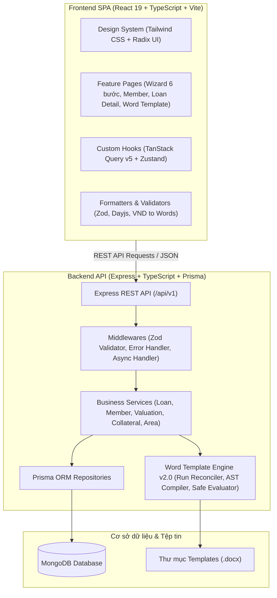
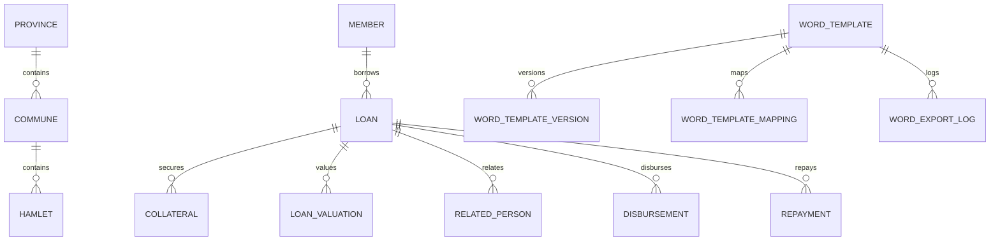
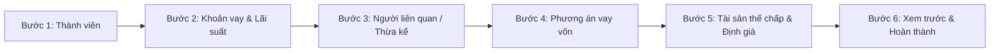
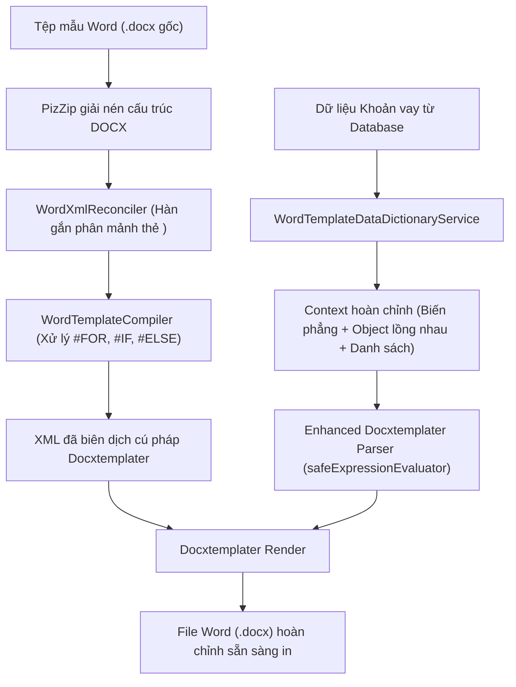

# HỆ THỐNG QUẢN LÝ TÍN DỤNG QUỸ TÍN DỤNG NHÂN DÂN (N_QTD)
## TÀI LIỆU ĐẶC TẢ KỸ THUẬT & TOÀN BỘ NGHIỆP VỤ HỆ THỐNG (SYSTEM SPECIFICATION)

> **Phiên bản:** 3.10 (Full System Specification)  
> **Ngày cập nhật:** 10/11/2026  
> **Trạng thái:** Hoàn thiện và đang vận hành chính thức  
> **Phạm vi áp dụng:** Toàn bộ hệ thống Backend, Frontend, Cơ sở dữ liệu và Động cơ Biểu mẫu Word (Word Template Engine v2.0)

---

## MỤC LỤC
1. [TỔNG QUAN DỰ ÁN](#1-tổng-quan-dự-án)
2. [KIẾN TRÚC HỆ THỐNG & CÔNG NGHỆ](#2-kiến-trúc-hệ-thống--công-nghệ)
3. [CƠ SỞ DỮ LIỆU & LƯỢC ĐỒ PRISMA (DATABASE MODELS)](#3-cơ-sở-dữ-liệu--lược-đồ-prisma-database-models)
4. [CHI TIẾT CÁC PHÂN HỆ NGHIỆP VỤ CHÍNH](#4-chi-tiết-các-phân-hệ-nghiệp-vụ-chính)
   - 4.1. [Quản lý Thành viên (Member Module)](#41-quản-lý-thành-viên-member-module)
   - 4.2. [Quản lý Địa bàn hành chính 3 cấp (Area Module)](#42-quản-lý-địa-bàn-hành-chính-3-cấp-area-module)
   - 4.3. [Biểu lãi suất & Bảng giá đất (Interest Rate & Asset Pricing)](#43-biểu-lãi-suất--bảng-giá-đất-interest-rate--asset-pricing)
   - 4.4. [Hồ sơ Khoản vay & Quy trình Wizard 6 bước (Loan Module)](#44-hồ-sơ-khoản-vay--quy-trình-wizard-6-bước-loan-module)
   - 4.5. [Phương án vay vốn, Chi phí & Nguồn thu (Loan Plan)](#45-phương-án-vay-vốn-chi-phí--nguồn-thu-loan-plan)
   - 4.6. [Tài sản thế chấp & Chủ sở hữu (Collateral Module)](#46-tài-sản-thế-chấp--chủ-sở-hữu-collateral-module)
   - 4.7. [Định giá tài sản độc lập & Liên kết (Loan Valuation Engine)](#47-định-giá-tài-sản-độc-lập--liên-kết-loan-valuation-engine)
   - 4.8. [Người liên quan & Người thừa kế (Related Person & Heir)](#48-người-liên-quan--người-thừa-kế-related-person--heir)
   - 4.9. [Giải ngân & Kế hoạch thu nợ (Disbursement & Repayment)](#49-giải-ngân--kế-hoạch-thu-nợ-disbursement--repayment)
   - 4.10. [Hệ thống Xác thực, Phân quyền & Hồ sơ Cán bộ (Auth & User Profile Module)](#410-hệ-thống-xác-thực-phân-quyền--hồ-sơ-cán-bộ-auth--user-profile-module)
   - 4.11. [Báo cáo & Thống kê Tín dụng Chuyên sâu (Reports & Analytics Module)](#411-báo-cáo--thống-kê-tín-dụng-chuyên-sâu-reports--analytics-module)
   - 4.12. [Sao lưu & Phục hồi Cơ sở dữ liệu Hệ thống (Database Backup & Restore Module)](#412-sao-lưu--phục-hồi-cơ-sở-dữ-liệu-hệ-thống-database-backup--restore-module)
5. [ĐỘNG CƠ SINH BIỂU MẪU WORD TỰ ĐỘNG (WORD TEMPLATE ENGINE v2.0)](#5-động-cơ-sinh-biểu-mẫu-word-tự-động-word-template-engine-v20)
   - 5.1. [Kiến trúc Engine xử lý XML Word](#51-kiến-trúc-engine-xử-lý-xml-word)
   - 5.2. [Hệ thống từ khóa toàn cục (Global Keywords Dictionary)](#52-hệ-thống-từ-khóa-toàn-cục-global-keywords-dictionary)
   - 5.3. [Xử lý danh sách lặp (Loops) & Điều kiện logic (Conditions)](#53-xử-lý-danh-sách-lặp-loops--điều-kiện-logic-conditions)
   - 5.4. [Cơ chế gộp tài sản & Quy tắc văn bản đặc thù](#54-cơ-chế-gộp-tài-sản--quy-tắc-văn-bản-đặc-thù)
6. [THIẾT KẾ GIAO DIỆN & TRẢI NGHIỆM NGƯỜI DÙNG (FRONTEND ARCHITECTURE)](#6-thiết-kế-giao-diện--trải-nghiệm-người-dùng-frontend-architecture)
7. [HỆ THỐNG XỬ LÝ LỖI, ĐỐI SOÁT & BẢO TOÀN DỮ LIỆU](#7-hệ-thống-xử-lý-lỗi-đối-soát--bảo-toàn-dữ-liệu)
8. [HƯỚNG DẪN BUILD, TEST & TRIỂN KHAI VẬN HÀNH](#8-hướng-dẫn-build-test--triển-khai-vận-hành)
9. [LỊCH SỬ TIẾN HÓA VÀ CÁC MỐC NÂNG CẤP HỆ THỐNG](#9-lịch-sử-tiến-hóa-và-các-mốc-nâng-cấp-hệ-thống)

---

## 1. TỔNG QUAN DỰ ÁN

### 1.1. Bối cảnh & Mục tiêu
**N_QTD** là hệ thống phần mềm chuyên biệt phục vụ công tác thẩm định, phê duyệt, quản lý hồ sơ tín dụng và sinh biểu mẫu tự động dành cho **Quỹ Tín dụng Nhân dân** (đặc thù triển khai thực tế tại Quỹ tín dụng nhân dân Nhị Trường).
Hệ thống giải quyết toàn diện bài toán nghiệp vụ tín dụng nông thôn và đô thị:
1. Quản lý chặt chẽ hồ sơ thành viên vay vốn và phân nhóm địa bàn hành chính 3 cấp (Tỉnh / Xã / Ấp).
2. Xây dựng hồ sơ vay vốn chuẩn theo quy định của Ngân hàng Nhà nước: Cho vay Thế chấp và Cho vay Tín chấp; Thời hạn vay Ngắn hạn (12 tháng) và Trung hạn (24 tháng).
3. Quản lý chi tiết phương án vay vốn: doanh thu, chi phí dự kiến, lợi nhuận, nguồn trả nợ.
4. Kê khai người có liên quan (bắt buộc với các khoản vay thế chấp từ 140 triệu VNĐ trở lên) và thông tin người thừa kế tài sản.
5. Quản lý tài sản thế chấp (Quyền sử dụng đất, nhà ở và tài sản gắn liền với đất), đa dạng loại giấy chứng nhận và đa chủ sở hữu (cá nhân, hộ gia đình, bảo lãnh bên thứ ba, đồng sở hữu).
6. Tách biệt và tối ưu hóa phân hệ **Định giá tài sản độc lập** theo 4 phương pháp chuẩn hóa của Quỹ.
7. Tự động hóa 100% khâu in ấn, sinh biểu mẫu Word (.docx) phức tạp theo chuẩn tài liệu pháp lý tín dụng: Thỏa thuận vay vốn, Hợp đồng thế chấp, Biên bản định giá tài sản, Biên bản bàn giao QSDĐ, Kê khai người liên quan, Tờ trình thẩm định.

---

## 2. KIẾN TRÚC HỆ THỐNG & CÔNG NGHỆ

Hệ thống được thiết kế theo cấu trúc Monorepo phân tách rõ ràng giữa Backend (API Service), Frontend (Single Page Application) và Thư viện Template văn bản.



### 2.1. Công nghệ Backend
- **Nền tảng:** Node.js (>= 20.x), TypeScript 5.x.
- **Web Framework:** Express.js 4.x.
- **ORM & Database:** Prisma ORM 6.x kết nối cơ sở dữ liệu **MongoDB**.
- **Kiểm thực dữ liệu:** Zod Schema Validation.
- **Xử lý tài liệu Word:** PizZip, Docxtemplater, Custom XML Reconciler, Fast AST Compiler.
- **Xử lý ngày giờ & tài chính:** Day.js, thư viện chuyển số tiền thành chữ tiếng Việt (`vndToWords`).
- **Testing Framework:** Vitest.

### 2.2. Công nghệ Frontend
- **Framework:** React 19, TypeScript.
- **Build Tool:** Vite 8.x.
- **Styling & UI Kit:** Tailwind CSS, Radix UI Primitives, Lucide Icons (phong cách Enterprise tối giản, gam màu Navy / Xanh thương hiệu).
- **Quản lý Form:** React Hook Form + Zod Resolver.
- **Quản lý Server State & Caching:** TanStack Query v5.
- **Quản lý Client State:** Zustand.

---

## 3. CƠ SỞ DỮ LIỆU & LƯỢC ĐỒ PRISMA (DATABASE MODELS)

Hệ thống sử dụng MongoDB với lược đồ Prisma (`backend/prisma/schema.prisma`). Dưới đây là lược đồ dữ liệu chi tiết của 14 Models và các Embedded Types:

### 3.1. Bảng kiểu liệt kê (Enums)
- **`IdDocumentType`**: `CAN_CUOC` (Căn cước), `CAN_CUOC_CONG_DAN` (Căn cước công dân).
- **`Gender`**: `NAM`, `NU`.
- **`LoanType`**: `TIN_CHAP` (Cho vay tín chấp), `THE_CHAP` (Cho vay thế chấp).
- **`LoanTermType`**: `NGAN_HAN` (12 tháng), `TRUNG_HAN` (24 tháng).
- **`LoanStatus`**:
  - `DANG_TAO`: Đang tạo hồ sơ (bản nháp).
  - `DA_HOAN_THANH_HO_SO`: Đã hoàn thiện hồ sơ tín dụng.
  - `DA_GIAI_NGAN`: Đã phát tiền vay.
  - `QUA_HAN`: Khoản vay có nợ quá hạn.
  - `DA_TAT_TOAN`: Đã thu hồi đủ gốc và lãi.
- **`CollateralAssetType`**:
  - `QUYEN_SU_DUNG_DAT`: Quyền sử dụng đất.
  - `QUYEN_SU_DUNG_DAT_QUYEN_SO_HUU_NHA_O_VA_TAI_SAN_KHAC_GAN_LIEN_VOI_DAT`: Quyền sử dụng đất, quyền sở hữu nhà ở và tài sản khác gắn liền với đất.
  - `QUYEN_SU_DUNG_DAT_QUYEN_SO_HUU_TAI_SAN_GAN_LIEN_VOI_DAT`: Quyền sử dụng đất, quyền sở hữu tài sản gắn liền với đất.
- **`CollateralCertificateType`**:
  - `GCN`: GCN.
  - `GIAY_CHUNG_NHAN`: Giấy chứng nhận.
  - `VAO_SO_CAP_GIAY_CHUNG_NHAN_QUYEN_SU_DUNG_DAT`: Vào sổ cấp giấy chứng nhận quyền sử dụng đất Số.
  - `GIAY_CHUNG_NHAN_QUYEN_SU_DUNG_DAT`: Giấy chứng nhận quyền sử dụng đất.
- **`CollateralOwnerType`**:
  - `NGUOI_VAY_CA_NHAN`: Người vay đứng tên cá nhân.
  - `NGUOI_VAY_HO`: Người vay đứng tên hộ gia đình.
  - `NGUOI_THUA_KE_CA_NHAN`: Người thừa kế đứng tên cá nhân.
  - `NGUOI_THUA_KE_HO`: Người thừa kế đứng tên hộ gia đình.
  - `NGUOI_VAY_VA_NGUOI_THUA_KE`: Người vay và người thừa kế cùng đứng tên.
  - `BAO_LANH`: Bên thứ ba bảo lãnh.
- **`ValuationType`**:
  - `THEO_NGHI_DINH_QUY`: 1. Theo nghị định Quỹ.
  - `THEO_NGHI_DINH_QUY_CU`: 2. Theo nghị định Quỹ (Cũ).
  - `THEO_GIA_THI_TRUONG`: 3. Theo giá thị trường.
  - `THEO_GIA_THI_TRUONG_VA_NGHI_DINH_QUY`: 4. Theo giá thị trường và theo nghị định Quỹ.

### 3.2. Cấu trúc các bảng dữ liệu chính



#### 1. Địa bàn hành chính (`provinces`, `communes`, `hamlets`, `area_groups`)
- Quản lý phân cấp 3 tầng: Tỉnh/Thành phố -> Xã/Phường -> Ấp/Khóm/Khu dân cư.
- Cung cấp snapshot địa chỉ đầy đủ gắn vào thành viên, tài sản và người liên quan.
- `area_groups` (Phân nhóm địa bàn Xã chuyên biệt cho Tài sản thế chấp):
  - Trường chính: `code` (Mã nhóm định danh duy nhất: `NHOM_1`, `NHOM_2`...), `name` (Tên nhóm: "Nhóm 1", "Nhóm 2"...), `description` (Mô tả mục đích nhóm), `communeIds` (Danh sách các ID Xã trực thuộc nhóm), `isActive`.

#### 2. Thành viên (`members`)
- Trường chính: `memberCode` (Mã TV), `isNewMember`, `fullName`, `yearOfBirth`, `gender`, `idType`, `idNumber` (Số CCCD - Unique), `idIssueDate`, `idIssuePlace`, `idExpiry`, `phoneNumber`, `address`, `communeId`, `hamletId`, `isDeleted`.

#### 3. Hồ sơ khoản vay (`loans`)
- Trường chính: `contractNumber` (Số khế ước - Unique), `contractDate`, `loanType`, `termType`, `termMonths`, `loanAmount`, `interestRate`, `status`, `expectedMaturityDate`, `maturityDate`, `halfTermPaymentDate`, `settlementDate`.
- Embedded types:
  - `heir` (Người thừa kế): `fullName`, `yearOfBirth`, `gender`, `idType`, `idNumber`, `idIssueDate`, `idIssuePlace`, `address`, `relationship`.
  - `loanPlan` (Phương án vay): `purpose`, `loanAmount`, `ownCapital`, `borrowedCapital`, `expenses`, `revenues`, `totalExpenses`, `totalRevenues`, `profit`.
  - `mortgageContract` (Hợp đồng thế chấp): `contractNumber`, `contractExpiryDate`, `committeeAuthDate`.
  - `householdMembers` (Danh sách thành viên hộ gia đình - quản lý tập trung ở cấp khoản vay): `fullName` (Họ và tên), `yearOfBirth` (Năm sinh), `gender` (Giới tính: `NAM`, `NU`), `idType` (Loại giấy tờ: `CAN_CUOC`, `CAN_CUOC_CONG_DAN`), `idNumber` (Số giấy tờ), `idIssueDate` (Ngày cấp), `idIssuePlace` (Nơi cấp), `address` (Địa chỉ thường trú).

#### 4. Người liên quan (`related_persons`)
- Kê khai bắt buộc cho khoản vay thế chấp có giá trị từ 140.000.000 VNĐ trở lên.
- Trường chính: `loanId`, `fullName`, `yearOfBirth`, `gender`, `idNumber`, `idIssueDate`, `idIssuePlace`, `phoneNumber`, `relatedPersonRelationship`, `creditFundLoan` (Vốn vay QTD: "Không" hoặc chi tiết), `address`, `communeId`, `hamletId`.

#### 5. Tài sản thế chấp (`collaterals`)
- Trường chính: `loanId`, `assetType`, `certificateType`, `assetCode` (Mã tài sản duy nhất toàn hệ thống, tự động sinh), `certificateNumber` (Số phát hành GCN), `issueBookNumber` (Số vào sổ cấp GCN), `sheetNumber` (Số tờ), `plotNumber` (Số thửa), `area` (Diện tích pháp lý), `actualArea` (Diện tích thực tế), `pricePerSqMeter`, `valuationAmount`, `origin`, `usagePurpose`, `usageDuration`, `usageForm`, `useRestrictions`, `issueDate`, `issuePlace`, `ownerType`.
- Phân loại chủ sở hữu `ownerType`: Cá nhân người vay, Hộ người vay (`NGUOI_VAY_HO`), Người thừa kế cá nhân, Hộ người thừa kế (`NGUOI_THUA_KE_HO`), Đồng sở hữu, Bảo lãnh bên thứ ba.
- Embedded types:
  - `thirdPartyInfo` (Dành cho bên thứ 3 bảo lãnh).
  - `householdMembers` (Tùy chọn lưu trữ đồng bộ hoặc snapshot theo tài sản khi cần thiết).

#### 6. Định giá khoản vay (`loan_valuations`)
- Tách thành bảng độc lập cho phép một khoản vay có nhiều dòng định giá tài sản chi tiết.
- Trường chính: `loanId`, `collateralId`, `collateralIds` (hỗ trợ liên kết gộp), `valuationType`, `valuationDate`, `sheetNumber`, `plotNumber`, `area`, `actualArea`, `pricePerSqMeter`, `totalPriceBeforeRound`, `totalPrice` (giá trị làm tròn theo quy tắc Quỹ), `notes`.

#### 7. Giải ngân (`disbursements`) & Thu nợ (`repayments`)
- `Disbursement`: `loanId`, `disbursementDate`, `amount`, `note`, `isDeleted`.
- `Repayment`: `loanId`, `repaymentDate`, `principalAmount` (Gốc), `interestAmount` (Lãi), `interestDays` (Số ngày tính lãi đối soát), `interestStartDate`, `interestEndDate`, `note`.

#### 8. Biểu lãi suất (`interest_rate_configs`) & Bảng giá đất (`asset_pricing_rules`)
- `InterestRateConfig`: Ngày hiệu lực, kỳ hạn áp dụng, danh sách bậc thang tiền vay và tỷ lệ % năm.
- `AssetPricingRule`: Phân loại vị trí đất theo khu vực, đơn giá quy định trên mỗi m² làm cơ sở áp giá nhanh.

#### 9. Quản lý biểu mẫu Word (`word_templates`, `word_template_mappings`, `global_word_keywords`)
- `WordTemplate`: Lưu trữ tệp tin `.docx`, phiên bản, nhóm nghiệp vụ, trạng thái kích hoạt.
- `WordTemplateMapping`: Ánh xạ từ khóa mẫu sang đường dẫn dữ liệu hệ thống (`dataPath`), thiết lập kiểu dữ liệu, định dạng hiển thị và điều kiện logic.
- `GlobalWordKeyword`: Thư viện chuẩn hóa danh mục từ khóa toàn hệ thống phục vụ gợi ý tự động khi người dùng tải lên mẫu Word mới.

---

## 4. CHI TIẾT CÁC PHÂN HỆ NGHIỆP VỤ CHÍNH

### 4.1. Quản lý Thành viên (Member Module)
- **Cấp mã thành viên:** Tự động chuẩn hóa mã thành viên. Nếu là thành viên mới kết nạp chưa có mã, hệ thống cho phép để trống và hỗ trợ xuất biểu mẫu tự động dưới dạng để trống thay vì hiển thị thông báo lỗi.
- **Định danh chính xác:** Hỗ trợ song song cả Căn cước (12 số mới) và Căn cước công dân (12 số). Kiểm tra ràng buộc duy nhất trên toàn hệ thống.
- **Snapshot địa bàn:** Khi chọn Tỉnh -> Xã -> Ấp, hệ thống lưu trữ đồng thời ID và tên địa bàn (snapshot) để đảm bảo lịch sử hồ sơ vay vốn không bị sai lệch nếu địa giới hành chính thay đổi sau này.
- **Xóa mềm (Soft Delete):** Thành viên khi xóa sẽ chuyển cờ `isDeleted = true`, lưu vết lý do và thời điểm xóa để phục vụ kiểm toán.

### 4.2. Quản lý Địa bàn hành chính & Phân nhóm Xã cho Tài sản thế chấp (Area Module)
- **Quản trị danh mục cây địa bàn 3 cấp:** Cấp Tỉnh -> Cấp Xã -> Cấp Ấp.
- **Component dùng chung `AreaCascaderSelect`:** Hỗ trợ lọc tầng nấc nhanh chóng với trải nghiệm mượt mà, hỗ trợ tìm kiếm theo tên hoặc mã.
- **Phân nhóm địa bàn cấp Xã chuyên biệt cho Tài sản thế chấp (Commune Grouping for Collaterals):**
  - **Mục đích nghiệp vụ:** Phục vụ phân loại địa bàn tài sản thế chấp theo từng nhóm thẩm quyền (như phân chia thẩm quyền Văn phòng Đăng ký đất đai, Chi nhánh phụ trách, địa bàn quản lý rủi ro...). **Lưu ý: Chỉ áp dụng phân nhóm này cho Tài sản thế chấp**, không áp dụng cho địa chỉ cư trú của Người vay hay Người liên quan.
  - **Mô hình quản lý nhóm:**
    - Cán bộ quản trị có thể tạo các Nhóm địa bàn (ví dụ: "Nhóm 1" - mã `NHOM_1`, "Nhóm 2" - mã `NHOM_2`...).
    - Mỗi nhóm bao gồm danh sách các Xã trực thuộc (`communeIds`).
    - Cho phép linh hoạt thêm, sửa tên, đổi mã, gán hoặc hủy gán các Xã vào nhóm ngay tại giao diện cấu hình Địa bàn.
  - **Cơ chế tự động nhận diện nhóm tài sản:**
    - Khi cán bộ lập hồ sơ khoản vay và nhập tài sản thế chấp (chọn Xã nơi có thửa đất): Hệ thống tự động đối chiếu `communeId` của tài sản với danh mục nhóm xã để gán thông tin Nhóm tương ứng cho tài sản đó.
    - Trong một hồ sơ vay vốn, nếu có nhiều tài sản thuộc các xã khác nhau, hệ thống tự động tổng hợp đầy đủ danh sách các nhóm xuất hiện trong hồ sơ.

### 4.3. Biểu lãi suất & Bảng giá đất (Interest Rate & Asset Pricing)
- **Lãi suất:**
  - **Cho vay Thế chấp (`THE_CHAP`):** Thiết lập bảng lãi suất theo từng mốc thời gian hiệu lực và phân chia nhiều bậc thang số tiền vay (Tiers) tương ứng với từng kỳ hạn (Ngắn hạn / Trung hạn).
  - **Cho vay Tín chấp (`TIN_CHAP`):** Áp dụng một mốc lãi suất duy nhất cho toàn bộ các khoản vay tín chấp không phân biệt số tiền hay kỳ hạn (kể cả ngắn hạn hay trung hạn).
  - **Chỉnh sửa / Xóa mốc lãi suất:** Cung cấp đầy đủ quyền chỉnh sửa và xóa các cấu hình / mốc lãi suất đã thiết lập.
  - **Tự động đồng bộ hồ sơ lưu nháp (`DANG_TAO`):** Khi ban hành mới, chỉnh sửa hoặc xóa mốc lãi suất, hệ thống tự động đồng bộ và cập nhật lại mức lãi suất mới nhất cho toàn bộ các khoản vay đang ở trạng thái lưu nháp (`DANG_TAO`). Cơ chế này đảm bảo ngoài danh mục khoản vay (`LoanListPage`), chi tiết khoản vay (`LoanDetailPage`), và Phương án vay vốn ở Bước 4 (`LoanPlan` - dòng chi phí trả lãi vay) đều lập tức phản ánh và tính toán theo đúng mốc lãi suất mới mà không bị găm lãi suất cũ.
- **Bảng giá đất:**
  - Quản lý đơn giá đất của Quỹ và Nhà nước theo từng danh mục đất (đất ruộng, đất cập lộ, cập kênh...). Cán bộ tín dụng có thể bấm 1 nút trên giao diện định giá để tự động điền đơn giá chuẩn mà không cần tra cứu thủ công.
  - **Tính năng di chuyển / sắp xếp thứ tự linh hoạt (Reorder):**
    - Cho phép di chuyển vị trí từng dòng giá đất lên trên (`ArrowUp`) hoặc xuống dưới (`ArrowDown`) ngay tại danh mục Bảng giá tài sản.
    - CSDL lưu trữ trường `sortOrder` và tự động cập nhật qua transaction nguyên tử `PATCH /api/v1/asset-pricing-rules/reorder`.
    - **Đồng bộ vị trí tùy chọn khi lập hồ sơ định giá:** Thứ tự sắp xếp trong danh mục này được đồng bộ 100% sang danh sách dropdown (`SelectInput`) tại màn hình định giá tài sản của khoản vay (Bước 5), giúp cán bộ thao tác áp giá đất theo đúng thứ tự quen thuộc đã định hình.
  - **Tính năng Xóa quy định đơn giá:** Hỗ trợ nút Xóa trực tiếp trên từng dòng kèm hộp thoại xác nhận `ConfirmDialog`, đồng bộ xóa vĩnh viễn qua `DELETE /api/v1/asset-pricing-rules/:id` và dọn sạch khỏi ô chọn định giá.

### 4.4. Hồ sơ Khoản vay & Quy trình Wizard 6 bước (Loan Module)
Quy trình lập hồ sơ vay vốn được thiết kế dưới dạng Wizard 6 bước thông minh, phản ứng linh hoạt theo loại vay:



- **Bước 1 - Chọn thành viên:** Tìm kiếm thành viên có sẵn hoặc mở modal tạo nhanh thành viên mới.
- **Bước 2 - Thông tin khoản vay:**
  - Chọn hình thức: Cho vay Thế chấp (`THE_CHAP`) hoặc Cho vay Tín chấp (`TIN_CHAP`).
  - Chọn thời hạn: Ngắn hạn (12 tháng) hoặc Trung hạn (24 tháng).
  - Nhập số tiền vay: Tự động format tiền tệ VNĐ và diễn giải số tiền bằng chữ tiếng Việt tức thì.
  - Tự động áp dụng lãi suất theo bậc thang và tính toán các mốc ngày quan trọng: Ngày cấp khế ước, Ngày đáo hạn dự kiến (12 hoặc 24 tháng), Ngày thanh toán phân nửa (đối với cho vay trung hạn).
  - **Tự động định dạng số khế ước & số HĐ thế chấp:** Hỗ trợ nhập và tự động format định dạng `YY.MM.XXX` (Ví dụ: `26.11.020`). Tự động trích xuất các từ khóa riêng biệt: `KHOAN_VAY.SO_KHE_UOC_NAM`, `KHOAN_VAY.SO_KHE_UOC_THANG`, `KHOAN_VAY.SO_KHE_UOC_NGAY`, `KHOAN_VAY.SO_KHE_UOC_SO` (số cuối) và so sánh tự động số khế ước có giống số HĐ thế chấp hay không.
- **Bước 3 - Người liên quan & Người thừa kế:**
  - Nếu là khoản vay thế chấp có giá trị **từ 140.000.000 VNĐ trở lên**: Hệ thống tự động kích hoạt bảng kê khai người liên quan (Cha, Mẹ, Con, Vợ/Chồng, Anh/Chị/Em...).
  - Quản lý thông tin Người thừa kế tài sản (nếu có).
- **Bước 4 - Phương án vay vốn:** Nhập mục đích vay, tổng nhu cầu vốn, vốn tự có, vốn vay Quỹ tín dụng; lập danh sách các khoản chi phí và danh sách nguồn thu dự kiến; tự động tính toán tổng chi phí, tổng doanh thu và lợi nhuận ròng.
- **Bước 5 - Tài sản thế chấp, Bảng định giá & Thành viên hộ gia đình:**
  - Nhập danh sách tài sản thế chấp (nếu là Cho vay thế chấp).
  - Tích hợp giao diện **Định giá độc lập trên cùng 1 trang**: Nhập loại định giá và ngày định giá dùng chung; thêm nhiều dòng định giá tài sản chi tiết (số tờ, số thửa, diện tích pháp lý, diện tích thực tế, đơn giá); tự động liên kết dòng định giá với tài sản tương ứng.
    - **Quy tắc tính giá trị định giá:** Giá tiền trước làm tròn = `Diện tích hiệu dụng × Đơn giá`. Trong đó, nếu có nhập diện tích thực tế (`actualArea > 0`) thì nhân theo diện tích thực tế; nếu để trống diện tích thực tế thì mới nhân theo diện tích pháp lý (`area`). Giá tiền sau cùng luôn được làm tròn xuống hàng triệu (`FLOOR`).
  - **Section Thành viên hộ gia đình (Thiết kế độc lập ở ngoài):** Tương tự như Section Định giá, ô/bảng nhập thành viên hộ được tổ chức thành một Section độc lập ngay trên trang hồ sơ vay vốn (không nằm ẩn trong modal từng tài sản). Section này tự động kích hoạt hiển thị khi thỏa mãn 2 điều kiện đồng thời:
    1. Thể loại vay là Cho vay thế chấp (`loanType === 'THE_CHAP'`).
    2. Hồ sơ có ít nhất một tài sản thế chấp thuộc loại đất hộ (`ownerType` là `NGUOI_VAY_HO`, `NGUOI_THUA_KE_HO`).
- **Bước 6 - Xem trước & Hoàn thành hồ sơ:** Kiểm tra tính toàn vẹn của hồ sơ, đối soát điều kiện tài sản định giá (> 0 VNĐ nếu là thế chấp) và bấm hoàn tất.

### 4.5. Phương án vay vốn, Chi phí & Nguồn thu (Loan Plan)
- Cân đối tài chính:
  $$\text{Tổng nhu cầu vốn} = \text{Vốn tự có} + \text{Vốn vay Quỹ tín dụng}$$
- Khả năng trả nợ:
  $$\text{Lợi nhuận ròng} = \text{Tổng nguồn thu} - \text{Tổng chi phí}$$
- Hỗ trợ nhập danh sách các khoản chi phí và nguồn thu linh hoạt; tự động cộng dồn và cung cấp các biến gộp để xuất văn bản: `PHUONG_AN.CHI_PHI_GOP`, `PHUONG_AN.NGUON_THU_GOP`, các vòng lặp bảng biểu.
- **Mẫu phương án vay vốn định hình sẵn (Loan Plan Templates):**
  - **Mẫu sửa nhà (`SUA_NHA`):**
    - Mục đích vay vốn (`purpose`): Cố định chính xác chuỗi ký tự `"Sửa nhà"`.
    - Danh mục chi phí: 2 chi phí đầu tiên gồm `Tiền mua vật liệu xây dựng` (mặc định 80% tổng nhu cầu vốn) và `Tiền công thợ` (mặc định 20% tổng nhu cầu vốn).
    - **Cơ chế nhảy số tự động (Auto-rebalancing):** Tổng của 2 chi phí đầu luôn bằng `Tổng nhu cầu vốn`. Khi người dùng sửa số tiền tại `Tiền mua vật liệu xây dựng` hoặc `Tiền công thợ`, chi phí còn lại sẽ tự động nhảy bù trừ (`Tổng nhu cầu vốn - Số vừa nhập`). Khi `Tổng nhu cầu vốn` thay đổi, chi phí công thợ tự động nhảy theo số chênh lệch.
    - Chi phí trả lãi tiền vay: Tự động tính toán theo số tiền vay thực tế, lãi suất và kỳ hạn vay.
  - **Mẫu chăn nuôi (`CHAN_NUOI`):**
    - Mục đích vay vốn (`purpose`): Cố định chính xác chuỗi ký tự `"Chăn nuôi bò sinh sản x con"`.
    - Danh mục chi phí: 3 chi phí đầu tiên gồm `Tiền mua con giống` (mặc định 80%), `Tiền xây dựng chuồng trại` (mặc định 15%) và `Tiền thức ăn` (mặc định 5%).
    - **Cơ chế nhảy số tự động (Auto-rebalancing):** Tổng của 3 chi phí đầu luôn bằng `Tổng nhu cầu vốn`. Khi người dùng chỉnh sửa số tiền ở bất kỳ chi phí nào trong 3 chi phí trên, chi phí liên đới (thức ăn / chuồng trại) sẽ tự động nhảy bù trừ tương ứng. Khi `Tổng nhu cầu vốn` thay đổi, chi phí tiền thức ăn tự động cập nhật để đảm bảo tổng 3 chi phí luôn khớp hoàn toàn với tổng nhu cầu vốn.

### 4.6. Tài sản thế chấp & Chủ sở hữu (Collateral Module)
- **Tự động sinh mã tài sản:** Mỗi tài sản thế chấp khi lưu trữ được hệ thống gán một mã định danh duy nhất không trùng lặp (ví dụ: `TS-001`, `TS-002`...).
- **Đa dạng hóa giấy chứng nhận quyền sử dụng đất:**
  - Hỗ trợ đầy đủ 4 loại giấy tờ pháp lý:
    1. `GCN`: Viết tắt.
    2. `GIAY_CHUNG_NHAN`: "Giấy chứng nhận".
    3. `VAO_SO_CAP_GIAY_CHUNG_NHAN_QUYEN_SU_DUNG_DAT`: "Vào sổ cấp giấy chứng nhận quyền sử dụng đất Số" (bảo đảm có chữ "Số").
    4. `GIAY_CHUNG_NHAN_QUYEN_SU_DUNG_DAT`: "Giấy chứng nhận quyền sử dụng đất".
  - Bảo toàn định dạng chuỗi của Số tờ, Số thửa để không bị mất các chữ số 0 ở đầu (ví dụ: `01`, `008`, `025`).
- **Phân loại chủ sở hữu tài sản chuyên sâu:**
  - `NGUOI_VAY_CA_NHAN`: Cá nhân người vay.
  - `NGUOI_VAY_HO`: Hộ gia đình do người vay đại diện (đất hộ).
  - `NGUOI_THUA_KE_CA_NHAN` / `NGUOI_THUA_KE_HO`: Đứng tên người thừa kế cá nhân / Hộ người thừa kế.
  - `NGUOI_VAY_VA_NGUOI_THUA_KE`: Đồng sở hữu giữa người vay và người thừa kế.
  - `BAO_LANH`: Bên thứ ba bảo lãnh bằng tài sản (kèm thông tin chi tiết của người bảo lãnh).
- **Ràng buộc nghiệp vụ thông minh:** Nếu hồ sơ không có người thừa kế, hệ thống tự động khóa lựa chọn chủ sở hữu, chỉ cho phép chọn Người vay hoặc Bảo lãnh bên thứ ba.
- **Danh sách chủ sở hữu mở rộng (`DANH_SACH_CHU_SO_HUU_VA_THUA_KE`):**
  - **Mục đích nghiệp vụ:** Phục vụ các văn bản yêu cầu liệt kê đầy đủ cả Chủ sở hữu của đất và Người thừa kế (nếu có), hoặc Người vay (nếu chủ sở hữu đất là người thừa kế).
  - **Quy tắc tự động thông minh:**
    1. **Trường hợp có người bảo lãnh (`BAO_LANH`):** Nếu trong danh sách chủ sở hữu có tài sản do bên thứ ba bảo lãnh, vòng lặp này **chỉ hiển thị duy nhất người bảo lãnh** (không bổ sung người vay hay người thừa kế, loại bỏ các chủ thể khác).
    2. **Nếu danh sách chủ sở hữu đã có từ 2 người trở lên:** Giữ nguyên, không bổ sung ai.
    3. **Nếu danh sách chủ sở hữu có Người vay:** Tự động bổ sung Người thừa kế vào cuối danh sách (nếu khoản vay có khai báo người thừa kế).
    4. **Nếu danh sách chủ sở hữu có Người thừa kế:** Tự động bổ sung Người vay vào cuối danh sách.
  - **Bí danh hỗ trợ:** `DANH_SACH_NGUOI_SO_HUU_VA_THUA_KE`, `DANH_SACH_CHU_SO_HUU_MO_RONG`, `DANH_SACH_CHU_SO_HUU_KEM_THUA_KE`.
- **Quản lý Thành viên hộ gia đình (Household Members Section):**
  - **Vị trí nhập liệu độc lập ở ngoài:** Tương tự như phân hệ Định giá tài sản (`Loan Valuation Section`), Thành viên hộ gia đình được thiết kế thành một Section độc lập nằm trực tiếp trên giao diện hồ sơ khoản vay (ở ngoài danh sách tài sản thế chấp, không nhập lồng trong modal chỉnh sửa từng tài sản).
  - **Điều kiện kích hoạt hiển thị Section:** Section Thành viên hộ gia đình chỉ xuất hiện khi đồng thời thỏa mãn 2 điều kiện:
    1. Thể loại vay là Cho vay thế chấp (`loanType === 'THE_CHAP'`).
    2. Hồ sơ có ít nhất một tài sản thế chấp thuộc loại đất hộ (`ownerType` là `NGUOI_VAY_HO` hoặc `NGUOI_THUA_KE_HO`...).
    *(Nếu là vay tín chấp hoặc toàn bộ tài sản đều thuộc diện sở hữu cá nhân/bảo lãnh, Section này sẽ tự động ẩn).*
  - **Hỗ trợ thêm nhiều thành viên:** Cho phép cán bộ thêm nhiều dòng thành viên trong hộ gia đình không giới hạn số lượng.
  - **Cấu trúc trường thông tin thành viên hộ:**
    1. `fullName`: Họ và tên (tự động chuẩn hóa chữ in hoa).
    2. `idNumber`: Số giấy tờ định danh (Số CCCD hoặc Căn cước 12 số).
    3. `idType`: Loại giấy tờ (`CAN_CUOC` - Căn cước, `CAN_CUOC_CONG_DAN` - Căn cước công dân).
    4. `yearOfBirth`: Năm sinh (khóa/disable, tự động nhận diện từ CCCD).
    5. `gender`: Giới tính (`NAM`, `NU` - khóa/disable, tự động nhận diện từ CCCD).
    6. `idIssuePlace`: Nơi cấp (khóa/disable, tự động nhảy chuẩn xác theo loại giấy tờ được chọn).
    7. `idIssueDate`: Ngày cấp giấy tờ.
    8. `address`: Địa chỉ thường trú của thành viên hộ.
  - **Cơ chế tự động nhảy dữ liệu thông minh (Auto-detection & Auto-fill):**
    - *Năm sinh & Giới tính:* Tương tự như màn hình tạo Người vay và Người liên quan, khi nhập đủ 12 số CCCD, hệ thống tự động bóc tách:
      - Ký tự thứ 4 đại diện cho thế kỷ sinh và giới tính (0: Nam TK 20, 1: Nữ TK 20, 2: Nam TK 21, 3: Nữ TK 21, v.v.).
      - Ký tự thứ 5 và 6 đại diện cho 2 số cuối của năm sinh.
      - Hệ thống tự động suy ra Năm sinh 4 số đầy đủ và chọn Giới tính tức thời. **Hai trường này bị khóa (disabled) trên giao diện**, không cho phép sửa tay để tránh sai lệch thông tin định danh.
    - *Nơi cấp:* Tự động nhảy linh hoạt theo loại giấy tờ được chọn và **bị khóa (disabled) trên giao diện**:
      - Nếu chọn `CAN_CUOC_CONG_DAN` (Căn cước công dân 12 số): Tự động điền `"Cục CSQLHC về TTXH"`.
      - Nếu chọn `CAN_CUOC` (Căn cước mới): Tự động điền `"Bộ Công An"`.
    - *Lấy nhanh địa chỉ người vay (Quick Address Copy):* Cung cấp nút tiện ích 1-click **"Lấy địa chỉ người vay"** bên cạnh ô nhập địa chỉ, tự động sao chép toàn bộ địa chỉ thường trú của người vay sang thành viên hộ, tối ưu tốc độ tác nghiệp của cán bộ tín dụng.
    - *Thiết kế giao diện thanh lịch (UI Polish):* Xóa bỏ hoàn toàn các chuỗi chú thích thừa như `(tự nhảy)` trên các nhãn trường (`label`), chỉ giữ lại các nhãn chuẩn: *"Năm sinh"*, *"Giới tính"*, *"Nơi cấp"* để giao diện sạch đẹp, trực quan và chuyên nghiệp.

### 4.7. Định giá tài sản độc lập & Liên kết (Loan Valuation Engine)
- **Tách biệt khỏi Collateral:** Trước đây việc định giá gắn chặt trong từng tài sản. Hệ thống đã nâng cấp tách thành bảng `loan_valuations` độc lập, cho phép nhiều dòng thẩm định chi tiết trên cùng một hoặc nhiều thửa đất.
- **Đồng bộ hóa 2 chiều tự động (`syncCollateralsValuation`):**
  - Khi thêm, sửa, xóa bất kỳ dòng định giá nào, Backend tự động tính tổng tiền định giá và cập nhật ngược lại vào trường `valuationAmount`, `pricePerSqMeter`, `actualArea` của tài sản thế chấp (`collaterals`).
  - Tự động nhận diện liên kết theo cặp **Số tờ / Số thửa** hoặc liên kết tài sản duy nhất.
  - Đảm bảo khi hoàn tất hồ sơ (`DA_HOAN_THANH_HO_SO`), hệ thống kiểm tra `totalCollateralValue` theo giá trị thực tế lớn nhất, tuyệt đối không bị chặn lỗi định giá 0 VNĐ.
- **Ngày định giá và Loại định giá chung:** Thiết kế form cho phép cán bộ tín dụng chọn 1 lần Ngày định giá và Loại định giá ở phần thông tin chung, áp dụng tự động cho toàn bộ các dòng tài sản bên dưới.

### 4.8. Người liên quan & Người thừa kế (Related Person & Heir)
- **Ngưỡng kiểm soát rủi ro:** Áp dụng theo quy định của Ngân hàng Nhà nước, tất cả khoản vay thế chấp có hạn mức từ 140 triệu VNĐ bắt buộc phải lập danh sách người có liên quan.
- **Quan hệ người liên quan:** Chỉ giữ lại mối quan hệ trực tiếp với Người vay (Vợ, Chồng, Con, Mẹ, Cha...), không bắt buộc/lược bỏ quan hệ với người thừa kế.
- **Kê khai vốn vay tại Quỹ tín dụng:** Cột "Vốn vay Quỹ tín dụng" (`creditFundLoan`) mặc định là `"Không"`, cho phép sửa nếu người liên quan có đang vay vốn tại Quỹ.
- **Tương thích mẫu in:** Cung cấp trọn bộ từ khóa trong khối lặp `DANH_SACH_NGUOI_LIEN_QUAN` (`nlq.HO_TEN`, `nlq.DANH_XUNG`, `nlq.SO_CCCD`, `nlq.NGAY_CAP`, `nlq.NOI_CAP`, `nlq.QUAN_HE`, `nlq.VON_VAY_QTD`...) và đồng thời tương thích ngược với cú pháp bảng biểu docxtemplater `{{#nguoi_lien_quan}} {{index}} {{ho_ten}} {{so_giay_to}} {{ngay_cap}} {{noi_cap}} {{quan_he}} {{von_vay}} {{/nguoi_lien_quan}}`.

### 4.9. Giải ngân & Kế hoạch thu nợ (Disbursement & Repayment)
- **Giải ngân:** Ghi nhận ngày giải ngân thực tế, số tiền, phương thức nhận tiền. Khoản vay tự động chuyển trạng thái `DA_GIAI_NGAN`.
- **Kế hoạch & Nhật ký thu nợ:**
  - Thu nợ gốc theo kỳ hạn (12 tháng hoặc 24 tháng).
  - Thu nợ lãi định kỳ hàng tháng/quý: Ghi nhận số tiền lãi, ngày bắt đầu kỳ tính lãi, ngày kết thúc kỳ tính lãi, và tự động tính số ngày tính lãi thực tế để đối soát.
  - Cập nhật số dư nợ gốc giảm dần chính xác sau mỗi lần thu nợ. Khi dư nợ về 0, chuyển trạng thái `DA_TAT_TOAN`.

### 4.10. Hệ thống Xác thực, Phân quyền & Hồ sơ Cán bộ (Auth & User Profile Module)

#### 4.10.1. Phân loại tài khoản trong hệ thống
1. **Tài khoản Admin (Quản trị viên mặc định):**
   - **Tên đăng nhập:** `ADMIN`.
   - **Mật khẩu khởi tạo:** `0258963Tn` (chỉ sử dụng để khởi tạo ban đầu, được băm an toàn bằng thuật toán `bcrypt` với cost factor 10 trước khi lưu vào Database).
   - **Tính duy nhất:** Hệ thống đảm bảo chỉ tồn tại duy nhất một tài khoản có vai trò `ADMIN`.
   - **Ràng buộc an toàn:** Tuyệt đối không cho phép đăng ký thêm Admin, không cho phép nâng quyền cán bộ lên Admin, không cho phép khóa hay xóa tài khoản Admin.
   - **Không ghi đè:** Cơ chế khởi tạo hệ thống (`seedDefaultAdmin`) kiểm tra nếu tài khoản `ADMIN` đã tồn tại thì bỏ qua, không ghi đè mật khẩu hay dữ liệu cá nhân.
   - **Bảo mật mật khẩu:** Không hardcode mật khẩu trên Frontend, không lưu plain-text trong Database, không trả về mật khẩu hay password hash trong bất kỳ API response nào, không hiển thị mật khẩu mặc định trên giao diện.

2. **Tài khoản Cán bộ tín dụng (`CREDIT_OFFICER`):**
   - Mỗi cán bộ tín dụng được cấp một tài khoản riêng biệt để đăng nhập và thực hiện nghiệp vụ.
   - Cán bộ không tự đăng ký tài khoản mà do Quản trị viên (`ADMIN`) tạo và quản lý tập trung.
   - Tên đăng nhập là duy nhất (`unique: true`).
   - Kiểm soát truy cập: Hỗ trợ khóa (`LOCKED`) hoặc mở khóa (`ACTIVE`) tài khoản. Khi bị khóa, cán bộ bị chặn đăng nhập và từ chối các request API, nhưng toàn bộ hồ sơ cá nhân và dữ liệu nghiệp vụ lịch sử vẫn được bảo toàn nguyên vẹn.

#### 4.10.2. Giao diện Đăng nhập Hiện đại (Ant Design Dark Theme)
- Thiết kế giao diện đăng nhập hiện đại, tối giản, chuyên nghiệp trên nền Deep Navy (`#06111f` $\rightarrow$ `#091b33` $\rightarrow$ `#0f284d`) đồng bộ với định hướng thiết kế của hệ thống.
- Sử dụng Ant Design (`ConfigProvider` với `theme.darkAlgorithm`, `Form`, `Input`, `Button`, `Alert`).
- Tên hệ thống: **QUỸ TÍN DỤNG NHÂN DÂN** - Hệ thống Quản lý Nghiệp vụ Tín dụng.
- Đầy đủ chức năng nhập tên đăng nhập, mật khẩu có nút hiện/ẩn (eye toggle), nút đăng nhập với trạng thái loading khi đang xác thực.
- Thông báo lỗi bảo mật chung (`"Tên đăng nhập hoặc mật khẩu không chính xác"`), không tiết lộ tài khoản có tồn tại hay không nhằm chống tấn công vét cạn (enumeration attack).
- Tuyệt đối không lưu mật khẩu dạng văn bản thuần và không tự động điền mật khẩu mặc định trên giao diện.

#### 4.10.3. Hồ sơ Cá nhân Cán bộ tín dụng (Profile - 7 trường dữ liệu chuẩn hóa)
Mỗi tài khoản được liên kết 1:1 với một hồ sơ cá nhân (`user_profiles`) qua khóa ngoại `userId` (ObjectId). Cán bộ chỉ có quyền xem và cập nhật hồ sơ của chính mình (chống giả mạo ID qua API). Hồ sơ quản lý chính xác 7 trường thông tin (không thêm trường dư thừa):
1. **Họ và tên (`fullName`):** Dạng Text, chuẩn hóa khoảng trắng dư thừa, từ 2 đến 100 ký tự.
2. **Loại giấy tờ (`idType`):** Dropdown Select, chỉ hỗ trợ 2 loại chuẩn: Căn cước công dân (`CAN_CUOC_CONG_DAN`) hoặc Căn cước (`CAN_CUOC`).
3. **Số giấy tờ (`idNumber`):** Text, kiểm tra tính hợp lệ (đúng 12 chữ số đối với CCCD/Căn cước).
4. **Ngày cấp (`idIssueDate`):** DatePicker, không vượt quá ngày hiện tại.
5. **Nơi cấp (`idIssuePlace`):** Text, tự động điền theo loại giấy tờ (Căn cước công dân: `"Cục CSQLHC về TTXH"`, Căn cước: `"Bộ Công An"`).
6. **Năm sinh (`yearOfBirth`):** Number, năm sinh hợp lệ (từ 1900 đến năm hiện tại).
7. **Giới tính (`gender`):** Dropdown Select, hiển thị rõ ràng `NAM` (Nam) hoặc `NU` (Nữ).

#### 4.10.4. Tự động nhận diện Giới tính & Năm sinh từ Số Căn cước (CCCD)
- Áp dụng cấu trúc 12 số định danh cá nhân theo quy định Nhà nước Việt Nam:
  - Ký tự thứ 4 (chỉ số 3) quy định thế kỷ sinh và giới tính:
    - `'0'`: Nam sinh thế kỷ 20 (19xx).
    - `'1'`: Nữ sinh thế kỷ 20 (19xx).
    - `'2'`: Nam sinh thế kỷ 21 (20xx).
    - `'3'`: Nữ sinh thế kỷ 21 (20xx).
  - 2 ký tự tiếp theo (chỉ số 4-5) quy định 2 chữ số cuối năm sinh.
- **Nguyên tắc an toàn:**
  - Chỉ tự động nhận diện khi loại giấy tờ là Căn cước công dân hoặc Căn cước và có đủ độ dài. Tuyệt đối không suy đoán cho các loại giấy tờ khác.
  - Không tự động ghi đè giới tính nếu người dùng đã chủ động chọn lại bằng tay (`isGenderManuallyChanged = true`).
  - Khi người dùng thay đổi loại giấy tờ hoặc số giấy tờ, hệ thống tự động kiểm tra và cập nhật lại tương ứng.

#### 4.10.5. Phân quyền và Bảo mật Backend (RBAC & Session Management)
- **Kiểm soát quyền truy cập tại Backend:** Mọi API đều được bảo vệ bởi middleware xác thực JWT Bearer (`authenticateToken`) và kiểm tra phân quyền RBAC (`requireRole`, `requirePermission`).
- **Mã hóa và Session:**
  - JWT token được cấp sau khi đăng nhập thành công với thời hạn cấu hình (`env.jwtExpiresIn`).
  - Tại Frontend, token được lưu an toàn trong bộ nhớ (`Zustand store`) kết hợp với `sessionStorage` cho phiên làm việc, tự động dọn dẹp khi đăng xuất hoặc khi tab trình duyệt đóng lại.
  - Ngăn chặn triệt để hành vi can thiệp ID (`ID tampering`) trên request: cán bộ bình thường chỉ có thể truy xuất và cập nhật hồ sơ của chính mình qua endpoint `/api/v1/auth/profile`.
- **Trang Quản lý Cán bộ dành cho Admin (`/users`):**
  - Quản lý danh sách cán bộ, tìm kiếm theo tên hoặc tên đăng nhập, lọc theo trạng thái hoạt động/đang khóa.
  - Drawer thêm mới và chỉnh sửa hồ sơ cán bộ.
  - Dialog Đặt lại mật khẩu (Reset password) an toàn.
  - Xác nhận Khóa / Mở khóa tài khoản cán bộ kèm hộp thoại cảnh báo `ConfirmDialog`.

### 4.11. Báo cáo & Thống kê Tín dụng Chuyên sâu (Reports & Analytics Module)
Phân hệ Báo cáo & Thống kê (`/reports`) được tổ chức thành 3 tab nghiệp vụ chuyên biệt:
1. **Xuất danh sách khoản vay đã giải ngân (`disbursed`):**
   - Hỗ trợ chọn khoảng thời gian (`Từ ngày` đến `Đến ngày`). Ô nhập liệu tự động chuẩn hóa định dạng `dd/mm/yyyy` (tự động thêm dấu `/` khi gõ).
   - Xuất file Excel chuẩn gồm 2 sheet:
     - **Sheet 1: Tín chấp:** STT, Số HĐ (Số khế ước), Tên người vay, Địa bàn (Ấp), Ngày vay, Ngày tới hạn (khoản vay trung hạn lấy mốc 1 năm - tới hạn thanh toán phân nửa), Số tiền vay, Số tờ, Diện tích tài sản, Mã tài sản, Loại tài sản.
     - **Sheet 2: Thế chấp:** Các cột tương tự, bổ sung cột `Tổng giá trị tài sản` nằm ngay trước cột `Loại tài sản`.
     - Chỉ trích xuất các khoản vay đã được giải ngân thực tế (`status === 'DA_GIAI_NGAN'`).
2. **Danh sách tới hạn theo tháng (`maturity`):**
   - Hỗ trợ chọn Tháng (1 - 12) và Năm.
   - Xuất file Excel chứa sheet tới hạn của tháng tương ứng với các cột: STT, Họ tên, Số giấy tờ, Địa bàn (Ấp), Số tiền vay, Ngày tới hạn.
3. **Khoản vay chậm đóng lãi (`unpaid-interest`):**
   - Bộ lọc chuyên sâu theo số tháng chưa đóng lãi: 3 tháng, 4 tháng hoặc tất cả các khoản vay quá hạn đóng lãi.
   - Hiển thị trực quan: Tên thành viên vay, Số điện thoại liên hệ trực tiếp, Số khế ước, Số tiền vay, Lãi suất, Ngày vay, Số ngày chưa đóng lãi, Số tiền lãi tạm tính còn thiếu.
   - Tích hợp nút hành động / liên kết nhanh đưa cán bộ trực tiếp sang tab Thu lãi / Thu nợ của khoản vay đó để thực hiện nghiệp vụ thu hồi nợ tức thì.

### 4.12. Sao lưu & Phục hồi Cơ sở dữ liệu Hệ thống (Database Backup & Restore Module)
- **Tách biệt phân hệ độc lập (`/admin/backup`):** Phân hệ Sao lưu & Phục hồi dữ liệu được tách thành một menu riêng biệt trong phần "Quản trị hệ thống".
- **Phân quyền tuyệt đối (Admin-only):**
  - **Backend:** Toàn bộ API `/api/v1/system/backup`, `/api/v1/system/restore`, `/api/v1/system/stats` đều được gắn middleware `requireRole(UserRole.ADMIN)`. Cán bộ tín dụng không thể truy xuất hay kích hoạt.
  - **Frontend:** Menu được đánh dấu `adminOnly: true` (ẩn hoàn toàn khỏi Sidebar và Drawer của cán bộ). Route `/admin/backup` được bảo vệ bằng component `<RequireRole role="ADMIN">` (tự động chuyển hướng về `/403` nếu người dùng không phải Admin).
- **Tính năng Sao lưu dữ liệu (Export Database):**
  - Xuất toàn bộ cơ sở dữ liệu (toàn bộ 19 collection của hệ thống: Người dùng, Thành viên, Khoản vay, Tài sản, Định giá, Biểu lãi suất, Bảng giá đất, Biểu mẫu Word, Audit Log...).
  - Đính kèm metadata chi tiết: Phiên bản hệ thống, thời gian tạo, tên cán bộ thực hiện, tổng số bản ghi và checksum mã hóa (SHA-256) để kiểm tra toàn vẹn.
- **Tính năng Phục hồi dữ liệu (Restore Database):**
  - Cho phép chọn file `.json` đã sao lưu trước đó.
  - Kiểm tra tính hợp lệ của cấu trúc file, schema version và checksum.
  - Cơ chế dọn dẹp dữ liệu cũ theo đúng thứ tự reverse-dependency để tránh xung đột ràng buộc khóa ngoại.
  - Chuẩn hóa toàn bộ chuỗi thời gian (ISO Date strings) sang định dạng `Date` đối tượng của MongoDB.
  - Tự động ghi lại nhật ký kiểm toán hệ thống (`audit_logs`) sau khi phục hồi thành công.
- **Tính năng Làm sạch Cơ sở dữ liệu (Clean Database / Reset):**
  - Phục vụ mục đích làm sạch hệ thống dữ liệu hoặc khởi tạo lại môi trường vận hành mới.
  - Được bảo vệ bằng hộp thoại xác nhận đa tầng `ConfirmDialog` với cảnh báo nghiêm ngặt về việc không thể hoàn tác.
  - **Quy tắc bảo toàn dữ liệu đặc thù:**
    - **XÓA SẠCH:** Toàn bộ thành viên, hồ sơ vay, tài sản thế chấp, định giá, giao dịch giải ngân, lịch sử thu nợ/lãi, lãi suất, toàn bộ đơn giá đất / bảng giá tài sản và các tài khoản cán bộ tín dụng.
    - **BẢO TOÀN AN TOÀN (KHÔNG BỊ XÓA):**
      1. Tài khoản Quản trị viên **`ADMIN`** và hồ sơ cá nhân của Admin.
      2. Toàn bộ **Thư viện từ khóa biểu mẫu Word** (`GlobalWordKeyword`).
      3. Toàn bộ các **Mẫu biểu Word** đã tải lên kèm cấu hình ánh xạ (`WordTemplate`, `WordTemplateVersion`, `WordTemplateMapping`).
      4. Toàn bộ **Danh mục Địa bàn hành chính 3 cấp** (`Province`, `Commune`, `Hamlet`, `AreaGroup`).
  - Ghi vết kiểm toán `DATABASE_CLEAN` vào `audit_logs` sau khi hoàn tất.
- **Cơ chế Tự hồi phục Dữ liệu nền tảng (Self-Healing on Startup & Query):**
  - Hệ thống tự động kiểm tra sự tồn tại của Thư viện từ khóa Word và Danh mục Địa bàn khi khởi động server (`bootstrap()`) cũng như khi người dùng truy vấn danh mục (`getCatalog()`, `getTree()`).
  - Nếu số lượng từ khóa trong CSDL bằng 0, hệ thống tự động nạp lại toàn bộ từ khóa chuẩn từ file `backend/prisma/keywords.sql`.
  - Nếu số lượng tỉnh/địa bàn trong CSDL bằng 0, hệ thống tự động khởi tạo địa bàn mặc định (Tỉnh Vĩnh Long, các xã Nhị Trường, Tập Sơn, Long Hiệp và Ấp Nô Lựa).
  - Khi người dùng thực hiện thao tác Phục hồi dữ liệu từ file sao lưu, Nạp file SQL hoặc Làm sạch CSDL, Frontend tự động xóa toàn bộ bộ nhớ đệm client (`queryClient.clear()` và `queryClient.invalidateQueries()`) để nạp mới tức thì mọi dữ liệu trên toàn bộ các trang (bao gồm Địa bàn và Từ khóa) mà người dùng không cần phải tải lại trang (F5).
- **Khóa toàn bộ nhóm "Quản trị hệ thống" (Admin-Only Enforcement):**
  - Toàn bộ các tab trong nhóm Quản trị hệ thống gồm: *Người dùng & Phân quyền* (`/admin/users`), *Sao lưu & Phục hồi dữ liệu* (`/admin/backup`) và *Design System DEV* (`/dev/ui`) đều được ẩn hoàn toàn khỏi giao diện người dùng thường và khóa cứng bằng route guard `<RequireRole role="ADMIN">` cùng backend middleware `requireRole(UserRole.ADMIN)`.

---

## 5. ĐỘNG CƠ SINH BIỂU MẪU WORD TỰ ĐỘNG (WORD TEMPLATE ENGINE v2.0)

Hệ thống sở hữu Động cơ sinh tài liệu Word độc quyền (Template Engine v2.0) được xây dựng chuyên sâu để xử lý các biểu mẫu tín dụng ngân hàng phức tạp mà các thư viện thông thường không thể đáp ứng.



### 5.1. Kiến trúc Engine xử lý XML Word
1. **XML Run Reconciler (`word-xml-reconciler.ts`):**  
   Microsoft Word thường tự ý cắt nhỏ một đoạn văn bản hoặc một từ khóa thành nhiều thẻ `<w:r>` khác nhau (ví dụ: `{{KHOAN_` và `VAY.SO_TIEN}}`). Reconciler quét toàn bộ cây XML `word/document.xml`, `header*.xml`, `footer*.xml`, tự động hàn gắn các run bị phân mảnh để bảo toàn nguyên vẹn cú pháp từ khóa.
2. **AST Compiler (`word-template-compiler.ts`):**  
   Biên dịch cú pháp mở rộng:
   - `{{#FOR item IN DANH_SACH}}...{{/FOR}}` -> Tự động chuyển đổi thành Section lặp bảng Docxtemplater, tự động tạo các biến chỉ mục: `@index`, `@number`, `@first`, `@last`, `@length`.
   - `{{#IF dieu_kien}}...{{#ELSE IF}}...{{#ELSE}}...{{/IF}}` -> Phân tích điều kiện logic (So sánh chuỗi, số, boolean, toán tử AND/OR/NOT) thành các cờ boolean tương ứng.
3. **Safe Expression Evaluator (`safe-evaluator.ts`):**  
   Bộ tính toán biểu thức an toàn, tự động duyệt scope stack từ trong ra ngoài, hỗ trợ dot-notation sâu mà không gây crash hệ thống.
4. **Enhanced Docxtemplater Parser (`word-template-generator.service.ts`):**  
   Cung cấp custom parser cho Docxtemplater, cho phép nhận diện song song cả biến phẳng (flat key như `'KHOAN_VAY.NGAY_DINH_GIA'`) lẫn thuộc tính đối tượng lồng nhau (`scope.KHOAN_VAY.NGAY_DINH_GIA`). Nếu không có dữ liệu, trả về chuỗi mặc định `...................` theo đúng chuẩn form in tín dụng.

### 5.2. Hệ thống từ khóa toàn cục (Global Keywords Dictionary)
Hệ thống cung cấp hơn 100+ từ khóa nghiệp vụ chuẩn hóa được định nghĩa trong [`word-template-data-dictionary.service.ts`](file:///d:/Development/AI/N_QTD/backend/src/modules/word-template/word-template-data-dictionary.service.ts):

| Nhóm từ khóa | Từ khóa tiêu biểu | Diễn giải & Ví dụ |
|---|---|---|
| **Người vay (`NGUOI_VAY.*`)** | `{{NGUOI_VAY.HO_TEN}}`<br>`{{NGUOI_VAY.DANH_XUNG}}`<br>`{{NGUOI_VAY.SO_CCCD}}`<br>`{{NGUOI_VAY.NGAY_CAP_CCCD}}`<br>`{{NGUOI_VAY.NOI_CAP_CCCD}}`<br>`{{NGUOI_VAY.DIA_CHI}}`<br>`{{NGUOI_VAY.MA_THANH_VIEN}}` | Họ và tên (Lê Văn Cường)<br>Danh xưng (Ông / Bà)<br>Số Căn cước / CCCD (12 số)<br>Ngày cấp (15/05/2021)<br>Nơi cấp (Cục Cảnh sát QLHC về TTXH)<br>Địa chỉ cư trú đầy đủ<br>Mã thành viên (để trống nếu chưa cấp) |
| **Khoản vay (`KHOAN_VAY.*`)** | `{{KHOAN_VAY.SO_KHE_UOC}}`<br>`{{KHOAN_VAY.NGAY_CAP_KHE_UOC}}`<br>`{{KHOAN_VAY.SO_HOP_DONG_THE_CHAP}}`<br>`{{KHOAN_VAY.SO_TIEN_SO}}`<br>`{{KHOAN_VAY.SO_TIEN_CHU}}`<br>`{{KHOAN_VAY.THOI_HAN_THANG}}`<br>`{{KHOAN_VAY.LAI_SUAT_NAM}}`<br>`{{KHOAN_VAY.MUC_DICH_VAY}}`<br>`{{KHOAN_VAY.NGAY_DINH_GIA}}`<br>`{{KHOAN_VAY.NGAY_DINH_GIA_NGAY}}`<br>`{{KHOAN_VAY.NGAY_DINH_GIA_THANG}}`<br>`{{KHOAN_VAY.NGAY_DINH_GIA_NAM}}`<br>`{{KHOAN_VAY.LOAI_DINH_GIA}}`<br>`{{KHOAN_VAY.TONG_GIA_TIEN_DINH_GIA}}`<br>`{{NGAY_CHUNG_THUC_UY_BAN_NGAY}}`<br>`{{NGAY_CHUNG_THUC_UY_BAN_THANG}}`<br>`{{NGAY_CHUNG_THUC_UY_BAN_NAM}}` | Số khế ước vay vốn (`15/HĐTD.NH-2026`)<br>Ngày cấp khế ước (`15/05/2026`)<br>Số HĐ thế chấp (`15/HĐTC-2026`)<br>Số tiền vay bằng số (`800.000.000 đ`)<br>Số tiền vay bằng chữ (Tám trăm triệu đồng)<br>Thời hạn vay (`12` hoặc `24` tháng)<br>Lãi suất (`10.5%/năm`)<br>Mục đích vay vốn<br>Ngày định giá đầy đủ (`15/05/2026`)<br>Phần ngày định giá (`15`)<br>Phần tháng định giá (`05`)<br>Phần năm định giá (`2026`)<br>Tên loại định giá áp dụng chung<br>Tổng giá trị định giá của hồ sơ<br>**Ngày chứng thực ủy ban:** `NGAY_CHUNG_THUC_UY_BAN_NGAY` (`20`), `NGAY_CHUNG_THUC_UY_BAN_THANG` (`05`), `NGAY_CHUNG_THUC_UY_BAN_NAM` (`2026`), hỗ trợ cả tiền tố `KHOAN_VAY.*`, `mortgage.*` và bí danh `UBND`. |
| **Tài sản thế chấp (`TAI_SAN.*`)** | `{{TAI_SAN.MA_TAI_SAN_GOP}}`<br>`{{TAI_SAN.SO_GCN_GOP}}`<br>`{{TAI_SAN.SO_VAO_SO_GOP}}`<br>`{{TAI_SAN.SO_TO_GOP}}`<br>`{{TAI_SAN.SO_THUA_GOP}}`<br>`{{TAI_SAN.DIEN_TICH_GOP}}`<br>`{{TAI_SAN.DIA_CHI_GOP}}`<br>`{{TAI_SAN.CHU_SO_HUU_GOP}}`<br>`{{TAI_SAN.LOAI_TAI_SAN_GOP}}`<br>`{{TAI_SAN.LOAI_GIAY_CHUNG_NHAN_GOP}}`<br>`{{TAI_SAN.CAU_SO_VAO_SO_GCN}}`<br>`{{TAI_SAN.TONG_GIA_TRI_DINH_GIA}}`<br>`{{TAI_SAN.TONG_DINH_GIA_70}}`<br>`{{TAI_SAN.TONG_DINH_GIA_70_SO}}`<br>`{{TAI_SAN.TONG_DINH_GIA_70_CHU}}`<br>`{{TAI_SAN.MA_NHOM}}`<br>`{{TAI_SAN.TEN_NHOM}}`<br>`{{TAI_SAN.DANH_SACH_NHOM_GOP}}` | Mã các tài sản gộp (ngăn cách bởi dấu `; `)<br>Số phát hành GCN gộp<br>Số vào sổ cấp GCN gộp<br>Số tờ bản đồ gộp<br>Số thửa đất gộp<br>Diện tích đất gộp (`500 m²; 1.200 m²`)<br>Địa chỉ các tài sản gộp<br>Danh sách chủ sở hữu các tài sản<br>Tên loại tài sản (tự động thêm từ "Giấy chứng nhận" phía trước)<br>Loại GCN gộp<br>Câu văn kết hợp đặc thù số vào sổ và số GCN<br>Tổng giá trị định giá tài sản làm tròn<br>70% tổng giá trị định giá làm tròn xuống (`350.000.000 đ`)<br>70% tổng định giá dạng số thuần (`350.000.000`)<br>70% tổng định giá đọc bằng chữ (`Ba trăm năm mươi triệu đồng`)<br>Mã nhóm địa bàn của tài sản đầu tiên (`NHOM_1`)<br>Tên nhóm địa bàn của tài sản đầu tiên (`Nhóm 1`)<br>Danh sách tên nhóm của các tài sản gộp (`Nhóm 1; Nhóm 2`) |
| **Phân nhóm tài sản (`CO_TAI_SAN_NHOM_*`)** | `{{CO_TAI_SAN_NHOM_1}}`<br>`{{CO_TAI_SAN_NHOM_2}}`<br>`{{CO_TAI_SAN_NHOM_<MA_NHOM>}}`<br>`{{KHOAN_VAY.CO_TAI_SAN_NHOM_1}}` | Cờ điều kiện boolean kiểm tra hồ sơ khoản vay có ít nhất 1 tài sản thuộc Nhóm 1, Nhóm 2 hoặc mã nhóm tương ứng (True/False) |
| **Chủ sở hữu (`CHU_SO_HUU.*`, `CHU_SO_HUU_1.*`, `CHU_SO_HUU_2.*`)** | `{{CHU_SO_HUU_1.HO_TEN}}`<br>`{{CHU_SO_HUU_1.DANH_XUNG}}`<br>`{{CHU_SO_HUU_1.NAM_SINH}}`<br>`{{CHU_SO_HUU_1.LOAI_GIAY_TO}}`<br>`{{CHU_SO_HUU_1.SO_CCCD}}`<br>`{{CHU_SO_HUU_1.NGAY_CAP}}`<br>`{{CHU_SO_HUU_1.NOI_CAP}}`<br>`{{CHU_SO_HUU_1.DIA_CHI}}`<br>`{{CHU_SO_HUU_1.QUAN_HE}}`<br>`{{CHU_SO_HUU_2.HO_TEN}}`<br>`{{CHU_SO_HUU_2.DANH_XUNG}}`<br>`{{CHU_SO_HUU_2.NAM_SINH}}`<br>`{{CHU_SO_HUU_2.SO_CCCD}}`<br>`{{CHU_SO_HUU_2.DIA_CHI}}`<br>`{{CO_CHU_SO_HUU_2}}` | Thông tin người đứng tên tài sản thế chấp:<br>- **Chủ sở hữu 1:** Họ tên (`CHU_SO_HUU_1.HO_TEN`, `CHU_SO_HUU_1`, `CHU_SO_HUU_THU_NHAT`), danh xưng (`DANH_XUNG`, `XUNG_HO`), năm sinh (`NAM_SINH`), loại giấy tờ (`LOAI_GIAY_TO`), số giấy tờ (`SO_CCCD`, `SO_GIAY_TO`), ngày cấp (`NGAY_CAP`), nơi cấp (`NOI_CAP`), địa chỉ (`DIA_CHI`), quan hệ (`QUAN_HE`), số điện thoại (`SO_DIEN_THOAI`)<br>- **Chủ sở hữu 2:** Họ tên (`CHU_SO_HUU_2.HO_TEN`, `CHU_SO_HUU_2`, `CHU_SO_HUU_THU_HAI`), danh xưng, năm sinh, loại giấy tờ, số CCCD, ngày cấp, nơi cấp, địa chỉ, quan hệ<br>- Cờ kiểm tra: `CO_CHU_SO_HUU_2` (True nếu có 2 chủ sở hữu đồng sở hữu) |
| **Chủ sở hữu mở rộng (`DANH_SACH_CHU_SO_HUU_VA_THUA_KE`)** | `{{#FOR cs IN DANH_SACH_CHU_SO_HUU_VA_THUA_KE}}`<br>`{{cs.HO_TEN}}`<br>`{{cs.DANH_XUNG}}`<br>`{{cs.SO_CCCD}}`<br>`{{cs.NGAY_CAP}}`<br>`{{cs.NOI_CAP}}`<br>`{{cs.DIA_CHI}}`<br>`{{cs.QUAN_HE}}` | Danh sách chủ sở hữu tài sản tự động bổ sung người thừa kế (nếu có) hoặc người vay vào cuối bảng theo 3 điều kiện chuẩn |
| **Thành viên hộ (`THANH_VIEN_HO.*`)** | `{{THANH_VIEN_HO.HO_TEN}}`<br>`{{THANH_VIEN_HO.DANH_XUNG}}`<br>`{{THANH_VIEN_HO.NAM_SINH}}`<br>`{{THANH_VIEN_HO.GIOI_TINH}}`<br>`{{THANH_VIEN_HO.SO_GIAY_TO}}`<br>`{{THANH_VIEN_HO.LOAI_GIAY_TO}}`<br>`{{THANH_VIEN_HO.NGAY_CAP}}`<br>`{{THANH_VIEN_HO.NOI_CAP}}`<br>`{{THANH_VIEN_HO.DIA_CHI}}`<br>`{{THANH_VIEN_HO.HO_TEN_GOP}}`<br>`{{THANH_VIEN_HO.SO_GIAY_TO_GOP}}`<br>`{{THANH_VIEN_HO.DANH_XUNG_HO_TEN_GOP}}`<br>`{{THANH_VIEN_HO.DIA_CHI_GOP}}`<br>`{{THANH_VIEN_HO.THONG_TIN_CHI_TIET_GOP}}` | Họ và tên thành viên hộ<br>Danh xưng (Ông / Bà)<br>Năm sinh (tự động nhận diện từ CCCD)<br>Giới tính (Nam / Nữ - tự động nhận diện từ CCCD)<br>Số giấy tờ CCCD / Căn cước (12 số)<br>Loại giấy tờ (Căn cước / CCCD)<br>Ngày cấp giấy tờ<br>Nơi cấp (Cục CSQLHC về TTXH / Bộ Công An)<br>Địa chỉ thường trú của thành viên hộ<br>Danh sách họ tên các thành viên hộ gộp<br>Danh sách số CCCD các thành viên gộp<br>Chuỗi kết hợp danh xưng + họ tên gộp<br>Danh sách địa chỉ các thành viên gộp<br>Chuỗi chi tiết thông tin pháp lý từng thành viên hộ gộp |
| **Phương án vay (`PHUONG_AN.*`)** | `{{PHUONG_AN.TONG_NHU_CAU_VON}}`<br>`{{PHUONG_AN.VON_TU_CO}}`<br>`{{PHUONG_AN.VON_VAY_QTD}}`<br>`{{PHUONG_AN.TONG_CHI_PHI}}`<br>`{{PHUONG_AN.TONG_NGUON_THU}}`<br>`{{PHUONG_AN.LOI_NHUAN}}` | Tổng nhu cầu vốn của phương án<br>Vốn tự có tham gia<br>Số tiền đề nghị vay Quỹ<br>Tổng chi phí sản xuất / kinh doanh<br>Tổng nguồn thu nhập dự kiến<br>Lợi nhuận ròng dự kiến |
| **Quỹ tín dụng (`QUY_TIN_DUNG.*`)** | `{{QUY_TIN_DUNG.TEN_QUY}}`<br>`{{QUY_TIN_DUNG.NGUOI_DAI_DIEN}}`<br>`{{QUY_TIN_DUNG.CHUC_VU}}` | Quỹ tín dụng nhân dân Nhị Trường<br>Ông Thạch Ngọc Hiệp<br>Chủ tịch HĐQT |

### 5.3. Xử lý danh sách lặp (Loops) & Điều kiện logic (Conditions)
- **Danh sách lặp bảng Word:**
  - `KHOAN_VAY.DANH_SACH_DINH_GIA`: Bảng danh sách các dòng định giá (Số tờ, Số thửa, Diện tích, Đơn giá, Thành tiền, Loại định giá, Cờ boolean kiểm tra loại định giá).
  - `DANH_SACH_TAI_SAN`: Bảng danh sách tài sản thế chấp tự động gom nhóm theo Địa chỉ (`address`).
    - **Cơ chế gom nhóm theo địa chỉ:**
      1. Nếu hồ sơ có 1 hoặc các tài sản có địa chỉ như nhau: Phần tử lặp con sẽ hiển thị đầy đủ thông tin gộp phân cách bởi dấu `; ` (tương đương với các biến gộp `TAI_SAN.*_GOP`).
      2. Nếu có nhiều tài sản và địa chỉ của các tài sản khác nhau: Các tài sản có cùng địa chỉ sẽ được gom chung vào 1 ô/phần tử trong vòng lặp (ví dụ: TS 1 và 2 cùng địa chỉ thì gom chung vào `index 0` và phân cách bằng dấu `; `, tài sản khác địa chỉ sẽ nằm ở `index 1`, nếu có 2 tài sản cùng địa chỉ tiếp theo thì nằm ở `index 2`...).
    - Cung cấp đầy đủ các biến con trong mỗi phần tử: `item.MA_TAI_SAN`, `item.SO_GCN`, `item.SO_VAO_SO`, `item.SO_TO`, `item.SO_THUA`, `item.DIEN_TICH`, `item.DIA_CHI`, `item.CHU_SO_HUU`, `item.SO_LUONG_TAI_SAN`...
  - `DANH_SACH_CHU_SO_HUU_VA_THUA_KE`: Bảng danh sách chủ sở hữu tài sản tự động bổ sung người thừa kế hoặc người vay vào cuối danh sách (Bí danh: `DANH_SACH_NGUOI_SO_HUU_VA_THUA_KE`, `DANH_SACH_CHU_SO_HUU_MO_RONG`, `DANH_SACH_NGUOI_SO_HUU`).
  - `DANH_SACH_THANH_VIEN_HO`: Bảng danh sách toàn bộ các thành viên trong hộ gia đình của các tài sản thế chấp thuộc diện Hộ (Cú pháp `{{#FOR item IN DANH_SACH_THANH_VIEN_HO}}...{{/FOR}}` với các biến con: `item.HO_TEN`, `item.DANH_XUNG`, `item.NAM_SINH`, `item.GIOI_TINH`, `item.SO_GIAY_TO`, `item.LOAI_GIAY_TO`, `item.NGAY_CAP`, `item.NOI_CAP`, `item.DIA_CHI`, `@index`, `@number`, `@first`, `@last`). **Đặc biệt: Biến số thứ tự `@number`, `_number` và `STT` trong vòng lặp này bắt đầu từ số 3** (do số 1 là người vay/chủ sở hữu 1, số 2 là người thừa kế/vợ chồng/chủ sở hữu 2).
  - `DANH_SACH_NGUOI_LIEN_QUAN`: Danh sách những người có liên quan của thành viên vay vốn.
  - `DANH_SACH_CHI_PHI`: Bảng kê chi phí phương án sản xuất kinh doanh.
  - `DANH_SACH_NGUON_THU`: Bảng kê nguồn thu nhập dự kiến.
- **Điều kiện logic:**
  - `{{#IF KHOAN_VAY.CO_DINH_GIA}}...{{/IF}}`: Kiểm tra khoản vay có bản ghi định giá hay không.
  - `{{#IF KHOAN_VAY.CO_DINH_GIA_THEO_NGHI_DINH_QUY}}...{{/IF}}`: Kiểm tra có định giá theo Nghị định Quỹ hay không.
  - `{{#IF KHOAN_VAY.IS_SO_KHE_UOC_GIONG_SO_HD_THE_CHAP}}...{{/IF}}`: Kiểm tra xem số khế ước có trùng với số hợp đồng thế chấp hay không để tự động ẩn/hiện điều khoản tương ứng trong văn bản.
  - `{{#IF KHOAN_VAY.CO_THANH_VIEN_HO}}...{{/IF}}`: Kiểm tra hồ sơ khoản vay có tài sản thuộc diện hộ và có khai báo thành viên hộ gia đình hay không.
  - `{{#IF TAI_SAN.CO_THANH_VIEN_HO}}...{{/IF}}`: Kiểm tra tài sản cụ thể có danh sách thành viên hộ hay không.
  - `{{#IF CO_TAI_SAN_NHOM_1}}...{{/IF}}`: Kiểm tra hồ sơ khoản vay có tài sản thuộc Nhóm 1 hay không.
  - `{{#IF CO_TAI_SAN_NHOM_2}}...{{/IF}}`: Kiểm tra hồ sơ khoản vay có tài sản thuộc Nhóm 2 hay không.
  - `{{#IF CO_TAI_SAN_NHOM_<MA_NHOM>}}...{{/IF}}`: Kiểm tra hồ sơ khoản vay có tài sản thuộc nhóm có mã cụ thể hay không.

### 5.4. Cơ chế gộp tài sản & Quy tắc văn bản đặc thù
Hệ thống cài đặt các thuật toán ghép chuỗi pháp lý cực kỳ nghiêm ngặt:
1. **Quy tắc gộp giá trị (`mergeAssetValues`):**  
   Nếu hồ sơ có nhiều tài sản mà các giá trị giống hệt nhau (ví dụ cùng Ngày cấp hoặc cùng Xã/Ấp) -> Chỉ in 1 giá trị duy nhất. Nếu khác nhau -> Ngăn cách bằng dấu chấm phẩy `; `.
2. **Quy tắc sinh từ khóa đặc biệt `{{TAI_SAN.CAU_SO_VAO_SO_GCN}}`:**
   - Kết hợp giữa Loại giấy chứng nhận và Số vào sổ cấp GCN.
   - Nếu loại GCN là `"GCN"`, `"Giấy chứng nhận"` hoặc `"Giấy chứng nhận quyền sử dụng đất"`: Tự động ghép tiền tố `Số vào sổ cấp [Loại GCN]: [Số vào sổ]`. (Ví dụ: `Số vào sổ cấp GCN: CS123`).
   - Nếu loại GCN được chọn là `"Vào sổ cấp giấy chứng nhận quyền sử dụng đất Số"`: Giữ nguyên văn phong chuẩn, không thêm từ "Số vào sổ cấp" phía trước, chỉ in: `Vào sổ cấp giấy chứng nhận quyền sử dụng đất Số: [Số vào sổ]`.
   - Khi có nhiều tài sản với loại giấy tờ khác nhau: Sử dụng dấu phẩy `, ` để phân cách từng vế câu văn hoàn chỉnh.
3. **Quy tắc danh xưng Người vay & Tài sản:**
   - Tự động nhận diện Giới tính (Nam -> "Ông", Nữ -> "Bà").
   - Nếu tài sản đứng tên Hộ gia đình hoặc nhiều người: Tự động chuẩn hóa loại bỏ tiền tố thừa, ghép danh xưng chuẩn: `Hộ Ông: Nguyễn Văn A + Bà: Trần Thị B`.

---

## 6. THIẾT KẾ GIAO DIỆN & TRẢI NGHIỆM NGƯỜI DÙNG (FRONTEND ARCHITECTURE)

### 6.1. Nguyên tắc thiết kế
- **Phong cách Core Banking hiện đại:** Gam màu Navy chủ đạo (`#0f172a`, `#1e3a8a`), nền sáng, độ tương phản cao, tối ưu hóa hiển thị bảng biểu mật độ cao trên màn hình làm việc của cán bộ tín dụng (1366x768 và 1920x1080).
- **Phân tách tầng nấc rõ ràng (Feature-based Architecture):**
  - `src/components/ui`: Các hạt nhân giao diện nguyên tử (Button, Card, Badge, Drawer, Modal, Table).
  - `src/components/form`: Các trường nhập liệu thông minh (FormTextField, FormCurrencyField, FormNumberField, DateInput có masking bàn phím tự động).
  - `src/features/*`: Từng phân hệ nghiệp vụ độc lập chứa trọn vẹn `api`, `hooks`, `types`, `schemas` và `components`.

### 6.2. Các màn hình chức năng chính
1. **Bảng điều khiển (Dashboard):** Thống kê số lượng thành viên, tổng dư nợ cho vay, biểu đồ phân bổ dư nợ theo loại hình và cảnh báo các khoản vay sắp đến hạn.
2. **Quản lý Thành viên (Member Management):** Danh sách thành viên phân trang server-side, tìm kiếm theo tên/CCCD/Mã TV, lọc theo địa bàn Xã/Ấp, tạo mới và chỉnh sửa thông tin thành viên.
3. **Tạo khoản vay (Loan Create Wizard):** Trải nghiệm 6 bước mượt mà với khả năng lưu nháp tức thì, tự động tính toán tài chính và validate theo thời gian thực.
4. **Chi tiết khoản vay (Loan Detail & Dossier Hub):** 
   - Thông tin tổng quan khoản vay, hạn mức, lãi suất, ngày đáo hạn.
   - Quản lý tài sản thế chấp và bảng định giá đa năng.
   - Lịch sử giải ngân và bảng theo dõi thu nợ gốc/lãi.
   - **Trung tâm xuất tài liệu (Document Export Center):** Xem trước danh sách toàn bộ biểu mẫu tín dụng áp dụng cho khoản vay, bấm 1-click để xem trước (Preview Modal) hoặc xuất gói tài liệu ZIP hoàn chỉnh.
5. **Thư viện mẫu Word (Word Template Catalog & Editor):** 
   - Quản lý danh mục file Word mẫu của Quỹ.
   - Upload phiên bản mới kèm ghi chú thay đổi (Versioning).
   - Trình gán mapping từ khóa trực quan (Tree Select Data Source), tự động gợi ý trường dữ liệu tương ứng.

---

## 7. HỆ THỐNG XỬ LÝ LỖI, ĐỐI SOÁT & BẢO TOÀN DỮ LIỆU

1. **Chuẩn hóa lỗi Backend (`AppError` & `ErrorCode`):**  
   Tất cả ngoại lệ đều được chuyển hóa về cấu trúc JSON chuẩn:
   ```json
   {
     "success": false,
     "error": {
       "code": "COLLATERAL_VALUATION_REQUIRED",
       "message": "Khoản vay thế chấp bắt buộc phải định giá tài sản thế chấp (> 0 VNĐ) trước khi hoàn thành hồ sơ.",
       "statusCode": 400
     }
   }
   ```
2. **Kiểm soát tính hợp lệ của MongoDB ObjectId:**  
   Bổ sung hàm kiểm tra định dạng hex 24 ký tự (`/^[0-9a-fA-F]{24}$/`) trước khi gọi Prisma, loại bỏ triệt để lỗi crash `Malformed ObjectID` trong cả môi trường chạy thật lẫn unit test.
3. **Kiểm tra tính an toàn biểu thức mẫu Word:**  
   Trước khi xuất file, hệ thống kiểm tra đối soát tất cả các từ khóa bắt buộc (`isRequired`). Nếu thiếu dữ liệu (ví dụ thiếu ngày cấp CCCD), hệ thống ghi log cảnh báo (`WARNING`) và điền chuỗi chấm chấm mặc định `...................` mà không làm gián đoạn tiến trình xuất file của cán bộ.
4. **Nhật ký kiểm toán (`AuditLog` & `WordExportLog`):**  
   Ghi lại toàn bộ lịch sử xuất file Word (người xuất, thời gian, tên file, dung lượng, cảnh báo) và lịch sử xóa mềm các thực thể để phục vụ thanh tra, kiểm tra.

---

## 8. HƯỚNG DẪN BUILD, TEST & TRIỂN KHAI VẬN HÀNH

### 8.1. Cấu trúc môi trường (.env)
- **Backend (`backend/.env`):**
  ```env
  PORT=3000
  NODE_ENV=production
  DATABASE_URL="mongodb://localhost:27017/n_qtd?replicaSet=rs0"
  JWT_SECRET="n_qtd_super_secret_jwt_key_2026"
  CORS_ORIGIN="http://localhost:5173"
  ```
- **Frontend (`frontend/.env.production`):**
  ```env
  VITE_API_BASE_URL="/api/v1"
  VITE_ENABLE_MOCK=false
  ```

### 8.2. Lệnh kiểm thử và biên dịch
1. **Sinh Prisma Client:**
   ```bash
   cd backend
   npx prisma generate
   ```
2. **Chạy kiểm thử tự động (Unit Tests):**
   ```bash
   cd backend
   npx vitest run loan-valuation
   npx vitest run word-template
   ```
3. **Biên dịch Backend:**
   ```bash
   cd backend
   npm run build
   # Kết quả biên dịch xuất ra thư mục dist/
   ```
4. **Biên dịch Frontend:**
   ```bash
   cd frontend
   npm run build
   # Kết quả tối ưu hóa xuất ra thư mục dist/
   ```

---

## 9. LỊCH SỬ TIẾN HÓA VÀ CÁC MỐC NÂNG CẤP HỆ THỐNG

| Mốc phiên bản | Nội dung nâng cấp trọng tâm |
|---|---|
| **v1.0 (Khởi tạo)** | Xây dựng lõi Quản lý thành viên, Khoản vay, Địa bàn 3 cấp, Giải ngân và Thu nợ cơ bản. |
| **v1.2 (Lãi suất & Bảng giá đất)** | Bổ sung phân hệ cấu hình biểu lãi suất bậc thang và bảng giá đất làm cơ sở định giá tài sản. |
| **v1.5 (Tài sản & Chủ sở hữu)** | Bổ sung phân loại chủ sở hữu tài sản (Cá nhân, Hộ, Bảo lãnh bên thứ ba, Người thừa kế). |
| **v1.8 (Template Engine v1.0)** | Triển khai Động cơ sinh biểu mẫu Word tự động, hỗ trợ tải lên file DOCX và ánh xạ từ khóa. |
| **v1.9 (Nâng cấp Định giá độc lập)** | Tách định giá thành phân hệ `loan_valuations` độc lập, hỗ trợ 4 phương pháp định giá, đồng bộ tự động 2 chiều giữa định giá và tài sản thế chấp. |
| **v2.0 (Toàn diện & Tối ưu hóa)** | - Ra mắt **Word Template Engine v2.0**: AST Compiler, Run Reconciler, Safe Expression Evaluator.<br>- Hỗ trợ câu văn đặc thù `{{TAI_SAN.CAU_SO_VAO_SO_GCN}}`, tự động thêm tiền tố "Số vào sổ cấp...".<br>- Khắc phục triệt để hiển thị `{{KHOAN_VAY.NGAY_DINH_GIA}}`, tự động phân rã ngày/tháng/năm.<br>- Tối ưu hóa giao diện Định giá trên cùng 1 trang và đồng bộ ngày/loại định giá chung. |
| **v2.1 (Thành viên hộ gia đình)** | - Tích hợp phân hệ **Thành viên hộ gia đình (`householdMembers`)** dưới dạng **Section độc lập ở ngoài** tương tự Section Định giá.<br>- **Điều kiện hiển thị:** Tự động xuất hiện khi Thể loại vay là Thế chấp (`THE_CHAP`) VÀ có ít nhất 1 tài sản thuộc loại đất hộ (`NGUOI_VAY_HO`, `NGUOI_THUA_KE_HO`).<br>- Bổ sung trường **Địa chỉ thường trú** (`address`) và nút tiện ích **"Lấy địa chỉ người vay"** 1-click.<br>- Cơ chế thông minh: Tự động trích xuất Năm sinh, Giới tính (khóa/disable) từ số CCCD 12 số; Nơi cấp khóa/disable và tự nhảy theo loại giấy tờ (Căn cước: "Bộ Công An", CCCD: "Cục CSQLHC về TTXH").<br>- Tinh gọn giao diện (bỏ chữ "tự nhảy" trên nhãn trường).<br>- Bổ sung bộ từ khóa biểu mẫu `THANH_VIEN_HO.*`, vòng lặp `DANH_SACH_THANH_VIEN_HO`, và điều kiện logic `CO_THANH_VIEN_HO`. |
| **v2.2 (Phân nhóm địa bàn Xã cho Tài sản)** | - Bổ sung tính năng **Phân nhóm địa bàn cấp Xã (`AreaGroup`)** tại mục Quản lý địa bàn Ấp / Xã.<br>- Cho phép tạo các Nhóm địa bàn (Nhóm 1, Nhóm 2...) và gán danh sách các Xã vào nhóm.<br>- Tài sản thế chấp tự động nhận diện nhóm tương ứng dựa theo Xã nơi có đất (lưu ý: chỉ áp dụng phân nhóm cho tài sản thế chấp).<br>- Cung cấp bộ từ khóa và điều kiện kiểm tra nhóm trong biểu mẫu Word: `CO_TAI_SAN_NHOM_1`, `CO_TAI_SAN_NHOM_2`, `CO_TAI_SAN_NHOM_<MA_NHOM>`, `TAI_SAN.MA_NHOM`, `TAI_SAN.TEN_NHOM`, `TAI_SAN.DANH_SACH_NHOM_GOP`, biến lặp `item.TEN_NHOM`, `item.CO_NHOM_1`... |
| **v2.3 (Chuẩn hóa Người liên quan, Khế ước & Định giá)** | - **Người liên quan:** Chỉ giữ mối quan hệ với người vay (bỏ quan hệ người thừa kế), bổ sung cột Vốn vay Quỹ tín dụng (`creditFundLoan`) mặc định `"Không"`, bổ sung đầy đủ bộ từ khóa trong `DANH_SACH_NGUOI_LIEN_QUAN` và hỗ trợ cú pháp `{{#nguoi_lien_quan}}`.<br>- **Format Số khế ước & HĐTC:** Tự động format định dạng `YY.MM.XXX` (dấu chấm tự động), bổ sung các keyword `SO_KHE_UOC_NAM`, `SO_KHE_UOC_THANG`, `SO_KHE_UOC_NGAY`, `SO_KHE_UOC_SO`.<br>- **Định giá:** Bổ sung keyword đơn giá thị trường `DON_GIA_THI_TRUONG`, cột `GHI_CHU` trong vòng lặp `DANH_SACH_DINH_GIA`, chuẩn hóa format số phân cách hàng nghìn cho `dg.GIA_TIEN_SO`. |
| **v2.4 (Bảng lặp Chủ sở hữu kèm Thừa kế / Người vay & Đồng bộ Từ khóa)** | - Xây dựng vòng lặp danh sách chủ sở hữu mở rộng **`DANH_SACH_CHU_SO_HUU_VA_THUA_KE`** (cùng các bí danh `DANH_SACH_NGUOI_SO_HUU_VA_THUA_KE`, `DANH_SACH_CHU_SO_HUU_MO_RONG`, `DANH_SACH_NGUOI_SO_HUU`).<br>- **Cơ chế tự động thông minh:**<br>  1. **Trường hợp có người bảo lãnh (`BAO_LANH`):** Chỉ hiển thị duy nhất người bảo lãnh (không bổ sung người vay hay người thừa kế).<br>  2. Nếu danh sách chủ sở hữu đã có từ 2 người trở lên: Giữ nguyên, không bổ sung ai.<br>  3. Nếu danh sách chủ sở hữu có Người vay: Tự động bổ sung Người thừa kế vào cuối (nếu có người thừa kế).<br>  4. Nếu danh sách chủ sở hữu có Người thừa kế: Tự động bổ sung Người vay vào cuối.<br>- Cung cấp đầy đủ các trường con: `HO_TEN`, `DANH_XUNG`, `XUNG_HO`, `GIOI_TINH`, `NAM_SINH`, `LOAI_GIAY_TO`, `SO_CCCD`, `SO_GIAY_TO`, `NGAY_CAP`, `NOI_CAP`, `DIA_CHI`, `QUAN_HE`, `SO_DIEN_THOAI`, `STT`, `index`.<br>- **Đồng bộ Thư viện Từ khóa hệ thống:** Bổ sung nhóm danh mục **Thành viên hộ gia đình (`THANH_VIEN_HO`)** vào Cơ sở dữ liệu từ khóa toàn cục (`GlobalWordKeyword`), đồng bộ 25+ từ khóa đơn lẻ, từ khóa gộp chuỗi (`_GOP`), vòng lặp `DANH_SACH_THANH_VIEN_HO`, điều kiện `CO_THANH_VIEN_HO`, và bổ sung bộ lọc nhóm trên giao diện Thư viện từ khóa. |
| **v2.5 (Vòng lặp DANH_SACH_TAI_SAN gom nhóm theo Địa chỉ)** | - **Cơ chế gom nhóm thông minh theo Địa chỉ (`address`):**<br>  1. Nếu hồ sơ có 1 hoặc các tài sản có cùng địa chỉ: Phần tử lặp con tự động hiển thị đầy đủ thông tin gộp phân cách bởi dấu `; ` (Mã, Số thửa, Số tờ, Số GCN, Diện tích...).<br>  2. Nếu có nhiều tài sản và địa chỉ khác nhau: Các tài sản cùng địa chỉ được gom chung vào 1 ô/phần tử trong vòng lặp (`index 0`), các tài sản có địa chỉ khác sẽ tự động nằm ở các phần tử kế tiếp (`index 1`, `index 2`...).<br>- Áp dụng thuật toán `mergeAssetValues`: chỉ nối dấu `; ` khi giá trị khác nhau, giữ nguyên 1 giá trị nếu giá trị trùng khớp (như Số tờ bản đồ trùng, Tên chủ sở hữu trùng...). |
| **v2.6 (Bổ sung từ khóa 70% Tổng giá trị định giá làm tròn xuống dạng Số & Chữ)** | - **Cơ chế tính toán:** Tự động tính 70% trên tổng giá trị định giá hiệu lực của tài sản/khoản vay và làm tròn xuống hàng triệu (`Math.floor(x / 1_000_000) * 1_000_000`).<br>- **Từ khóa dạng số:**<br>  - `TAI_SAN.TONG_DINH_GIA_70` / `TONG_DINH_GIA_70` / `KHOAN_VAY.TONG_DINH_GIA_70`: Định dạng tiền tệ có đuôi `" đ"` (ví dụ: `350.000.000 đ`).<br>  - `TAI_SAN.TONG_DINH_GIA_70_SO` / `TONG_DINH_GIA_70_SO` / `KHOAN_VAY.TONG_DINH_GIA_70_SO`: Định dạng số thuần phân cách hàng nghìn (ví dụ: `350.000.000`).<br>- **Từ khóa dạng chữ:**<br>  - `TAI_SAN.TONG_DINH_GIA_70_CHU` / `TONG_DINH_GIA_70_CHU` / `KHOAN_VAY.TONG_DINH_GIA_70_CHU` / `MUC_CHO_VAY_TOI_DA_70_CHU`: Đọc số tiền bằng chữ tiếng Việt viết hoa chữ cái đầu và có đuôi `"đồng"` (ví dụ: `Ba trăm năm mươi triệu đồng`).<br>- Đồng bộ toàn diện vào Từ điển dữ liệu (`DataDictionary`), AST Compiler, Docxtemplater context, và Danh mục từ khóa toàn cục (`GlobalWordKeyword`). |
| **v2.7 (Phân nhóm địa bàn cấp Xã, Điều kiện CO_TRONG_NHOM_* & Fix format Diện tích, GCN)** | - **Phân nhóm địa bàn cấp Xã (`AreaGroup`):**<br>  1. Quản lý phân nhóm địa bàn cấp Xã độc lập tại trang Quản lý địa bàn (Tỉnh $\rightarrow$ Xã $\rightarrow$ Ấp), chỉ gán nhóm cho cấp Xã.<br>  2. Tự động sinh các từ khóa điều kiện logic: `CO_TRONG_NHOM_1`, `CO_TRONG_NHOM_2`, `CO_TRONG_NHOM_3`, `CO_TRONG_NHOM_<MA_NHOM>`, `CO_TAI_SAN_NHOM_1`... để kiểm tra địa bàn tài sản thế chấp hoặc người vay trong mẫu Word.<br>  3. Đồng bộ danh mục từ khóa toàn cục (`GlobalWordKeyword`) với các key `CO_TRONG_NHOM_*`, `TAI_SAN.MA_NHOM`, `TAI_SAN.TEN_NHOM`, `TAI_SAN.DANH_SACH_NHOM_GOP`.<br>- **Fix 1 (Format diện tích không hiển thị dấu chấm phân cách hàng nghìn):** Chỉnh sửa hiển thị diện tích sang chuẩn `1992,5 m²` (bỏ dấu chấm `.` phân cách hàng nghìn, giữ dấu phẩy `,` cho phần thập phân) trên tất cả các biến đơn, biến gộp và vòng lặp tài sản.<br>- **Fix 2 (Gộp tiền tố Số vào sổ cấp GCN khi cùng loại):** Khi các tài sản thế chấp cùng có loại giấy chứng nhận là `GCN`, tiền tố `"Số vào sổ cấp GCN: "` chỉ xuất hiện 1 lần duy nhất, các số GCN được phân cách bằng dấu chấm phẩy (ví dụ: `"Số vào sổ cấp GCN: CS04421; CS04418"`), chỉ hiển thị cả 2 tiền tố khi khác loại giấy chứng nhận. |
| **v2.8 (Chuẩn hóa Tab Tài sản, Tự động gộp Hình thức sử dụng & Hiển thị Số khế ước)** | - **Chuẩn hóa form Tài sản thế chấp:**<br>  1. Bỏ ô nhập diện tích thực tế (thẩm định) ở tab tài sản (chuyển quản lý độc lập tại tab Định giá), bổ sung ô nhập **Nguồn gốc sử dụng** (`origin`).<br>  2. Bỏ placeholder mặc định của **Mã số tài sản** (`assetCode`), để trống cho cán bộ tự nhập.<br>  3. Thêm nút tiện ích **Copy ký tự m²** (ở thanh tiện ích và trực tiếp trên trường Hình thức sử dụng) để cán bộ sao chép nhanh 1-click.<br>- **Tự động gộp Hình thức sử dụng (`formatMergedUsageForms`):**<br>  - Khi có nhiều thửa đất với thông tin diện tích riêng/chung (ví dụ: `riêng: x1 m2, chung: y1 m2` và `riêng: x2 m2, chung: y2 m2` hoặc `sử dụng riêng: ...`), hệ thống tự động cộng dồn số m2 và gộp thành 1 câu: `riêng: x1+x2 m2; chung: y1+y2 m2` (hoặc `sử dụng riêng: ...; sử dụng chung: ...`). Tương tự nếu chỉ có diện tích riêng.<br>- **Chuẩn hóa hiển thị Số khế ước:**<br>  - Loại bỏ hoàn toàn mã fallback ngẫu nhiên `KU-2026-XXXXXX` khi tạo mới khoản vay; nếu để trống số khế ước, hệ thống lưu `null` và hiển thị nhãn thân thiện **"Chưa cấp số khế ước"** tại danh sách khoản vay, dashboard, lịch sử vay của thành viên và trang chi tiết. |
| **v2.9 (Tính năng Sao chép khoản vay kèm toàn bộ Tài sản & Định giá)** | - **Backend (`POST /api/v1/loans/:id/clone`):**<br>  1. Sao chép toàn bộ thông tin khoản vay nguồn: Thành viên vay vốn, thể loại vay, kỳ hạn, số tiền, lãi suất, người thừa kế, phương án vay (kèm chi phí, doanh thu, lợi nhuận), hợp đồng thế chấp (tự động xóa số hợp đồng để cán bộ cấp mới), và danh sách thành viên hộ gia đình.<br>  2. Sao chép toàn bộ **Người liên quan (`RelatedPerson`)**.<br>  3. Sao chép toàn bộ **Tài sản thế chấp (`Collateral`)**: GCN, số tờ, số thửa, diện tích, nguồn gốc sử dụng, hình thức sử dụng... Cơ chế kiểm tra và tự động sinh hậu tố `-1`, `-2` cho mã tài sản (`assetCode`) nếu mã đã tồn tại để tránh xung đột unique key trong cơ sở dữ liệu.<br>  4. Sao chép và liên kết lại toàn bộ **Bản ghi định giá (`LoanValuation`)** sang các tài sản thế chấp vừa được nhân bản.<br>  5. Thiết lập mặc định an toàn cho khoản vay mới: `contractNumber: null` ("Chưa cấp số khế ước"), `status: DANG_TAO` (để cán bộ kiểm tra và hoàn thiện hồ sơ), `loanStartDate: Hôm nay`, các mảng giải ngân và thu nợ để trống.<br>- **Frontend:**<br>  1. Modal tìm kiếm và chọn khoản vay cũ để sao chép (`LoanCloneModal`) tích hợp trực tiếp tại màn hình Tạo khoản vay (`LoanCreatePage`), hỗ trợ tìm kiếm nhanh theo tên người vay, CCCD, số khế ước, hiển thị số tiền và số lượng tài sản thế chấp.<br>  2. Nút tiện ích "Tải từ khoản vay cũ / Sao chép từ khoản vay cũ" tại Bước 1 và Header của wizard tạo mới hồ sơ.<br>  3. Nút hành động "Sao chép khoản vay" tại màn hình Chi tiết khoản vay (`LoanDetailPage`) và Danh sách khoản vay (`LoanListPage`).<br>  4. Tự động chuyển hướng ngay tới màn hình hoàn thiện hồ sơ `/loans/new?draft=<id>` sau khi sao chép thành công. |
| **v2.10 (Bổ sung biến Chủ sở hữu thứ hai - CHU_SO_HUU_2)** | - **Bối cảnh nghiệp vụ:** Mỗi khoản vay có thể có tối đa 2 người cùng đứng tên sở hữu trên 1 tài sản hoặc nhiều tài sản (Đồng sở hữu Người vay & Người thừa kế, hoặc 2 tài sản thuộc 2 chủ sở hữu khác nhau).<br>- **Biến trích xuất Chủ sở hữu thứ 2:**<br>  - Họ và tên: `{{CHU_SO_HUU_2.HO_TEN}}`, `{{CHU_SO_HUU_2}}`, `{{CHU_SO_HUU_2_HO_TEN}}`, `{{CHU_SO_HUU_THU_HAI.HO_TEN}}`, `{{CHU_SO_HUU_THU_HAI}}`, `{{TAI_SAN.CHU_SO_HUU_2}}`.<br>  - Các trường chi tiết: `{{CHU_SO_HUU_2.DANH_XUNG}}`, `{{CHU_SO_HUU_2.XUNG_HO}}`, `{{CHU_SO_HUU_2.SO_CCCD}}`, `{{CHU_SO_HUU_2.SO_GIAY_TO}}`, `{{CHU_SO_HUU_2.NGAY_CAP}}`, `{{CHU_SO_HUU_2.NOI_CAP}}`, `{{CHU_SO_HUU_2.DIA_CHI}}`, `{{CHU_SO_HUU_2.NAM_SINH}}`, `{{CHU_SO_HUU_2.QUAN_HE}}`.<br>  - Cờ điều kiện boolean: `{{CO_CHU_SO_HUU_2}}`, `{{CO_CHU_SO_HUU_THU_HAI}}` (True nếu hồ sơ có chủ sở hữu thứ 2).<br>  - Đồng bộ bí danh Chủ sở hữu thứ 1: `{{CHU_SO_HUU_1.HO_TEN}}`, `{{CHU_SO_HUU_1}}`, `{{CHU_SO_HUU_THU_NHAT}}`. |
| **v2.11 (Quản lý Khế ước, Sắp xếp Template & Danh mục Phương án, Chuẩn hóa Giấy tờ & Ràng buộc Hồ sơ)** | - **Giải phóng & Quản lý Số khế ước:**<br>  1. Dọn dẹp index unique cũ trong MongoDB, chuyển sang index thông thường kết hợp kiểm tra nghiệp vụ tầng service.<br>  2. Khi xóa khoản vay (xóa mềm), hệ thống tự động giải phóng `contractNumber: null` và `findByContractNumber` loại trừ các hồ sơ đã xóa (`isDeleted: { not: true }`), cho phép tái sử dụng số khế ước ngay lập tức.<br>  3. Khi bỏ trống số khế ước, hệ thống ghi nhận giá trị `null` ("Chưa cấp số khế ước"), tuyệt đối không báo lỗi đã tồn tại.<br>- **Di chuyển vị trí Phương án & Chi phí:** Bổ sung nút Di chuyển lên (ArrowUp) / Di chuyển xuống (ArrowDown) cho từng dòng trong Danh mục Chi phí đầu tư và Danh mục Nguồn thu trả nợ tại Bước 4 (Phương án vay).<br>- **Sắp xếp thứ tự Biểu mẫu Word:**<br>  1. Thêm trường `sortOrder` vào model `WordTemplate`, hỗ trợ endpoint `PUT /api/v1/word-templates/reorder`.<br>  2. Giao diện Quản lý biểu mẫu (`TemplateListPage`) bổ sung nút Di chuyển lên / Di chuyển xuống cho từng thẻ biểu mẫu.<br>  3. Danh sách tải xuống tài liệu (`TemplateExportDialog`) tự động hiển thị theo đúng thứ tự đã sắp xếp.<br>- **Đồng bộ chuẩn 2 loại giấy tờ:** Thống nhất toàn hệ thống chỉ có 2 loại giấy tờ tùy thân: **"Căn cước công dân"** (`CAN_CUOC_CONG_DAN`) và **"Căn cước"** (`CAN_CUOC`), loại bỏ hoàn toàn cụm từ "Thẻ căn cước" khỏi giao diện, từ khóa biểu mẫu và bộ kiểm tra dữ liệu.<br>- **Ràng buộc Người liên quan:** Hồ sơ vay thế chấp (`THE_CHAP`) có số tiền vay từ **140.000.000 VNĐ** trở lên bắt buộc phải khai báo Người liên quan trước khi Hoàn thành hồ sơ. Nếu chưa có, hệ thống khóa nút hoàn thành và chỉ cho phép Lưu nháp (`DANG_TAO`).<br>- **Cho phép chỉnh sửa Loại vay & Kỳ hạn khi Lưu nháp:** Khoản vay ở trạng thái `DANG_TAO` được phép thay đổi linh hoạt giữa Thế chấp / Tín chấp và Ngắn hạn / Trung hạn tại Bước 2.<br>- **Tối ưu vị trí nút Sao chép:** Nút "Sao chép khoản vay" chỉ hiển thị duy nhất tại màn hình Tạo mới khoản vay (`LoanCreatePage`), loại bỏ khỏi Danh sách khoản vay (`LoanListPage`) và Chi tiết khoản vay (`LoanDetailPage`).<br>- **Cập nhật Khế ước & Chứng thực linh hoạt trong Chi tiết:** Bổ sung modal và chức năng cập nhật Số khế ước, Ngày lập khế ước và Ngày chứng thực ủy ban trực tiếp tại trang Chi tiết khoản vay (`LoanDetailPage`), áp dụng cho tất cả hồ sơ kể cả sau khi đã giải ngân (`DA_GIAI_NGAN`). |
| **v3.0 (Chỉnh sửa/Xóa Mốc Lãi Suất & Hỗ trợ Lãi Suất Cho Vay Tín Chấp)** | - **Cho vay Tín chấp (`TIN_CHAP`):**<br>  1. Tín chấp chỉ có **1 mốc lãi suất duy nhất** (%/năm), áp dụng đồng nhất cho toàn bộ các khoản vay tín chấp của Quỹ (kể cả ngắn hạn 12 tháng hay trung hạn 24 tháng, không phân chia theo số tiền).<br>  2. Giao diện thiết lập lãi suất tín chấp tinh gọn: chỉ hiển thị 1 ô nhập lãi suất năm (%/năm), tự động cấu hình tier bao trùm toàn bộ các khoản vay.<br>  3. Khi cán bộ chọn loại vay là Tín chấp tại wizard tạo khoản vay (`LoanCreatePage`), hệ thống tự động tra cứu và gợi ý mốc lãi suất tín chấp duy nhất này.<br>- **Cho vay Thế chấp (`THE_CHAP`):**<br>  - Giữ nguyên cấu trúc phân loại theo kỳ hạn (Ngắn hạn / Trung hạn) và danh sách nhiều bậc lãi suất theo mức tiền vay (Từ mức ... Đến mức ... %/năm).<br>- **Chức năng Chỉnh sửa & Xóa mốc lãi suất:**<br>  1. **Backend (`PUT /api/v1/interest-rates/:id`, `DELETE /api/v1/interest-rates/:id`):** Cho phép cập nhật thông tin ngày hiệu lực, loại hình vay, kỳ hạn, các bậc lãi suất, ghi chú, trạng thái hoạt động; và xóa mốc lãi suất khi cần.<br>  2. **Frontend (`InterestRatePage`):**<br>     - Thêm thẻ hiển thị Lãi suất Tín chấp hiện hành bên cạnh 2 thẻ Thế chấp ngắn hạn & trung hạn.<br>     - Thêm cột Thao tác với nút **"Sửa"** (icon Pencil) mở Drawer chỉnh sửa và nút **"Xóa"** (icon Trash2) kèm ConfirmDialog xác nhận.<br>     - Drawer hỗ trợ cả chế độ Ban hành mới và Chỉnh sửa, tự động chuyển đổi giao diện linh hoạt giữa Thế chấp và Tín chấp.<br>     - Bổ sung quyền hạn `interest-rate:update` và `interest-rate:delete`. |
| **v3.1 (Chuẩn hóa Gộp Hình thức sử dụng, Định giá Thực tế & Biến Chủ sở hữu)** | - **Chuẩn hóa Gộp Hình thức sử dụng (`HINH_THUC_SU_DUNG_GOP`):**<br>  1. Chỉ gộp diện tích khi các tài sản có cùng cấu trúc và phong cách từ ngữ (giữ nguyên từng chữ "riêng", "chung", "sử dụng riêng", "sử dụng chung" như người dùng nhập, không tự đổi chữ).<br>  2. Ví dụ: `riêng: 10m2; chung: không m2` + `riêng: 20m2; chung: không m2` $\rightarrow$ `riêng: 30 m2; chung: không m2`.<br>  3. Nếu có thửa chỉ nhập chữ (ví dụ `"Sử dụng riêng"`) và thửa khác có số (ví dụ `"riêng: 10m2; chung: Không m2"`) hoặc khác phong cách viết: Tuyệt đối **không tự gộp**, giữ nguyên 2 vế tách nhau bằng dấu `; `.<br>- **Định giá theo Diện tích thực tế:**<br>  - Khi tính thành tiền định giá: Nếu có nhập diện tích thực tế (`actualArea > 0`), hệ thống nhân đơn giá với diện tích thực tế; nếu để trống mới nhân theo diện tích pháp lý (`area`).<br>- **Chuẩn hóa Biến Chủ sở hữu (`csh.HO_TEN`, Danh xưng Hộ):**<br>  1. Biến họ tên chủ sở hữu (`HO_TEN`, `csh.HO_TEN`) loại bỏ hoàn toàn tiền tố `"Hộ "` để giữ nguyên họ tên gốc của người đứng tên.<br>  2. Khi hồ sơ có đồng thời tài sản hộ và cá nhân: Danh xưng vẫn giữ chuẩn `"Hộ Ông"` / `"Hộ Bà"` theo giới tính người đại diện. |
| **v3.2 (Bổ sung bộ từ khóa đầy đủ cho Chủ sở hữu 1 & Tên Viết Hoa cho Chủ sở hữu 1, 2)** | - **Bổ sung trọn bộ từ khóa chi tiết cho Chủ sở hữu 1 (`CHU_SO_HUU_1.*`)**:<br>  - Họ và tên thường: `{{CHU_SO_HUU_1.HO_TEN}}`, `{{CHU_SO_HUU_1}}`, `{{CHU_SO_HUU_1_HO_TEN}}`, `{{CHU_SO_HUU_THU_NHAT.HO_TEN}}`, `{{CHU_SO_HUU_THU_NHAT}}`, `{{CHU_SO_HUU_THU_1.HO_TEN}}`, `{{CHU_SO_HUU_THU_1}}`, `{{TAI_SAN.CHU_SO_HUU_1}}`.<br>  - Danh xưng / Xưng hô: `{{CHU_SO_HUU_1.DANH_XUNG}}`, `{{CHU_SO_HUU_1.XUNG_HO}}`, `{{CHU_SO_HUU_1_DANH_XUNG}}`, `{{CHU_SO_HUU_1_XUNG_HO}}`, `{{CHU_SO_HUU_THU_NHAT.DANH_XUNG}}`.<br>  - Năm sinh: `{{CHU_SO_HUU_1.NAM_SINH}}`, `{{CHU_SO_HUU_1_NAM_SINH}}`, `{{CHU_SO_HUU_THU_NHAT.NAM_SINH}}`.<br>  - Loại giấy tờ: `{{CHU_SO_HUU_1.LOAI_GIAY_TO}}`, `{{CHU_SO_HUU_1_LOAI_GIAY_TO}}`, `{{CHU_SO_HUU_THU_NHAT.LOAI_GIAY_TO}}`.<br>  - Số giấy tờ / CCCD: `{{CHU_SO_HUU_1.SO_CCCD}}`, `{{CHU_SO_HUU_1.SO_GIAY_TO}}`, `{{CHU_SO_HUU_1_SO_CCCD}}`, `{{CHU_SO_HUU_1_SO_GIAY_TO}}`, `{{CHU_SO_HUU_THU_NHAT.SO_CCCD}}`.<br>  - Ngày cấp: `{{CHU_SO_HUU_1.NGAY_CAP}}`, `{{CHU_SO_HUU_1.NGAY_CAP_CCCD}}`, `{{CHU_SO_HUU_1_NGAY_CAP}}`, `{{CHU_SO_HUU_THU_NHAT.NGAY_CAP}}`.<br>  - Nơi cấp: `{{CHU_SO_HUU_1.NOI_CAP}}`, `{{CHU_SO_HUU_1.NOI_CAP_CCCD}}`, `{{CHU_SO_HUU_1_NOI_CAP}}`, `{{CHU_SO_HUU_THU_NHAT.NOI_CAP}}`.<br>  - Địa chỉ: `{{CHU_SO_HUU_1.DIA_CHI}}`, `{{CHU_SO_HUU_1_DIA_CHI}}`, `{{CHU_SO_HUU_THU_NHAT.DIA_CHI}}`.<br>  - Quan hệ: `{{CHU_SO_HUU_1.QUAN_HE}}`, `{{CHU_SO_HUU_1_QUAN_HE}}`, `{{CHU_SO_HUU_THU_NHAT.QUAN_HE}}`.<br>  - Giới tính: `{{CHU_SO_HUU_1.GIOI_TINH}}`, `{{CHU_SO_HUU_1_GIOI_TINH}}`.<br>  - Số điện thoại: `{{CHU_SO_HUU_1.SO_DIEN_THOAI}}`, `{{CHU_SO_HUU_1_SO_DIEN_THOAI}}`.<br>- **Bổ sung biến Họ tên VIẾT HOA / IN HOA cho Chủ sở hữu 1 & 2:**<br>  - Chủ sở hữu 1: `{{CHU_SO_HUU_1.HO_TEN_IN_HOA}}`, `{{CHU_SO_HUU_1.HO_TEN_VIET_HOA}}`, `{{CHU_SO_HUU_1_HO_TEN_IN_HOA}}`, `{{CHU_SO_HUU_1_HO_TEN_VIET_HOA}}`, `{{CHU_SO_HUU_THU_NHAT.HO_TEN_IN_HOA}}`, `{{CHU_SO_HUU_THU_NHAT_HO_TEN_IN_HOA}}`, `{{CHU_SO_HUU.HO_TEN_IN_HOA}}`.<br>  - Chủ sở hữu 2: `{{CHU_SO_HUU_2.HO_TEN_IN_HOA}}`, `{{CHU_SO_HUU_2.HO_TEN_VIET_HOA}}`, `{{CHU_SO_HUU_2_HO_TEN_IN_HOA}}`, `{{CHU_SO_HUU_2_HO_TEN_VIET_HOA}}`, `{{CHU_SO_HUU_THU_HAI.HO_TEN_IN_HOA}}`, `{{CHU_SO_HUU_THU_HAI_HO_TEN_IN_HOA}}`.<br>  - Hỗ trợ trong vòng lặp `DANH_SACH_TAI_SAN` (`item.CHU_SO_HUU_1_HO_TEN_IN_HOA`, `item.CHU_SO_HUU_2_HO_TEN_IN_HOA`) và `DANH_SACH_CHU_SO_HUU` (`item.HO_TEN_IN_HOA`, `item.HO_TEN_VIET_HOA`).<br>- **Vòng lặp Thành viên hộ (`DANH_SACH_THANH_VIEN_HO`):**<br>  - Biến thứ tự `{{@number}}` (cũng như `{{_number}}` và `{{STT}}`) trong vòng lặp `DANH_SACH_THANH_VIEN_HO` được thiết lập **bắt đầu từ số 3** (ví dụ: thành viên hộ đầu tiên là số 3, thành viên hộ thứ hai là số 4...). |
| **v3.3 (Bổ sung bộ từ khóa Ngày chứng thực ủy ban)** | - **Bổ sung 3 biến Ngày chứng thực ủy ban:**<br>  - Ngày: `{{NGAY_CHUNG_THUC_UY_BAN_NGAY}}`<br>  - Tháng: `{{NGAY_CHUNG_THUC_UY_BAN_THANG}}`<br>  - Năm: `{{NGAY_CHUNG_THUC_UY_BAN_NAM}}`<br>- **Đồng bộ đầy đủ tiền tố và bí danh:**<br>  - Tiền tố Khoản vay: `{{KHOAN_VAY.NGAY_CHUNG_THUC_UY_BAN_NGAY}}`, `{{KHOAN_VAY.NGAY_CHUNG_THUC_UY_BAN_THANG}}`, `{{KHOAN_VAY.NGAY_CHUNG_THUC_UY_BAN_NAM}}`<br>  - Tiền tố Thế chấp: `{{mortgage.committeeAuthDateDay}}`, `{{mortgage.committeeAuthDateMonth}}`, `{{mortgage.committeeAuthDateYear}}`, `{{mortgage.NGAY_CHUNG_THUC_UY_BAN_NGAY}}`...<br>  - Bí danh UBND: `{{NGAY_CHUNG_THUC_UBND_NGAY}}`, `{{NGAY_CHUNG_THUC_UBND_THANG}}`, `{{NGAY_CHUNG_THUC_UBND_NAM}}`<br>  - Ngày đầy đủ: `{{NGAY_CHUNG_THUC_UY_BAN}}`, `{{NGAY_CHUNG_THUC_UBND}}`, `{{NGAY_CHUNG_THUC}}`<br>- **Cơ chế xử lý:** Tự động trích xuất từ `mortgageContract.committeeAuthDate`, hỗ trợ cả Date object, ISO date string và chuỗi `DD/MM/YYYY`. Nếu chưa nhập hoặc không có HĐTC, trả về rỗng. |
| **v3.4 (Hệ thống Đăng nhập, Quản lý Tài khoản & Hồ sơ Cán bộ)** | - **Tài khoản Admin mặc định:** Khởi tạo an toàn với username `ADMIN`, mật khẩu `0258963Tn`, mã hóa bcrypt, duy nhất 1 tài khoản, không cho phép đăng ký thêm, không cho phép nâng quyền hoặc khóa/xóa Admin, không ghi đè khi đã tồn tại.<br>- **Màn hình Đăng nhập:** Thiết kế lại hoàn toàn trên nền Ant Design Dark Theme hiện đại, tông màu Deep Navy (`#06111f` - `#091b33`), input password có toggle ẩn/hiện, thông báo lỗi bảo mật chống enumeration.<br>- **Hồ sơ Cá nhân Cán bộ (Profile):** Quản lý chuẩn xác 7 trường thông tin (`fullName`, `idType`, `idNumber`, `idIssueDate`, `idIssuePlace`, `yearOfBirth`, `gender`), liên kết 1:1 với User theo ObjectId `userId`.<br>- **Tự động nhận diện Giới tính & Năm sinh:** Tự động trích xuất từ số CCCD 12 số (ký tự thứ 4 và 2 ký tự năm sinh), không ghi đè khi người dùng đã chỉnh sửa thủ công, không suy đoán cho các loại giấy tờ khác.<br>- **Quản lý Tài khoản & Phân quyền (RBAC):** Backend xác thực token JWT, kiểm tra trạng thái khóa `LOCKED`, chống giả mạo ID; Admin quản trị danh sách cán bộ, tạo mới, chỉnh sửa hồ sơ, reset mật khẩu, khóa/mở khóa tài khoản bảo toàn dữ liệu nghiệp vụ. |
| **v3.5 (Quản lý Biểu mẫu 3 Cột & Gỡ bỏ Tính năng In Biểu mẫu Cũ)** | - **Quản lý biểu mẫu Word 3 cột (`TemplateListPage`):**<br>  1. Phân chia giao diện quản lý biểu mẫu thành **3 cột riêng biệt**: Cột 1 - **Biểu mẫu Thế chấp** (`THE_CHAP`), Cột 2 - **Biểu mẫu Tín chấp** (`TIN_CHAP`), Cột 3 - **Biểu mẫu Chung** (`ALL`).<br>  2. Mỗi cột sở hữu danh sách thẻ biểu mẫu riêng biệt, huy hiệu đếm số lượng, và nút **"+ Thêm"** riêng giúp mở modal tải lên với phạm vi và nhóm danh mục được chọn sẵn.<br>  3. Nút di chuyển vị trí (ArrowUp / ArrowDown) cho phép điều chỉnh thứ tự sắp xếp linh hoạt ngay bên trong từng cột tương ứng.<br>  4. Thêm dropdown chuyển cột nhanh trên từng thẻ biểu mẫu giúp đổi cột (phạm vi áp dụng) tức thì mà không cần xóa đi tải lại.<br>- **Gỡ bỏ Tính năng In Biểu mẫu Cũ trong Chi tiết Hồ sơ Vay (`LoanDetailPage`):**<br>  - Loại bỏ hoàn toàn nút **"In biểu mẫu"** cùng menu các mẫu in HTML/PDF cũ khỏi màn hình Chi tiết khoản vay; chỉ duy trì duy nhất tính năng **"Xuất biểu mẫu Word"** do cán bộ tự tải lên và cấu hình từ khóa. |
| **v3.6 (Bổ sung bộ từ khóa Cán bộ đang đăng nhập - CAN_BO.*)** | - **Tự động nhận diện Cán bộ đang thao tác:**<br>  1. Tích hợp middleware xác thực `optionalAuthenticateToken` trên toàn bộ các route Word Template, tự động nhận diện tài khoản cán bộ đăng nhập qua Bearer JWT Token.<br>  2. Khi chạy xem trước (`previewTemplate`) hoặc xuất tài liệu (`exportLoanDocuments`), hệ thống tự động truyền đối tượng người dùng hiện tại kèm hồ sơ cá nhân (`user.profile`) vào bộ dữ liệu context.<br>  3. Hỗ trợ fallback tự động tìm cán bộ/quản trị viên kích hoạt đầu tiên trong hệ thống nếu chạy từ các kịch bản nền không có token.<br>- **Bộ từ khóa chuẩn hóa Cán bộ (`CAN_BO.*`):**<br>  - **Họ và tên:** `{{CAN_BO.HO_TEN}}`, `{{CAN_BO.HO_TEN_IN_HOA}}`, `{{CAN_BO_HO_TEN}}`, `{{CAN_BO}}`<br>  - **Loại giấy tờ:** `{{CAN_BO.LOAI_GIAY_TO}}`, `{{CAN_BO_LOAI_GIAY_TO}}` (chuẩn hóa "Căn cước công dân" hoặc "Căn cước")<br>  - **Số giấy tờ / CCCD:** `{{CAN_BO.SO_GIAY_TO}}`, `{{CAN_BO.SO_CCCD}}`, `{{CAN_BO_SO_GIAY_TO}}`, `{{CAN_BO_SO_CCCD}}`<br>  - **Nơi cấp:** `{{CAN_BO.NOI_CAP}}`, `{{CAN_BO.NOI_CAP_GIAY_TO}}`, `{{CAN_BO_NOI_CAP}}`<br>  - **Ngày cấp:** `{{CAN_BO.NGAY_CAP}}`, `{{CAN_BO_NGAY_CAP}}` (DD/MM/YYYY), kèm phân rã `{{CAN_BO.NGAY_CAP_NGAY}}`, `{{CAN_BO.NGAY_CAP_THANG}}`, `{{CAN_BO.NGAY_CAP_NAM}}`<br>  - **Giới tính:** `{{CAN_BO.GIOI_TINH}}`, `{{CAN_BO_GIOI_TINH}}` ("Nam" hoặc "Nữ")<br>  - **Năm sinh:** `{{CAN_BO.NAM_SINH}}`, `{{CAN_BO_NAM_SINH}}`<br>  - **Danh xưng & Chức vụ:** `{{CAN_BO.DANH_XUNG}}` ("Ông"/"Bà"), `{{CAN_BO.CHUC_VU}}` ("Cán bộ tín dụng" / "Quản trị hệ thống")<br>- **Đồng bộ Từ điển Dữ liệu & Thư viện Toàn cục:** Thêm nhóm `CAN_BO` vào Data Dictionary (`DataDictionaryGroup`) và Thư viện Từ khóa Toàn cục (`GlobalWordKeyword`), đồng thời bổ sung bộ lọc nhóm `CAN_BO` trên giao diện Tra cứu từ khóa (`TemplateCatalogPage`). |
| **v3.7 (Khắc phục lỗi Dư Dấu Ngoặc Nhọn & Làm Sạch Track Changes Biểu Mẫu Word)** | - **Cơ chế Tự động Chuẩn hóa Dấu Ngoặc Nhọn (`normalizeTemplateBraces`):**<br>  1. Tự động thu gọn và làm sạch các trường hợp dư thừa 3 hoặc 4 dấu ngoặc nhọn do gõ nhầm hoặc bộ gõ tiếng Việt / Word tạo ra (ví dụ: `{{{{#IF CO_TRONG_NHOM_2}}`, `{{{{#IF CO_TRONG_NHOM_2}}}}`, `{{{#IF CO_TRONG_NHOM_2}}}`, `{{#IF CO_TRONG_NHOM_2}}}}`, `{{{{/IF}}}}`, `{{{{CAN_BO.HO_TEN}}}}`...) về chuẩn xác dạng `{{...}}`.<br>  2. Tự động chuẩn hóa các dấu ngoặc bị gõ cách rời rạc bằng khoảng trắng (ví dụ: `{ { #IF ... } }` $\rightarrow$ `{{#IF ...}}`).<br>- **Loại bỏ Hoàn toàn Dấu vết Track Changes / Revision Deletion (`<w:del>`, `<w:delText>`):**<br>  - Microsoft Word thường lưu các ký tự đã bị xóa vào thẻ `<w:del>` và `<w:delText>`. Khi trích xuất văn bản từ XML, các ký tự xóa này bị dính liền vào thẻ mới tạo nên hiện tượng `{{{{`. Hệ thống tự động loại bỏ triệt để toàn bộ các thẻ `<w:del>` trước khi reconciliation và phân tích cú pháp.<br>- **Nâng cấp Toàn bộ 4 Tầng Pipeline Động Cơ Word:**<br>  1. `WordXmlReconciler`: Tự động lọc sạch `<w:del>`, chuẩn hóa các run `<w:t>` và ghép nối hoàn hảo các tag bị xé lẻ giữa các thẻ `<w:r>`.<br>  2. `WordTemplateParserService`: Loại bỏ `<w:del>` và chuẩn hóa ngoặc nhọn trong `extractTextFromXml` khi đọc file DOCX.<br>  3. `TemplateAstParser`: Cập nhật regex chấp nhận từ 2 dấu ngoặc trở lên (`/{ {2,}\s*([\s\S]*?)\s*}{2,}/g`), cắt bỏ ngoặc nhọn thừa hai đầu, loại bỏ hoàn toàn lỗi `UNKNOWN_TAG_SYNTAX` đối với các thẻ bị dư dấu ngoặc.<br>  4. `WordTemplateCompiler`: Hỗ trợ regex linh hoạt cho các lệnh `#IF`, `#ELSE IF`, `#ELSE` (kể cả có hoặc không có dấu `#`), `/IF`, `#FOR`, `/FOR`, và chuẩn hóa lần cuối toàn bộ XML trước khi Docxtemplater thực hiện rendering.<br>- Người dùng không còn phải tự xóa và gõ lại dấu ngoặc trong file Word khi gặp hiện tượng này. |
| **v3.8 (Làm Sạch và Tinh Gọn Toàn Bộ Thư Viện Từ Khóa Hệ Thống)** | - **Rà soát Đối chiếu Toàn diện 44 Biểu Mẫu:**<br>  - Thực hiện quét tự động toàn bộ 44 file biểu mẫu Word (.docx) đang có trên hệ thống (bao gồm các file biểu mẫu active trong database, thư mục uploads và thư mục template/done).<br>- **Loại bỏ Triệt để 280 Từ khóa Không Sử Dụng:**<br>  - Xóa sạch 280 từ khóa rác/dư thừa/không có mẫu nào sử dụng trong cơ sở dữ liệu MongoDB (`global_word_keywords`).<br>  - Cập nhật và tinh gọn mã nguồn khởi tạo `seedDefaultCatalog` trong `global-word-keyword.service.ts` từ 3.324 dòng xuống còn 1.387 dòng, chỉ duy trì đúng **106 từ khóa chuẩn mực** thuộc 9 nhóm nghiệp vụ đang được sử dụng thực tế.<br>- **Hiệu quả:**<br>  - Giao diện Thư viện Từ khóa (`TemplateCatalogPage`) hiển thị gọn gàng, sạch sẽ, không còn các từ khóa mồ côi.<br>  - Đảm bảo 100% tính toàn vẹn khi biên dịch và xuất văn bản DOCX, tốc độ tra cứu và mapping tăng đáng kể. |
| **v3.9 (Phân Hệ Báo Cáo Thống Kê & Xuất Excel Chuẩn Hóa)** | - **Gỡ bỏ Tính năng Xuất Excel Cũ & Tái Cấu Trúc Toàn Bộ Trang Báo Cáo (`ReportsPage`):**<br>  - Thay thế toàn bộ 3 tab cũ và tính năng export dummy bằng 2 tab nghiệp vụ chuyên sâu: **"Khoản vay đã giải ngân"** và **"Danh sách tới hạn"**.<br>- **Tab 1: Khoản vay đã giải ngân (`disbursed`):**<br>  1. Bộ lọc ngày thông minh: "Từ ngày" và "Đến ngày" với `DateInput` (tự động thêm dấu `/` khi gõ theo định dạng `dd/mm/yyyy`).<br>  2. Chỉ lọc các hồ sơ khoản vay đã giải ngân (`status: DA_GIAI_NGAN`).<br>  3. Xuất file Excel (.xlsx) đa sheet chuyên nghiệp bằng `exceljs` gồm đúng 2 sheet:<br>     - **Sheet 1 (`Tín chấp` - 11 cột):** `STT`, `Số HĐ` (Số khế ước), `Tên người vay`, `Địa bàn` (lấy cấp Ấp), `Ngày vay`, `Ngày tới hạn` (trung hạn tính mốc 1 năm trả 1/2 vốn), `Số tiền vay`, `Số tờ` (tổng tài sản), `Diện tích tài sản`, `Mã tài sản`, `Loại tài sản`.<br>     - **Sheet 2 (`Thế chấp` - 12 cột):** Cấu trúc tương tự Tín chấp nhưng có thêm 1 cột **`Tổng giá trị tài sản`** nằm ngay trước cột `Loại tài sản`.<br>  4. Hỗ trợ xem trước (preview) dữ liệu từng sheet, thẻ thống kê tổng số hồ sơ, tổng dư nợ giải ngân và tổng giá trị định giá.<br>- **Tab 2: Danh sách tới hạn (`maturity`):**<br>  1. Bộ lọc chọn **Tháng** (1 - 12) và **Năm**.<br>  2. Tự động tính toán ngày tới hạn theo đặc thù tín dụng: Vay ngắn hạn (mốc đáo hạn 12 tháng); Vay trung hạn (mốc 1 năm trả 1 nửa vốn hoặc mốc đáo hạn toàn phần).<br>  3. Xuất file Excel (.xlsx) 1 sheet chứa đầy đủ 6 cột chuẩn mực: `STT`, `Họ tên`, `Số giấy tờ`, `Địa bàn` (lấy cấp Ấp), `Số tiền vay`, `Ngày tới hạn`.<br>  4. Thống kê tổng hợp số hồ sơ và tổng dư nợ đến hạn thanh toán trong tháng được chọn. |
| **v3.10 (Bổ Sung Tab Nợ Chậm Đóng Lãi & Tab Sao Lưu / Phục Hồi Cơ Sở Dữ Liệu)** | - **Tab 3: Khoản vay Chậm đóng lãi (`unpaid-interest`):**<br>  1. **Bộ lọc linh hoạt:** Lọc theo số tháng chậm đóng lãi (Chậm từ 3 tháng trở lên, Đúng 3 tháng, Đúng 4 tháng, Từ 4 tháng trở lên, hoặc Tất cả) và thanh tìm kiếm tức thời theo Tên, Số điện thoại, Số HĐ hoặc CCCD.<br>  2. **Hiển thị thông tin liên lạc & nợ lãi:**<br>     - Cột Số điện thoại người vay được hiển thị nổi bật với liên kết gọi điện `tel:...` 1-click giúp cán bộ gọi nhắc nợ dễ dàng.<br>     - Cột Số tiền lãi chưa đóng hiển thị số tiền to, đậm, màu đỏ tính chuẩn xác theo ngày sinh lãi đến hiện tại.<br>     - Cột Số tháng chậm đóng lãi kèm huy hiệu trực quan (3 tháng màu cam, từ 4 tháng màu đỏ cảnh báo).<br>  3. **Tương tác 1-click:** Bấm vào bất kỳ dòng nào hoặc nút "Thu lãi ngay" sẽ điều hướng thẳng đến tab **"Thu nợ gốc & lãi"** (`/loans/:id?tab=repayments`) của chính khoản vay đó.<br>  4. **Xuất file Excel:** Hỗ trợ xuất file Excel danh sách các khoản vay chậm đóng lãi phục vụ kiểm tra và nhắc nợ tại địa bàn.<br>- **Tab 4: Sao lưu & Tải lên Cơ sở dữ liệu (`backup-restore`):**<br>  1. **Sao lưu dữ liệu (Backup):** Bấm nút "Sao lưu dữ liệu ngay" sẽ xuất toàn bộ cơ sở dữ liệu hệ thống (19 collections: Người dùng, Thành viên, Khoản vay, Tài sản, Định giá, Người liên quan, Giải ngân, Lịch sử Thu nợ/lãi, Biểu mẫu Word, Cấu hình lãi suất...) ra 1 file JSON độc lập đính kèm đầy đủ metadata và dấu thời gian.<br>  2. **Tải lên & Phục hồi dữ liệu (Restore):** Cho phép chọn file sao lưu `.json` và nạp lại toàn bộ dữ liệu vào hệ thống. Tích hợp thuật toán bảo toàn quan hệ phụ thuộc (xóa theo thứ tự đảo ngược, khôi phục ngày tháng từ ISO string và nạp theo lô). Hộp thoại `ConfirmDialog` xác nhận cảnh báo an toàn trước khi thực thi. |
| **v3.11 (Bảo Mật Quản Trị Hệ Thống, Làm Sạch CSDL, Phương Án Mẫu & Sắp Xếp/Xóa Bảng Giá)** | - **Bảo mật Quản trị Hệ thống (Admin-Only):** Toàn bộ các tab quản trị hệ thống (`/admin/users`, `/admin/backup`, `/dev/ui`) chỉ hiển thị và cho phép truy cập bởi tài khoản vai trò `ADMIN`. Cán bộ tín dụng truy cập trực tiếp bằng URL sẽ bị chặn và chuyển hướng an toàn.<br>- **Làm Sạch Cơ Sở Dữ Liệu (Clean Database):** Nút làm sạch dữ liệu trong trang Sao lưu cho phép xóa sạch toàn bộ dữ liệu nghiệp vụ (hồ sơ vay, thành viên, tài sản, định giá, trả nợ, giải ngân, bảng giá tài sản...), bảo toàn duy nhất tài khoản Admin, Thư viện Từ khóa Toàn cục và Danh mục Mẫu Word.<br>- **Nhảy Số Tự Động Phương Án Mẫu (Sửa Nhà & Chăn Nuôi):**<br>  1. Mẫu "Sửa nhà": Mục đích ghi đúng chữ "Sửa nhà"; 2 chi phí đầu tiên (tiền vật liệu, tiền công thợ) tự động cân đối theo tổng nhu cầu vốn.<br>  2. Mẫu "Chăn nuôi": Mục đích ghi đúng chữ "Chăn nuôi bò sinh sản x con"; 3 chi phí đầu tiên (tiền mua con giống, chuồng trại, thức ăn) tự động nhảy số theo tổng nhu cầu vốn.<br>- **Sắp Xếp & Xóa Bảng Giá Tài Sản:** Cho phép di chuyển thứ tự (Lên/Xuống) và Xóa đơn giá trong Bảng giá đất (`/settings/asset-pricing`). Thứ tự sắp xếp được đồng bộ tức thì vào danh sách chọn loại đất trong bước định giá khoản vay. |
| **v3.12 (Bổ Sung Tính Năng Thêm & Xóa Xã Trong Quản Lý Địa Bàn Hành Chính)** | - **Thêm Xã Mới (`QuickCreateCommuneDialog`):**<br>  1. Bổ sung nút **"Thêm Xã mới"** tại PageHeader và Card trạng thái rỗng trên trang Quản lý địa bàn (`/settings/areas`).<br>  2. Hộp thoại tạo nhanh xã cho phép chọn Tỉnh trực thuộc, nhập Tên Xã (tự động chuẩn hóa tiền tố "Xã" nếu chỉ nhập tên riêng như "Long Sơn" $\rightarrow$ "Xã Long Sơn") và Mã Xã tùy chọn (tự động slugify từ tên nếu để trống).<br>  3. Kiểm tra chống trùng tên hoặc trùng mã xã trong cùng một Tỉnh (`AREA_ALREADY_EXISTS`), lưu vào MongoDB và tự động ghi nhật ký kiểm toán `AuditLog` action `CREATE_COMMUNE`.<br>- **Xóa Xã (`Commune`):** Bổ sung nút "Xóa xã" trên từng thẻ xã tại trang Quản lý địa bàn (`/settings/areas`).<br>- **Ràng buộc an toàn tuyệt đối:**<br>  1. Chặn xóa và hiển thị thông báo lỗi thân thiện nếu xã đang được tham chiếu bởi bất kỳ hồ sơ thành viên (`Member`) hoặc tài sản thế chấp (`Collateral`) nào.<br>  2. Nếu không có dữ liệu nghiệp vụ tham chiếu: tự động xóa sạch các ấp trực thuộc (`Hamlet`), gỡ liên kết khỏi các nhóm địa bàn (`AreaGroup.communeIds`), xóa bản ghi xã khỏi database và ghi nhận nhật ký kiểm toán (`AuditLog`).<br>- **Giao diện & Trải nghiệm:** Hộp thoại `ConfirmDialog` cảnh báo số lượng ấp trực thuộc bị ảnh hưởng và yêu cầu xác nhận trước khi thực hiện. Tự động bỏ lọc xã đang chọn nếu xã đó vừa bị xóa. |
| **v3.13 (Thiết Kế Hệ Thống Dark Mode - Giao Diện Tối Navy Night)** | - **3 Chế độ Giao diện Linh hoạt:** Hỗ trợ 3 tùy chọn: **Sáng (Light)**, **Tối (Dark)**, và **Tự động theo hệ thống (System)** với `useThemeStore` (Zustand + `localStorage.qtd.theme`).<br>- **Chống Nháy Màu Khi Tải Trang (Anti-Flash Script):** Script nội tuyến nhỏ gọn chèn ngay trong thẻ `<head>` của `index.html` kiểm tra và kích hoạt class `.dark` trước khi render HTML/React.<br>- **Bảng Màu Dark Mode Chuyên Nghiệp "Navy Night":**<br>  1. Nền canvas tối sang trọng (`#0a111e`), bề mặt thẻ/bảng/hộp thoại (`#0f1829`), đường viền sắc nét (`#223049`), thanh cuộn tối ngả navy.<br>  2. Đảo ngược thông minh thang màu `slate` và các màu chữ trạng thái (làm sáng chữ xanh lá, đỏ, cam, xanh dương để đạt chuẩn tương phản cao WCAG).<br>  3. Các thẻ Badge, Alert chuyển sang lớp phủ màu trong suốt tinh tế.<br>  4. Cơ chế `.theme-fixed` bảo toàn bảng màu gốc cho thanh bên Desktop và màn hình Đăng nhập.<br>- **Công cụ Chuyển đổi Tiện lợi & Đa kênh:**<br>  1. Nút bấm `ThemeToggle` trên thanh Header với hoạt họa Sun/Moon mượt mà.<br>  2. Tích hợp tùy chọn chuyển đổi trong Menu đại diện người dùng (User Avatar Dropdown).<br>  3. Thẻ cài đặt trực quan "Giao diện hiển thị" tại trang Hồ sơ cá nhân (`/profile`).<br>  4. Phím tắt toàn cục nhanh: `Ctrl + Shift + L` (hoặc `Cmd + Shift + L`).<br>  5. Đồng bộ màu thông báo nổi Toaster (`sonner`). |

---

*Tài liệu đặc tả này là tài liệu chuẩn chính thức cho toàn bộ dự án **N_QTD**, được tạo và bảo trì tự động.*

