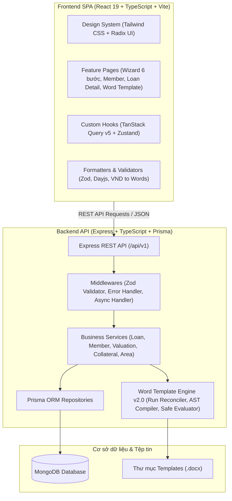
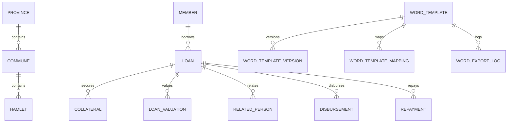
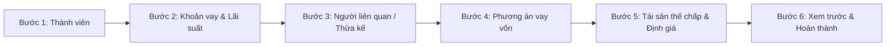
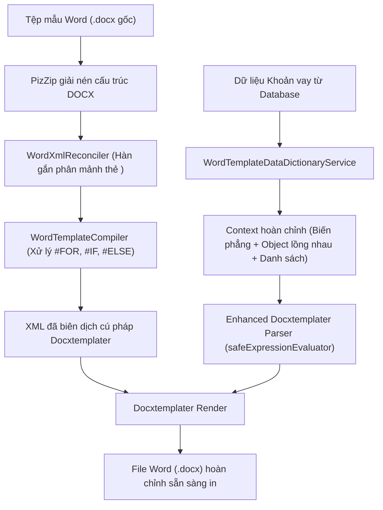

# HỆ THỐNG QUẢN LÝ TÍN DỤNG QUỸ TÍN DỤNG NHÂN DÂN (N_QTD)
## TÀI LIỆU ĐẶC TẢ KỸ THUẬT & TOÀN BỘ NGHIỆP VỤ HỆ THỐNG (SYSTEM SPECIFICATION)

> **Phiên bản:** 2.1 (Full System Specification)  
> **Ngày cập nhật:** 05/11/2026  
> **Trạng thái:** Hoàn thiện và đang vận hành chính thức  
> **Phạm vi áp dụng:** Toàn bộ hệ thống Backend, Frontend, Cơ sở dữ liệu và Động cơ Biểu mẫu Word (Word Template Engine v2.0)

---

## MỤC LỤC
1. [TỔNG QUAN DỰ ÁN](#1-tổng-quan-dự-án)
2. [KIẾN TRÚC HỆ THỐNG & CÔNG NGHỆ](#2-kiến-trúc-hệ-thống--công-nghệ)
3. [CƠ SỞ DỮ LIỆU & LƯỢC ĐỒ PRISMA (DATABASE MODELS)](#3-cơ-sở-dữ-liệu--lược-đồ-prisma-database-models)
4. [CHI TIẾT CÁC PHÂN HỆ NGHIỆP VỤ CHÍNH](#4-chi-tiết-các-phân-hệ-nghiệp-vụ-chính)
   - 4.1. [Quản lý Thành viên (Member Module)](#41-quản-lý-thành-viên-member-module)
   - 4.2. [Quản lý Địa bàn hành chính 3 cấp (Area Module)](#42-quản-lý-địa-bàn-hành-chính-3-cấp-area-module)
   - 4.3. [Biểu lãi suất & Bảng giá đất (Interest Rate & Asset Pricing)](#43-biểu-lãi-suất--bảng-giá-đất-interest-rate--asset-pricing)
   - 4.4. [Hồ sơ Khoản vay & Quy trình Wizard 6 bước (Loan Module)](#44-hồ-sơ-khoản-vay--quy-trình-wizard-6-bước-loan-module)
   - 4.5. [Phương án vay vốn, Chi phí & Nguồn thu (Loan Plan)](#45-phương-án-vay-vốn-chi-phí--nguồn-thu-loan-plan)
   - 4.6. [Tài sản thế chấp & Chủ sở hữu (Collateral Module)](#46-tài-sản-thế-chấp--chủ-sở-hữu-collateral-module)
   - 4.7. [Định giá tài sản độc lập & Liên kết (Loan Valuation Engine)](#47-định-giá-tài-sản-độc-lập--liên-kết-loan-valuation-engine)
   - 4.8. [Người liên quan & Người thừa kế (Related Person & Heir)](#48-người-liên-quan--người-thừa-kế-related-person--heir)
   - 4.9. [Giải ngân & Kế hoạch thu nợ (Disbursement & Repayment)](#49-giải-ngân--kế-hoạch-thu-nợ-disbursement--repayment)
5. [ĐỘNG CƠ SINH BIỂU MẪU WORD TỰ ĐỘNG (WORD TEMPLATE ENGINE v2.0)](#5-động-cơ-sinh-biểu-mẫu-word-tự-động-word-template-engine-v20)
   - 5.1. [Kiến trúc Engine xử lý XML Word](#51-kiến-trúc-engine-xử-lý-xml-word)
   - 5.2. [Hệ thống từ khóa toàn cục (Global Keywords Dictionary)](#52-hệ-thống-từ-khóa-toàn-cục-global-keywords-dictionary)
   - 5.3. [Xử lý danh sách lặp (Loops) & Điều kiện logic (Conditions)](#53-xử-lý-danh-sách-lặp-loops--điều-kiện-logic-conditions)
   - 5.4. [Cơ chế gộp tài sản & Quy tắc văn bản đặc thù](#54-cơ-chế-gộp-tài-sản--quy-tắc-văn-bản-đặc-thù)
6. [THIẾT KẾ GIAO DIỆN & TRẢI NGHIỆM NGƯỜI DÙNG (FRONTEND ARCHITECTURE)](#6-thiết-kế-giao-diện--trải-nghiệm-người-dùng-frontend-architecture)
7. [HỆ THỐNG XỬ LÝ LỖI, ĐỐI SOÁT & BẢO TOÀN DỮ LIỆU](#7-hệ-thống-xử-lý-lỗi-đối-soát--bảo-toàn-dữ-liệu)
8. [HƯỚNG DẪN BUILD, TEST & TRIỂN KHAI VẬN HÀNH](#8-hướng-dẫn-build-test--triển-khai-vận-hành)
9. [LỊCH SỬ TIẾN HÓA VÀ CÁC MỐC NÂNG CẤP HỆ THỐNG](#9-lịch-sử-tiến-hóa-và-các-mốc-nâng-cấp-hệ-thống)

---

## 1. TỔNG QUAN DỰ ÁN

### 1.1. Bối cảnh & Mục tiêu
**N_QTD** là hệ thống phần mềm chuyên biệt phục vụ công tác thẩm định, phê duyệt, quản lý hồ sơ tín dụng và sinh biểu mẫu tự động dành cho **Quỹ Tín dụng Nhân dân** (đặc thù triển khai thực tế tại Quỹ tín dụng nhân dân Nhị Trường).
Hệ thống giải quyết toàn diện bài toán nghiệp vụ tín dụng nông thôn và đô thị:
1. Quản lý chặt chẽ hồ sơ thành viên vay vốn và phân nhóm địa bàn hành chính 3 cấp (Tỉnh / Xã / Ấp).
2. Xây dựng hồ sơ vay vốn chuẩn theo quy định của Ngân hàng Nhà nước: Cho vay Thế chấp và Cho vay Tín chấp; Thời hạn vay Ngắn hạn (12 tháng) và Trung hạn (24 tháng).
3. Quản lý chi tiết phương án vay vốn: doanh thu, chi phí dự kiến, lợi nhuận, nguồn trả nợ.
4. Kê khai người có liên quan (bắt buộc với các khoản vay thế chấp từ 140 triệu VNĐ trở lên) và thông tin người thừa kế tài sản.
5. Quản lý tài sản thế chấp (Quyền sử dụng đất, nhà ở và tài sản gắn liền với đất), đa dạng loại giấy chứng nhận và đa chủ sở hữu (cá nhân, hộ gia đình, bảo lãnh bên thứ ba, đồng sở hữu).
6. Tách biệt và tối ưu hóa phân hệ **Định giá tài sản độc lập** theo 4 phương pháp chuẩn hóa của Quỹ.
7. Tự động hóa 100% khâu in ấn, sinh biểu mẫu Word (.docx) phức tạp theo chuẩn tài liệu pháp lý tín dụng: Thỏa thuận vay vốn, Hợp đồng thế chấp, Biên bản định giá tài sản, Biên bản bàn giao QSDĐ, Kê khai người liên quan, Tờ trình thẩm định.

---

## 2. KIẾN TRÚC HỆ THỐNG & CÔNG NGHỆ

Hệ thống được thiết kế theo cấu trúc Monorepo phân tách rõ ràng giữa Backend (API Service), Frontend (Single Page Application) và Thư viện Template văn bản.



### 2.1. Công nghệ Backend
- **Nền tảng:** Node.js (>= 20.x), TypeScript 5.x.
- **Web Framework:** Express.js 4.x.
- **ORM & Database:** Prisma ORM 6.x kết nối cơ sở dữ liệu **MongoDB**.
- **Kiểm thực dữ liệu:** Zod Schema Validation.
- **Xử lý tài liệu Word:** PizZip, Docxtemplater, Custom XML Reconciler, Fast AST Compiler.
- **Xử lý ngày giờ & tài chính:** Day.js, thư viện chuyển số tiền thành chữ tiếng Việt (`vndToWords`).
- **Testing Framework:** Vitest.

### 2.2. Công nghệ Frontend
- **Framework:** React 19, TypeScript.
- **Build Tool:** Vite 8.x.
- **Styling & UI Kit:** Tailwind CSS, Radix UI Primitives, Lucide Icons (phong cách Enterprise tối giản, gam màu Navy / Xanh thương hiệu).
- **Quản lý Form:** React Hook Form + Zod Resolver.
- **Quản lý Server State & Caching:** TanStack Query v5.
- **Quản lý Client State:** Zustand.

---

## 3. CƠ SỞ DỮ LIỆU & LƯỢC ĐỒ PRISMA (DATABASE MODELS)

Hệ thống sử dụng MongoDB với lược đồ Prisma (`backend/prisma/schema.prisma`). Dưới đây là lược đồ dữ liệu chi tiết của 14 Models và các Embedded Types:

### 3.1. Bảng kiểu liệt kê (Enums)
- **`IdDocumentType`**: `CAN_CUOC` (Căn cước), `CAN_CUOC_CONG_DAN` (Căn cước công dân).
- **`Gender`**: `NAM`, `NU`.
- **`LoanType`**: `TIN_CHAP` (Cho vay tín chấp), `THE_CHAP` (Cho vay thế chấp).
- **`LoanTermType`**: `NGAN_HAN` (12 tháng), `TRUNG_HAN` (24 tháng).
- **`LoanStatus`**:
  - `DANG_TAO`: Đang tạo hồ sơ (bản nháp).
  - `DA_HOAN_THANH_HO_SO`: Đã hoàn thiện hồ sơ tín dụng.
  - `DA_GIAI_NGAN`: Đã phát tiền vay.
  - `QUA_HAN`: Khoản vay có nợ quá hạn.
  - `DA_TAT_TOAN`: Đã thu hồi đủ gốc và lãi.
- **`CollateralAssetType`**:
  - `QUYEN_SU_DUNG_DAT`: Quyền sử dụng đất.
  - `QUYEN_SU_DUNG_DAT_QUYEN_SO_HUU_NHA_O_VA_TAI_SAN_KHAC_GAN_LIEN_VOI_DAT`: Quyền sử dụng đất, quyền sở hữu nhà ở và tài sản khác gắn liền với đất.
  - `QUYEN_SU_DUNG_DAT_QUYEN_SO_HUU_TAI_SAN_GAN_LIEN_VOI_DAT`: Quyền sử dụng đất, quyền sở hữu tài sản gắn liền với đất.
- **`CollateralCertificateType`**:
  - `GCN`: GCN.
  - `GIAY_CHUNG_NHAN`: Giấy chứng nhận.
  - `VAO_SO_CAP_GIAY_CHUNG_NHAN_QUYEN_SU_DUNG_DAT`: Vào sổ cấp giấy chứng nhận quyền sử dụng đất Số.
  - `GIAY_CHUNG_NHAN_QUYEN_SU_DUNG_DAT`: Giấy chứng nhận quyền sử dụng đất.
- **`CollateralOwnerType`**:
  - `NGUOI_VAY_CA_NHAN`: Người vay đứng tên cá nhân.
  - `NGUOI_VAY_HO`: Người vay đứng tên hộ gia đình.
  - `NGUOI_THUA_KE_CA_NHAN`: Người thừa kế đứng tên cá nhân.
  - `NGUOI_THUA_KE_HO`: Người thừa kế đứng tên hộ gia đình.
  - `NGUOI_VAY_VA_NGUOI_THUA_KE`: Người vay và người thừa kế cùng đứng tên.
  - `BAO_LANH`: Bên thứ ba bảo lãnh.
- **`ValuationType`**:
  - `THEO_NGHI_DINH_QUY`: 1. Theo nghị định Quỹ.
  - `THEO_NGHI_DINH_QUY_CU`: 2. Theo nghị định Quỹ (Cũ).
  - `THEO_GIA_THI_TRUONG`: 3. Theo giá thị trường.
  - `THEO_GIA_THI_TRUONG_VA_NGHI_DINH_QUY`: 4. Theo giá thị trường và theo nghị định Quỹ.

### 3.2. Cấu trúc các bảng dữ liệu chính



#### 1. Địa bàn hành chính (`provinces`, `communes`, `hamlets`, `area_groups`)
- Quản lý phân cấp 3 tầng: Tỉnh/Thành phố -> Xã/Phường -> Ấp/Khóm/Khu dân cư.
- Cung cấp snapshot địa chỉ đầy đủ gắn vào thành viên, tài sản và người liên quan.
- `area_groups` (Phân nhóm địa bàn Xã chuyên biệt cho Tài sản thế chấp):
  - Trường chính: `code` (Mã nhóm định danh duy nhất: `NHOM_1`, `NHOM_2`...), `name` (Tên nhóm: "Nhóm 1", "Nhóm 2"...), `description` (Mô tả mục đích nhóm), `communeIds` (Danh sách các ID Xã trực thuộc nhóm), `isActive`.

#### 2. Thành viên (`members`)
- Trường chính: `memberCode` (Mã TV), `isNewMember`, `fullName`, `yearOfBirth`, `gender`, `idType`, `idNumber` (Số CCCD - Unique), `idIssueDate`, `idIssuePlace`, `idExpiry`, `phoneNumber`, `address`, `communeId`, `hamletId`, `isDeleted`.

#### 3. Hồ sơ khoản vay (`loans`)
- Trường chính: `contractNumber` (Số khế ước - Unique), `contractDate`, `loanType`, `termType`, `termMonths`, `loanAmount`, `interestRate`, `status`, `expectedMaturityDate`, `maturityDate`, `halfTermPaymentDate`, `settlementDate`.
- Embedded types:
  - `heir` (Người thừa kế): `fullName`, `yearOfBirth`, `gender`, `idType`, `idNumber`, `idIssueDate`, `idIssuePlace`, `address`, `relationship`.
  - `loanPlan` (Phương án vay): `purpose`, `loanAmount`, `ownCapital`, `borrowedCapital`, `expenses`, `revenues`, `totalExpenses`, `totalRevenues`, `profit`.
  - `mortgageContract` (Hợp đồng thế chấp): `contractNumber`, `contractExpiryDate`, `committeeAuthDate`.
  - `householdMembers` (Danh sách thành viên hộ gia đình - quản lý tập trung ở cấp khoản vay): `fullName` (Họ và tên), `yearOfBirth` (Năm sinh), `gender` (Giới tính: `NAM`, `NU`), `idType` (Loại giấy tờ: `CAN_CUOC`, `CAN_CUOC_CONG_DAN`), `idNumber` (Số giấy tờ), `idIssueDate` (Ngày cấp), `idIssuePlace` (Nơi cấp), `address` (Địa chỉ thường trú).

#### 4. Người liên quan (`related_persons`)
- Kê khai bắt buộc cho khoản vay thế chấp có giá trị từ 140.000.000 VNĐ trở lên.
- Trường chính: `loanId`, `fullName`, `yearOfBirth`, `gender`, `idNumber`, `idIssueDate`, `idIssuePlace`, `phoneNumber`, `relatedPersonRelationship`, `creditFundLoan` (Vốn vay QTD: "Không" hoặc chi tiết), `address`, `communeId`, `hamletId`.

#### 5. Tài sản thế chấp (`collaterals`)
- Trường chính: `loanId`, `assetType`, `certificateType`, `assetCode` (Mã tài sản duy nhất toàn hệ thống, tự động sinh), `certificateNumber` (Số phát hành GCN), `issueBookNumber` (Số vào sổ cấp GCN), `sheetNumber` (Số tờ), `plotNumber` (Số thửa), `area` (Diện tích pháp lý), `actualArea` (Diện tích thực tế), `pricePerSqMeter`, `valuationAmount`, `origin`, `usagePurpose`, `usageDuration`, `usageForm`, `useRestrictions`, `issueDate`, `issuePlace`, `ownerType`.
- Phân loại chủ sở hữu `ownerType`: Cá nhân người vay, Hộ người vay (`NGUOI_VAY_HO`), Người thừa kế cá nhân, Hộ người thừa kế (`NGUOI_THUA_KE_HO`), Đồng sở hữu, Bảo lãnh bên thứ ba.
- Embedded types:
  - `thirdPartyInfo` (Dành cho bên thứ 3 bảo lãnh).
  - `householdMembers` (Tùy chọn lưu trữ đồng bộ hoặc snapshot theo tài sản khi cần thiết).

#### 6. Định giá khoản vay (`loan_valuations`)
- Tách thành bảng độc lập cho phép một khoản vay có nhiều dòng định giá tài sản chi tiết.
- Trường chính: `loanId`, `collateralId`, `collateralIds` (hỗ trợ liên kết gộp), `valuationType`, `valuationDate`, `sheetNumber`, `plotNumber`, `area`, `actualArea`, `pricePerSqMeter`, `totalPriceBeforeRound`, `totalPrice` (giá trị làm tròn theo quy tắc Quỹ), `notes`.

#### 7. Giải ngân (`disbursements`) & Thu nợ (`repayments`)
- `Disbursement`: `loanId`, `disbursementDate`, `amount`, `note`, `isDeleted`.
- `Repayment`: `loanId`, `repaymentDate`, `principalAmount` (Gốc), `interestAmount` (Lãi), `interestDays` (Số ngày tính lãi đối soát), `interestStartDate`, `interestEndDate`, `note`.

#### 8. Biểu lãi suất (`interest_rate_configs`) & Bảng giá đất (`asset_pricing_rules`)
- `InterestRateConfig`: Ngày hiệu lực, kỳ hạn áp dụng, danh sách bậc thang tiền vay và tỷ lệ % năm.
- `AssetPricingRule`: Phân loại vị trí đất theo khu vực, đơn giá quy định trên mỗi m² làm cơ sở áp giá nhanh.

#### 9. Quản lý biểu mẫu Word (`word_templates`, `word_template_mappings`, `global_word_keywords`)
- `WordTemplate`: Lưu trữ tệp tin `.docx`, phiên bản, nhóm nghiệp vụ, trạng thái kích hoạt.
- `WordTemplateMapping`: Ánh xạ từ khóa mẫu sang đường dẫn dữ liệu hệ thống (`dataPath`), thiết lập kiểu dữ liệu, định dạng hiển thị và điều kiện logic.
- `GlobalWordKeyword`: Thư viện chuẩn hóa danh mục từ khóa toàn hệ thống phục vụ gợi ý tự động khi người dùng tải lên mẫu Word mới.

---

## 4. CHI TIẾT CÁC PHÂN HỆ NGHIỆP VỤ CHÍNH

### 4.1. Quản lý Thành viên (Member Module)
- **Cấp mã thành viên:** Tự động chuẩn hóa mã thành viên. Nếu là thành viên mới kết nạp chưa có mã, hệ thống cho phép để trống và hỗ trợ xuất biểu mẫu tự động dưới dạng để trống thay vì hiển thị thông báo lỗi.
- **Định danh chính xác:** Hỗ trợ song song cả Căn cước (12 số mới) và Căn cước công dân (12 số). Kiểm tra ràng buộc duy nhất trên toàn hệ thống.
- **Snapshot địa bàn:** Khi chọn Tỉnh -> Xã -> Ấp, hệ thống lưu trữ đồng thời ID và tên địa bàn (snapshot) để đảm bảo lịch sử hồ sơ vay vốn không bị sai lệch nếu địa giới hành chính thay đổi sau này.
- **Xóa mềm (Soft Delete):** Thành viên khi xóa sẽ chuyển cờ `isDeleted = true`, lưu vết lý do và thời điểm xóa để phục vụ kiểm toán.

### 4.2. Quản lý Địa bàn hành chính & Phân nhóm Xã cho Tài sản thế chấp (Area Module)
- **Quản trị danh mục cây địa bàn 3 cấp:** Cấp Tỉnh -> Cấp Xã -> Cấp Ấp.
- **Component dùng chung `AreaCascaderSelect`:** Hỗ trợ lọc tầng nấc nhanh chóng với trải nghiệm mượt mà, hỗ trợ tìm kiếm theo tên hoặc mã.
- **Phân nhóm địa bàn cấp Xã chuyên biệt cho Tài sản thế chấp (Commune Grouping for Collaterals):**
  - **Mục đích nghiệp vụ:** Phục vụ phân loại địa bàn tài sản thế chấp theo từng nhóm thẩm quyền (như phân chia thẩm quyền Văn phòng Đăng ký đất đai, Chi nhánh phụ trách, địa bàn quản lý rủi ro...). **Lưu ý: Chỉ áp dụng phân nhóm này cho Tài sản thế chấp**, không áp dụng cho địa chỉ cư trú của Người vay hay Người liên quan.
  - **Mô hình quản lý nhóm:**
    - Cán bộ quản trị có thể tạo các Nhóm địa bàn (ví dụ: "Nhóm 1" - mã `NHOM_1`, "Nhóm 2" - mã `NHOM_2`...).
    - Mỗi nhóm bao gồm danh sách các Xã trực thuộc (`communeIds`).
    - Cho phép linh hoạt thêm, sửa tên, đổi mã, gán hoặc hủy gán các Xã vào nhóm ngay tại giao diện cấu hình Địa bàn.
  - **Cơ chế tự động nhận diện nhóm tài sản:**
    - Khi cán bộ lập hồ sơ khoản vay và nhập tài sản thế chấp (chọn Xã nơi có thửa đất): Hệ thống tự động đối chiếu `communeId` của tài sản với danh mục nhóm xã để gán thông tin Nhóm tương ứng cho tài sản đó.
    - Trong một hồ sơ vay vốn, nếu có nhiều tài sản thuộc các xã khác nhau, hệ thống tự động tổng hợp đầy đủ danh sách các nhóm xuất hiện trong hồ sơ.

### 4.3. Biểu lãi suất & Bảng giá đất (Interest Rate & Asset Pricing)
- **Lãi suất:** Cho phép thiết lập bảng lãi suất theo từng mốc thời gian hiệu lực và bậc thang số tiền vay (Tiers). Khoản vay khi khởi tạo sẽ khóa cố định lãi suất tại thời điểm vay.
- **Bảng giá đất:** Quản lý đơn giá đất của Quỹ và Nhà nước theo từng danh mục đất (đất ruộng, đất cập lộ, cập kênh...). Cán bộ tín dụng có thể bấm 1 nút trên giao diện định giá để tự động điền đơn giá chuẩn mà không cần tra cứu thủ công.

### 4.4. Hồ sơ Khoản vay & Quy trình Wizard 6 bước (Loan Module)
Quy trình lập hồ sơ vay vốn được thiết kế dưới dạng Wizard 6 bước thông minh, phản ứng linh hoạt theo loại vay:



- **Bước 1 - Chọn thành viên:** Tìm kiếm thành viên có sẵn hoặc mở modal tạo nhanh thành viên mới.
- **Bước 2 - Thông tin khoản vay:**
  - Chọn hình thức: Cho vay Thế chấp (`THE_CHAP`) hoặc Cho vay Tín chấp (`TIN_CHAP`).
  - Chọn thời hạn: Ngắn hạn (12 tháng) hoặc Trung hạn (24 tháng).
  - Nhập số tiền vay: Tự động format tiền tệ VNĐ và diễn giải số tiền bằng chữ tiếng Việt tức thì.
  - Tự động áp dụng lãi suất theo bậc thang và tính toán các mốc ngày quan trọng: Ngày cấp khế ước, Ngày đáo hạn dự kiến (12 hoặc 24 tháng), Ngày thanh toán phân nửa (đối với cho vay trung hạn).
  - **Tự động định dạng số khế ước & số HĐ thế chấp:** Hỗ trợ nhập và tự động format định dạng `YY.MM.XXX` (Ví dụ: `26.11.020`). Tự động trích xuất các từ khóa riêng biệt: `KHOAN_VAY.SO_KHE_UOC_NAM`, `KHOAN_VAY.SO_KHE_UOC_THANG`, `KHOAN_VAY.SO_KHE_UOC_NGAY`, `KHOAN_VAY.SO_KHE_UOC_SO` (số cuối) và so sánh tự động số khế ước có giống số HĐ thế chấp hay không.
- **Bước 3 - Người liên quan & Người thừa kế:**
  - Nếu là khoản vay thế chấp có giá trị **từ 140.000.000 VNĐ trở lên**: Hệ thống tự động kích hoạt bảng kê khai người liên quan (Cha, Mẹ, Con, Vợ/Chồng, Anh/Chị/Em...).
  - Quản lý thông tin Người thừa kế tài sản (nếu có).
- **Bước 4 - Phương án vay vốn:** Nhập mục đích vay, tổng nhu cầu vốn, vốn tự có, vốn vay Quỹ tín dụng; lập danh sách các khoản chi phí và danh sách nguồn thu dự kiến; tự động tính toán tổng chi phí, tổng doanh thu và lợi nhuận ròng.
- **Bước 5 - Tài sản thế chấp, Bảng định giá & Thành viên hộ gia đình:**
  - Nhập danh sách tài sản thế chấp (nếu là Cho vay thế chấp).
  - Tích hợp giao diện **Định giá độc lập trên cùng 1 trang**: Nhập loại định giá và ngày định giá dùng chung; thêm nhiều dòng định giá tài sản chi tiết (số tờ, số thửa, diện tích pháp lý, diện tích thực tế, đơn giá); tự động liên kết dòng định giá với tài sản tương ứng.
  - **Section Thành viên hộ gia đình (Thiết kế độc lập ở ngoài):** Tương tự như Section Định giá, ô/bảng nhập thành viên hộ được tổ chức thành một Section độc lập ngay trên trang hồ sơ vay vốn (không nằm ẩn trong modal từng tài sản). Section này tự động kích hoạt hiển thị khi thỏa mãn 2 điều kiện đồng thời:
    1. Thể loại vay là Cho vay thế chấp (`loanType === 'THE_CHAP'`).
    2. Hồ sơ có ít nhất một tài sản thế chấp thuộc loại đất hộ (`ownerType` là `NGUOI_VAY_HO`, `NGUOI_THUA_KE_HO`).
- **Bước 6 - Xem trước & Hoàn thành hồ sơ:** Kiểm tra tính toàn vẹn của hồ sơ, đối soát điều kiện tài sản định giá (> 0 VNĐ nếu là thế chấp) và bấm hoàn tất.

### 4.5. Phương án vay vốn, Chi phí & Nguồn thu (Loan Plan)
- Cân đối tài chính:
  $$\text{Tổng nhu cầu vốn} = \text{Vốn tự có} + \text{Vốn vay Quỹ tín dụng}$$
- Khả năng trả nợ:
  $$\text{Lợi nhuận ròng} = \text{Tổng nguồn thu} - \text{Tổng chi phí}$$
- Hỗ trợ nhập danh sách các khoản chi phí và nguồn thu linh hoạt; tự động cộng dồn và cung cấp các biến gộp để xuất văn bản: `PHUONG_AN.CHI_PHI_GOP`, `PHUONG_AN.NGUON_THU_GOP`, các vòng lặp bảng biểu.

### 4.6. Tài sản thế chấp & Chủ sở hữu (Collateral Module)
- **Tự động sinh mã tài sản:** Mỗi tài sản thế chấp khi lưu trữ được hệ thống gán một mã định danh duy nhất không trùng lặp (ví dụ: `TS-001`, `TS-002`...).
- **Đa dạng hóa giấy chứng nhận quyền sử dụng đất:**
  - Hỗ trợ đầy đủ 4 loại giấy tờ pháp lý:
    1. `GCN`: Viết tắt.
    2. `GIAY_CHUNG_NHAN`: "Giấy chứng nhận".
    3. `VAO_SO_CAP_GIAY_CHUNG_NHAN_QUYEN_SU_DUNG_DAT`: "Vào sổ cấp giấy chứng nhận quyền sử dụng đất Số" (bảo đảm có chữ "Số").
    4. `GIAY_CHUNG_NHAN_QUYEN_SU_DUNG_DAT`: "Giấy chứng nhận quyền sử dụng đất".
  - Bảo toàn định dạng chuỗi của Số tờ, Số thửa để không bị mất các chữ số 0 ở đầu (ví dụ: `01`, `008`, `025`).
- **Phân loại chủ sở hữu tài sản chuyên sâu:**
  - `NGUOI_VAY_CA_NHAN`: Cá nhân người vay.
  - `NGUOI_VAY_HO`: Hộ gia đình do người vay đại diện (đất hộ).
  - `NGUOI_THUA_KE_CA_NHAN` / `NGUOI_THUA_KE_HO`: Đứng tên người thừa kế cá nhân / Hộ người thừa kế.
  - `NGUOI_VAY_VA_NGUOI_THUA_KE`: Đồng sở hữu giữa người vay và người thừa kế.
  - `BAO_LANH`: Bên thứ ba bảo lãnh bằng tài sản (kèm thông tin chi tiết của người bảo lãnh).
- **Ràng buộc nghiệp vụ thông minh:** Nếu hồ sơ không có người thừa kế, hệ thống tự động khóa lựa chọn chủ sở hữu, chỉ cho phép chọn Người vay hoặc Bảo lãnh bên thứ ba.
- **Danh sách chủ sở hữu mở rộng (`DANH_SACH_CHU_SO_HUU_VA_THUA_KE`):**
  - **Mục đích nghiệp vụ:** Phục vụ các văn bản yêu cầu liệt kê đầy đủ cả Chủ sở hữu của đất và Người thừa kế (nếu có), hoặc Người vay (nếu chủ sở hữu đất là người thừa kế).
  - **Quy tắc tự động thông minh:**
    1. **Trường hợp có người bảo lãnh (`BAO_LANH`):** Nếu trong danh sách chủ sở hữu có tài sản do bên thứ ba bảo lãnh, vòng lặp này **chỉ hiển thị duy nhất người bảo lãnh** (không bổ sung người vay hay người thừa kế, loại bỏ các chủ thể khác).
    2. **Nếu danh sách chủ sở hữu đã có từ 2 người trở lên:** Giữ nguyên, không bổ sung ai.
    3. **Nếu danh sách chủ sở hữu có Người vay:** Tự động bổ sung Người thừa kế vào cuối danh sách (nếu khoản vay có khai báo người thừa kế).
    4. **Nếu danh sách chủ sở hữu có Người thừa kế:** Tự động bổ sung Người vay vào cuối danh sách.
  - **Bí danh hỗ trợ:** `DANH_SACH_NGUOI_SO_HUU_VA_THUA_KE`, `DANH_SACH_CHU_SO_HUU_MO_RONG`, `DANH_SACH_CHU_SO_HUU_KEM_THUA_KE`.
- **Quản lý Thành viên hộ gia đình (Household Members Section):**
  - **Vị trí nhập liệu độc lập ở ngoài:** Tương tự như phân hệ Định giá tài sản (`Loan Valuation Section`), Thành viên hộ gia đình được thiết kế thành một Section độc lập nằm trực tiếp trên giao diện hồ sơ khoản vay (ở ngoài danh sách tài sản thế chấp, không nhập lồng trong modal chỉnh sửa từng tài sản).
  - **Điều kiện kích hoạt hiển thị Section:** Section Thành viên hộ gia đình chỉ xuất hiện khi đồng thời thỏa mãn 2 điều kiện:
    1. Thể loại vay là Cho vay thế chấp (`loanType === 'THE_CHAP'`).
    2. Hồ sơ có ít nhất một tài sản thế chấp thuộc loại đất hộ (`ownerType` là `NGUOI_VAY_HO` hoặc `NGUOI_THUA_KE_HO`...).
    *(Nếu là vay tín chấp hoặc toàn bộ tài sản đều thuộc diện sở hữu cá nhân/bảo lãnh, Section này sẽ tự động ẩn).*
  - **Hỗ trợ thêm nhiều thành viên:** Cho phép cán bộ thêm nhiều dòng thành viên trong hộ gia đình không giới hạn số lượng.
  - **Cấu trúc trường thông tin thành viên hộ:**
    1. `fullName`: Họ và tên (tự động chuẩn hóa chữ in hoa).
    2. `idNumber`: Số giấy tờ định danh (Số CCCD hoặc Căn cước 12 số).
    3. `idType`: Loại giấy tờ (`CAN_CUOC` - Căn cước, `CAN_CUOC_CONG_DAN` - Căn cước công dân).
    4. `yearOfBirth`: Năm sinh (khóa/disable, tự động nhận diện từ CCCD).
    5. `gender`: Giới tính (`NAM`, `NU` - khóa/disable, tự động nhận diện từ CCCD).
    6. `idIssuePlace`: Nơi cấp (khóa/disable, tự động nhảy chuẩn xác theo loại giấy tờ được chọn).
    7. `idIssueDate`: Ngày cấp giấy tờ.
    8. `address`: Địa chỉ thường trú của thành viên hộ.
  - **Cơ chế tự động nhảy dữ liệu thông minh (Auto-detection & Auto-fill):**
    - *Năm sinh & Giới tính:* Tương tự như màn hình tạo Người vay và Người liên quan, khi nhập đủ 12 số CCCD, hệ thống tự động bóc tách:
      - Ký tự thứ 4 đại diện cho thế kỷ sinh và giới tính (0: Nam TK 20, 1: Nữ TK 20, 2: Nam TK 21, 3: Nữ TK 21, v.v.).
      - Ký tự thứ 5 và 6 đại diện cho 2 số cuối của năm sinh.
      - Hệ thống tự động suy ra Năm sinh 4 số đầy đủ và chọn Giới tính tức thời. **Hai trường này bị khóa (disabled) trên giao diện**, không cho phép sửa tay để tránh sai lệch thông tin định danh.
    - *Nơi cấp:* Tự động nhảy linh hoạt theo loại giấy tờ được chọn và **bị khóa (disabled) trên giao diện**:
      - Nếu chọn `CAN_CUOC_CONG_DAN` (Căn cước công dân 12 số): Tự động điền `"Cục CSQLHC về TTXH"`.
      - Nếu chọn `CAN_CUOC` (Căn cước mới): Tự động điền `"Bộ Công An"`.
    - *Lấy nhanh địa chỉ người vay (Quick Address Copy):* Cung cấp nút tiện ích 1-click **"Lấy địa chỉ người vay"** bên cạnh ô nhập địa chỉ, tự động sao chép toàn bộ địa chỉ thường trú của người vay sang thành viên hộ, tối ưu tốc độ tác nghiệp của cán bộ tín dụng.
    - *Thiết kế giao diện thanh lịch (UI Polish):* Xóa bỏ hoàn toàn các chuỗi chú thích thừa như `(tự nhảy)` trên các nhãn trường (`label`), chỉ giữ lại các nhãn chuẩn: *"Năm sinh"*, *"Giới tính"*, *"Nơi cấp"* để giao diện sạch đẹp, trực quan và chuyên nghiệp.

### 4.7. Định giá tài sản độc lập & Liên kết (Loan Valuation Engine)
- **Tách biệt khỏi Collateral:** Trước đây việc định giá gắn chặt trong từng tài sản. Hệ thống đã nâng cấp tách thành bảng `loan_valuations` độc lập, cho phép nhiều dòng thẩm định chi tiết trên cùng một hoặc nhiều thửa đất.
- **Đồng bộ hóa 2 chiều tự động (`syncCollateralsValuation`):**
  - Khi thêm, sửa, xóa bất kỳ dòng định giá nào, Backend tự động tính tổng tiền định giá và cập nhật ngược lại vào trường `valuationAmount`, `pricePerSqMeter`, `actualArea` của tài sản thế chấp (`collaterals`).
  - Tự động nhận diện liên kết theo cặp **Số tờ / Số thửa** hoặc liên kết tài sản duy nhất.
  - Đảm bảo khi hoàn tất hồ sơ (`DA_HOAN_THANH_HO_SO`), hệ thống kiểm tra `totalCollateralValue` theo giá trị thực tế lớn nhất, tuyệt đối không bị chặn lỗi định giá 0 VNĐ.
- **Ngày định giá và Loại định giá chung:** Thiết kế form cho phép cán bộ tín dụng chọn 1 lần Ngày định giá và Loại định giá ở phần thông tin chung, áp dụng tự động cho toàn bộ các dòng tài sản bên dưới.

### 4.8. Người liên quan & Người thừa kế (Related Person & Heir)
- **Ngưỡng kiểm soát rủi ro:** Áp dụng theo quy định của Ngân hàng Nhà nước, tất cả khoản vay thế chấp có hạn mức từ 140 triệu VNĐ bắt buộc phải lập danh sách người có liên quan.
- **Quan hệ người liên quan:** Chỉ giữ lại mối quan hệ trực tiếp với Người vay (Vợ, Chồng, Con, Mẹ, Cha...), không bắt buộc/lược bỏ quan hệ với người thừa kế.
- **Kê khai vốn vay tại Quỹ tín dụng:** Cột "Vốn vay Quỹ tín dụng" (`creditFundLoan`) mặc định là `"Không"`, cho phép sửa nếu người liên quan có đang vay vốn tại Quỹ.
- **Tương thích mẫu in:** Cung cấp trọn bộ từ khóa trong khối lặp `DANH_SACH_NGUOI_LIEN_QUAN` (`nlq.HO_TEN`, `nlq.DANH_XUNG`, `nlq.SO_CCCD`, `nlq.NGAY_CAP`, `nlq.NOI_CAP`, `nlq.QUAN_HE`, `nlq.VON_VAY_QTD`...) và đồng thời tương thích ngược với cú pháp bảng biểu docxtemplater `{{#nguoi_lien_quan}} {{index}} {{ho_ten}} {{so_giay_to}} {{ngay_cap}} {{noi_cap}} {{quan_he}} {{von_vay}} {{/nguoi_lien_quan}}`.

### 4.9. Giải ngân & Kế hoạch thu nợ (Disbursement & Repayment)
- **Giải ngân:** Ghi nhận ngày giải ngân thực tế, số tiền, phương thức nhận tiền. Khoản vay tự động chuyển trạng thái `DA_GIAI_NGAN`.
- **Kế hoạch & Nhật ký thu nợ:**
  - Thu nợ gốc theo kỳ hạn (12 tháng hoặc 24 tháng).
  - Thu nợ lãi định kỳ hàng tháng/quý: Ghi nhận số tiền lãi, ngày bắt đầu kỳ tính lãi, ngày kết thúc kỳ tính lãi, và tự động tính số ngày tính lãi thực tế để đối soát.
  - Cập nhật số dư nợ gốc giảm dần chính xác sau mỗi lần thu nợ. Khi dư nợ về 0, chuyển trạng thái `DA_TAT_TOAN`.

---

## 5. ĐỘNG CƠ SINH BIỂU MẪU WORD TỰ ĐỘNG (WORD TEMPLATE ENGINE v2.0)

Hệ thống sở hữu Động cơ sinh tài liệu Word độc quyền (Template Engine v2.0) được xây dựng chuyên sâu để xử lý các biểu mẫu tín dụng ngân hàng phức tạp mà các thư viện thông thường không thể đáp ứng.



### 5.1. Kiến trúc Engine xử lý XML Word
1. **XML Run Reconciler (`word-xml-reconciler.ts`):**  
   Microsoft Word thường tự ý cắt nhỏ một đoạn văn bản hoặc một từ khóa thành nhiều thẻ `<w:r>` khác nhau (ví dụ: `{{KHOAN_` và `VAY.SO_TIEN}}`). Reconciler quét toàn bộ cây XML `word/document.xml`, `header*.xml`, `footer*.xml`, tự động hàn gắn các run bị phân mảnh để bảo toàn nguyên vẹn cú pháp từ khóa.
2. **AST Compiler (`word-template-compiler.ts`):**  
   Biên dịch cú pháp mở rộng:
   - `{{#FOR item IN DANH_SACH}}...{{/FOR}}` -> Tự động chuyển đổi thành Section lặp bảng Docxtemplater, tự động tạo các biến chỉ mục: `@index`, `@number`, `@first`, `@last`, `@length`.
   - `{{#IF dieu_kien}}...{{#ELSE IF}}...{{#ELSE}}...{{/IF}}` -> Phân tích điều kiện logic (So sánh chuỗi, số, boolean, toán tử AND/OR/NOT) thành các cờ boolean tương ứng.
3. **Safe Expression Evaluator (`safe-evaluator.ts`):**  
   Bộ tính toán biểu thức an toàn, tự động duyệt scope stack từ trong ra ngoài, hỗ trợ dot-notation sâu mà không gây crash hệ thống.
4. **Enhanced Docxtemplater Parser (`word-template-generator.service.ts`):**  
   Cung cấp custom parser cho Docxtemplater, cho phép nhận diện song song cả biến phẳng (flat key như `'KHOAN_VAY.NGAY_DINH_GIA'`) lẫn thuộc tính đối tượng lồng nhau (`scope.KHOAN_VAY.NGAY_DINH_GIA`). Nếu không có dữ liệu, trả về chuỗi mặc định `...................` theo đúng chuẩn form in tín dụng.

### 5.2. Hệ thống từ khóa toàn cục (Global Keywords Dictionary)
Hệ thống cung cấp hơn 100+ từ khóa nghiệp vụ chuẩn hóa được định nghĩa trong [`word-template-data-dictionary.service.ts`](file:///d:/Development/AI/N_QTD/backend/src/modules/word-template/word-template-data-dictionary.service.ts):

| Nhóm từ khóa | Từ khóa tiêu biểu | Diễn giải & Ví dụ |
|---|---|---|
| **Người vay (`NGUOI_VAY.*`)** | `{{NGUOI_VAY.HO_TEN}}`<br>`{{NGUOI_VAY.DANH_XUNG}}`<br>`{{NGUOI_VAY.SO_CCCD}}`<br>`{{NGUOI_VAY.NGAY_CAP_CCCD}}`<br>`{{NGUOI_VAY.NOI_CAP_CCCD}}`<br>`{{NGUOI_VAY.DIA_CHI}}`<br>`{{NGUOI_VAY.MA_THANH_VIEN}}` | Họ và tên (Lê Văn Cường)<br>Danh xưng (Ông / Bà)<br>Số Căn cước / CCCD (12 số)<br>Ngày cấp (15/05/2021)<br>Nơi cấp (Cục Cảnh sát QLHC về TTXH)<br>Địa chỉ cư trú đầy đủ<br>Mã thành viên (để trống nếu chưa cấp) |
| **Khoản vay (`KHOAN_VAY.*`)** | `{{KHOAN_VAY.SO_KHE_UOC}}`<br>`{{KHOAN_VAY.NGAY_CAP_KHE_UOC}}`<br>`{{KHOAN_VAY.SO_HOP_DONG_THE_CHAP}}`<br>`{{KHOAN_VAY.SO_TIEN_SO}}`<br>`{{KHOAN_VAY.SO_TIEN_CHU}}`<br>`{{KHOAN_VAY.THOI_HAN_THANG}}`<br>`{{KHOAN_VAY.LAI_SUAT_NAM}}`<br>`{{KHOAN_VAY.MUC_DICH_VAY}}`<br>`{{KHOAN_VAY.NGAY_DINH_GIA}}`<br>`{{KHOAN_VAY.NGAY_DINH_GIA_NGAY}}`<br>`{{KHOAN_VAY.NGAY_DINH_GIA_THANG}}`<br>`{{KHOAN_VAY.NGAY_DINH_GIA_NAM}}`<br>`{{KHOAN_VAY.LOAI_DINH_GIA}}`<br>`{{KHOAN_VAY.TONG_GIA_TIEN_DINH_GIA}}` | Số khế ước vay vốn (`15/HĐTD.NH-2026`)<br>Ngày cấp khế ước (`15/05/2026`)<br>Số HĐ thế chấp (`15/HĐTC-2026`)<br>Số tiền vay bằng số (`800.000.000 đ`)<br>Số tiền vay bằng chữ (Tám trăm triệu đồng)<br>Thời hạn vay (`12` hoặc `24` tháng)<br>Lãi suất (`10.5%/năm`)<br>Mục đích vay vốn<br>Ngày định giá đầy đủ (`15/05/2026`)<br>Phần ngày định giá (`15`)<br>Phần tháng định giá (`05`)<br>Phần năm định giá (`2026`)<br>Tên loại định giá áp dụng chung<br>Tổng giá trị định giá của hồ sơ |
| **Tài sản thế chấp (`TAI_SAN.*`)** | `{{TAI_SAN.MA_TAI_SAN_GOP}}`<br>`{{TAI_SAN.SO_GCN_GOP}}`<br>`{{TAI_SAN.SO_VAO_SO_GOP}}`<br>`{{TAI_SAN.SO_TO_GOP}}`<br>`{{TAI_SAN.SO_THUA_GOP}}`<br>`{{TAI_SAN.DIEN_TICH_GOP}}`<br>`{{TAI_SAN.DIA_CHI_GOP}}`<br>`{{TAI_SAN.CHU_SO_HUU_GOP}}`<br>`{{TAI_SAN.LOAI_TAI_SAN_GOP}}`<br>`{{TAI_SAN.LOAI_GIAY_CHUNG_NHAN_GOP}}`<br>`{{TAI_SAN.CAU_SO_VAO_SO_GCN}}`<br>`{{TAI_SAN.TONG_GIA_TRI_DINH_GIA}}`<br>`{{TAI_SAN.TONG_DINH_GIA_70}}`<br>`{{TAI_SAN.TONG_DINH_GIA_70_SO}}`<br>`{{TAI_SAN.TONG_DINH_GIA_70_CHU}}`<br>`{{TAI_SAN.MA_NHOM}}`<br>`{{TAI_SAN.TEN_NHOM}}`<br>`{{TAI_SAN.DANH_SACH_NHOM_GOP}}` | Mã các tài sản gộp (ngăn cách bởi dấu `; `)<br>Số phát hành GCN gộp<br>Số vào sổ cấp GCN gộp<br>Số tờ bản đồ gộp<br>Số thửa đất gộp<br>Diện tích đất gộp (`500 m²; 1.200 m²`)<br>Địa chỉ các tài sản gộp<br>Danh sách chủ sở hữu các tài sản<br>Tên loại tài sản (tự động thêm từ "Giấy chứng nhận" phía trước)<br>Loại GCN gộp<br>Câu văn kết hợp đặc thù số vào sổ và số GCN<br>Tổng giá trị định giá tài sản làm tròn<br>70% tổng giá trị định giá làm tròn xuống (`350.000.000 đ`)<br>70% tổng định giá dạng số thuần (`350.000.000`)<br>70% tổng định giá đọc bằng chữ (`Ba trăm năm mươi triệu đồng`)<br>Mã nhóm địa bàn của tài sản đầu tiên (`NHOM_1`)<br>Tên nhóm địa bàn của tài sản đầu tiên (`Nhóm 1`)<br>Danh sách tên nhóm của các tài sản gộp (`Nhóm 1; Nhóm 2`) |
| **Phân nhóm tài sản (`CO_TAI_SAN_NHOM_*`)** | `{{CO_TAI_SAN_NHOM_1}}`<br>`{{CO_TAI_SAN_NHOM_2}}`<br>`{{CO_TAI_SAN_NHOM_<MA_NHOM>}}`<br>`{{KHOAN_VAY.CO_TAI_SAN_NHOM_1}}` | Cờ điều kiện boolean kiểm tra hồ sơ khoản vay có ít nhất 1 tài sản thuộc Nhóm 1, Nhóm 2 hoặc mã nhóm tương ứng (True/False) |
| **Chủ sở hữu (`CHU_SO_HUU.*`)** | `{{CHU_SO_HUU.HO_TEN}}`<br>`{{CHU_SO_HUU.DANH_XUNG}}`<br>`{{CHU_SO_HUU.SO_CCCD}}`<br>`{{CHU_SO_HUU.NGAY_CAP}}`<br>`{{CHU_SO_HUU.DIA_CHI}}` | Thông tin người đứng tên tài sản thế chấp (Cá nhân người vay, Hộ gia đình, hoặc Bên bảo lãnh) |
| **Chủ sở hữu mở rộng (`DANH_SACH_CHU_SO_HUU_VA_THUA_KE`)** | `{{#FOR cs IN DANH_SACH_CHU_SO_HUU_VA_THUA_KE}}`<br>`{{cs.HO_TEN}}`<br>`{{cs.DANH_XUNG}}`<br>`{{cs.SO_CCCD}}`<br>`{{cs.NGAY_CAP}}`<br>`{{cs.NOI_CAP}}`<br>`{{cs.DIA_CHI}}`<br>`{{cs.QUAN_HE}}` | Danh sách chủ sở hữu tài sản tự động bổ sung người thừa kế (nếu có) hoặc người vay vào cuối bảng theo 3 điều kiện chuẩn |
| **Thành viên hộ (`THANH_VIEN_HO.*`)** | `{{THANH_VIEN_HO.HO_TEN}}`<br>`{{THANH_VIEN_HO.DANH_XUNG}}`<br>`{{THANH_VIEN_HO.NAM_SINH}}`<br>`{{THANH_VIEN_HO.GIOI_TINH}}`<br>`{{THANH_VIEN_HO.SO_GIAY_TO}}`<br>`{{THANH_VIEN_HO.LOAI_GIAY_TO}}`<br>`{{THANH_VIEN_HO.NGAY_CAP}}`<br>`{{THANH_VIEN_HO.NOI_CAP}}`<br>`{{THANH_VIEN_HO.DIA_CHI}}`<br>`{{THANH_VIEN_HO.HO_TEN_GOP}}`<br>`{{THANH_VIEN_HO.SO_GIAY_TO_GOP}}`<br>`{{THANH_VIEN_HO.DANH_XUNG_HO_TEN_GOP}}`<br>`{{THANH_VIEN_HO.DIA_CHI_GOP}}`<br>`{{THANH_VIEN_HO.THONG_TIN_CHI_TIET_GOP}}` | Họ và tên thành viên hộ<br>Danh xưng (Ông / Bà)<br>Năm sinh (tự động nhận diện từ CCCD)<br>Giới tính (Nam / Nữ - tự động nhận diện từ CCCD)<br>Số giấy tờ CCCD / Căn cước (12 số)<br>Loại giấy tờ (Căn cước / CCCD)<br>Ngày cấp giấy tờ<br>Nơi cấp (Cục CSQLHC về TTXH / Bộ Công An)<br>Địa chỉ thường trú của thành viên hộ<br>Danh sách họ tên các thành viên hộ gộp<br>Danh sách số CCCD các thành viên gộp<br>Chuỗi kết hợp danh xưng + họ tên gộp<br>Danh sách địa chỉ các thành viên gộp<br>Chuỗi chi tiết thông tin pháp lý từng thành viên hộ gộp |
| **Phương án vay (`PHUONG_AN.*`)** | `{{PHUONG_AN.TONG_NHU_CAU_VON}}`<br>`{{PHUONG_AN.VON_TU_CO}}`<br>`{{PHUONG_AN.VON_VAY_QTD}}`<br>`{{PHUONG_AN.TONG_CHI_PHI}}`<br>`{{PHUONG_AN.TONG_NGUON_THU}}`<br>`{{PHUONG_AN.LOI_NHUAN}}` | Tổng nhu cầu vốn của phương án<br>Vốn tự có tham gia<br>Số tiền đề nghị vay Quỹ<br>Tổng chi phí sản xuất / kinh doanh<br>Tổng nguồn thu nhập dự kiến<br>Lợi nhuận ròng dự kiến |
| **Quỹ tín dụng (`QUY_TIN_DUNG.*`)** | `{{QUY_TIN_DUNG.TEN_QUY}}`<br>`{{QUY_TIN_DUNG.NGUOI_DAI_DIEN}}`<br>`{{QUY_TIN_DUNG.CHUC_VU}}` | Quỹ tín dụng nhân dân Nhị Trường<br>Ông Thạch Ngọc Hiệp<br>Chủ tịch HĐQT |

### 5.3. Xử lý danh sách lặp (Loops) & Điều kiện logic (Conditions)
- **Danh sách lặp bảng Word:**
  - `KHOAN_VAY.DANH_SACH_DINH_GIA`: Bảng danh sách các dòng định giá (Số tờ, Số thửa, Diện tích, Đơn giá, Thành tiền, Loại định giá, Cờ boolean kiểm tra loại định giá).
  - `DANH_SACH_TAI_SAN`: Bảng danh sách tài sản thế chấp tự động gom nhóm theo Địa chỉ (`address`).
    - **Cơ chế gom nhóm theo địa chỉ:**
      1. Nếu hồ sơ có 1 hoặc các tài sản có địa chỉ như nhau: Phần tử lặp con sẽ hiển thị đầy đủ thông tin gộp phân cách bởi dấu `; ` (tương đương với các biến gộp `TAI_SAN.*_GOP`).
      2. Nếu có nhiều tài sản và địa chỉ của các tài sản khác nhau: Các tài sản có cùng địa chỉ sẽ được gom chung vào 1 ô/phần tử trong vòng lặp (ví dụ: TS 1 và 2 cùng địa chỉ thì gom chung vào `index 0` và phân cách bằng dấu `; `, tài sản khác địa chỉ sẽ nằm ở `index 1`, nếu có 2 tài sản cùng địa chỉ tiếp theo thì nằm ở `index 2`...).
    - Cung cấp đầy đủ các biến con trong mỗi phần tử: `item.MA_TAI_SAN`, `item.SO_GCN`, `item.SO_VAO_SO`, `item.SO_TO`, `item.SO_THUA`, `item.DIEN_TICH`, `item.DIA_CHI`, `item.CHU_SO_HUU`, `item.SO_LUONG_TAI_SAN`...
  - `DANH_SACH_CHU_SO_HUU_VA_THUA_KE`: Bảng danh sách chủ sở hữu tài sản tự động bổ sung người thừa kế hoặc người vay vào cuối danh sách (Bí danh: `DANH_SACH_NGUOI_SO_HUU_VA_THUA_KE`, `DANH_SACH_CHU_SO_HUU_MO_RONG`, `DANH_SACH_NGUOI_SO_HUU`).
  - `DANH_SACH_THANH_VIEN_HO`: Bảng danh sách toàn bộ các thành viên trong hộ gia đình của các tài sản thế chấp thuộc diện Hộ (Cú pháp `{{#FOR item IN DANH_SACH_THANH_VIEN_HO}}...{{/FOR}}` với các biến con: `item.HO_TEN`, `item.DANH_XUNG`, `item.NAM_SINH`, `item.GIOI_TINH`, `item.SO_GIAY_TO`, `item.LOAI_GIAY_TO`, `item.NGAY_CAP`, `item.NOI_CAP`, `item.DIA_CHI`, `@index`, `@number`, `@first`, `@last`).
  - `DANH_SACH_NGUOI_LIEN_QUAN`: Danh sách những người có liên quan của thành viên vay vốn.
  - `DANH_SACH_CHI_PHI`: Bảng kê chi phí phương án sản xuất kinh doanh.
  - `DANH_SACH_NGUON_THU`: Bảng kê nguồn thu nhập dự kiến.
- **Điều kiện logic:**
  - `{{#IF KHOAN_VAY.CO_DINH_GIA}}...{{/IF}}`: Kiểm tra khoản vay có bản ghi định giá hay không.
  - `{{#IF KHOAN_VAY.CO_DINH_GIA_THEO_NGHI_DINH_QUY}}...{{/IF}}`: Kiểm tra có định giá theo Nghị định Quỹ hay không.
  - `{{#IF KHOAN_VAY.IS_SO_KHE_UOC_GIONG_SO_HD_THE_CHAP}}...{{/IF}}`: Kiểm tra xem số khế ước có trùng với số hợp đồng thế chấp hay không để tự động ẩn/hiện điều khoản tương ứng trong văn bản.
  - `{{#IF KHOAN_VAY.CO_THANH_VIEN_HO}}...{{/IF}}`: Kiểm tra hồ sơ khoản vay có tài sản thuộc diện hộ và có khai báo thành viên hộ gia đình hay không.
  - `{{#IF TAI_SAN.CO_THANH_VIEN_HO}}...{{/IF}}`: Kiểm tra tài sản cụ thể có danh sách thành viên hộ hay không.
  - `{{#IF CO_TAI_SAN_NHOM_1}}...{{/IF}}`: Kiểm tra hồ sơ khoản vay có tài sản thuộc Nhóm 1 hay không.
  - `{{#IF CO_TAI_SAN_NHOM_2}}...{{/IF}}`: Kiểm tra hồ sơ khoản vay có tài sản thuộc Nhóm 2 hay không.
  - `{{#IF CO_TAI_SAN_NHOM_<MA_NHOM>}}...{{/IF}}`: Kiểm tra hồ sơ khoản vay có tài sản thuộc nhóm có mã cụ thể hay không.

### 5.4. Cơ chế gộp tài sản & Quy tắc văn bản đặc thù
Hệ thống cài đặt các thuật toán ghép chuỗi pháp lý cực kỳ nghiêm ngặt:
1. **Quy tắc gộp giá trị (`mergeAssetValues`):**  
   Nếu hồ sơ có nhiều tài sản mà các giá trị giống hệt nhau (ví dụ cùng Ngày cấp hoặc cùng Xã/Ấp) -> Chỉ in 1 giá trị duy nhất. Nếu khác nhau -> Ngăn cách bằng dấu chấm phẩy `; `.
2. **Quy tắc sinh từ khóa đặc biệt `{{TAI_SAN.CAU_SO_VAO_SO_GCN}}`:**
   - Kết hợp giữa Loại giấy chứng nhận và Số vào sổ cấp GCN.
   - Nếu loại GCN là `"GCN"`, `"Giấy chứng nhận"` hoặc `"Giấy chứng nhận quyền sử dụng đất"`: Tự động ghép tiền tố `Số vào sổ cấp [Loại GCN]: [Số vào sổ]`. (Ví dụ: `Số vào sổ cấp GCN: CS123`).
   - Nếu loại GCN được chọn là `"Vào sổ cấp giấy chứng nhận quyền sử dụng đất Số"`: Giữ nguyên văn phong chuẩn, không thêm từ "Số vào sổ cấp" phía trước, chỉ in: `Vào sổ cấp giấy chứng nhận quyền sử dụng đất Số: [Số vào sổ]`.
   - Khi có nhiều tài sản với loại giấy tờ khác nhau: Sử dụng dấu phẩy `, ` để phân cách từng vế câu văn hoàn chỉnh.
3. **Quy tắc danh xưng Người vay & Tài sản:**
   - Tự động nhận diện Giới tính (Nam -> "Ông", Nữ -> "Bà").
   - Nếu tài sản đứng tên Hộ gia đình hoặc nhiều người: Tự động chuẩn hóa loại bỏ tiền tố thừa, ghép danh xưng chuẩn: `Hộ Ông: Nguyễn Văn A + Bà: Trần Thị B`.

---

## 6. THIẾT KẾ GIAO DIỆN & TRẢI NGHIỆM NGƯỜI DÙNG (FRONTEND ARCHITECTURE)

### 6.1. Nguyên tắc thiết kế
- **Phong cách Core Banking hiện đại:** Gam màu Navy chủ đạo (`#0f172a`, `#1e3a8a`), nền sáng, độ tương phản cao, tối ưu hóa hiển thị bảng biểu mật độ cao trên màn hình làm việc của cán bộ tín dụng (1366x768 và 1920x1080).
- **Phân tách tầng nấc rõ ràng (Feature-based Architecture):**
  - `src/components/ui`: Các hạt nhân giao diện nguyên tử (Button, Card, Badge, Drawer, Modal, Table).
  - `src/components/form`: Các trường nhập liệu thông minh (FormTextField, FormCurrencyField, FormNumberField, DateInput có masking bàn phím tự động).
  - `src/features/*`: Từng phân hệ nghiệp vụ độc lập chứa trọn vẹn `api`, `hooks`, `types`, `schemas` và `components`.

### 6.2. Các màn hình chức năng chính
1. **Bảng điều khiển (Dashboard):** Thống kê số lượng thành viên, tổng dư nợ cho vay, biểu đồ phân bổ dư nợ theo loại hình và cảnh báo các khoản vay sắp đến hạn.
2. **Quản lý Thành viên (Member Management):** Danh sách thành viên phân trang server-side, tìm kiếm theo tên/CCCD/Mã TV, lọc theo địa bàn Xã/Ấp, tạo mới và chỉnh sửa thông tin thành viên.
3. **Tạo khoản vay (Loan Create Wizard):** Trải nghiệm 6 bước mượt mà với khả năng lưu nháp tức thì, tự động tính toán tài chính và validate theo thời gian thực.
4. **Chi tiết khoản vay (Loan Detail & Dossier Hub):** 
   - Thông tin tổng quan khoản vay, hạn mức, lãi suất, ngày đáo hạn.
   - Quản lý tài sản thế chấp và bảng định giá đa năng.
   - Lịch sử giải ngân và bảng theo dõi thu nợ gốc/lãi.
   - **Trung tâm xuất tài liệu (Document Export Center):** Xem trước danh sách toàn bộ biểu mẫu tín dụng áp dụng cho khoản vay, bấm 1-click để xem trước (Preview Modal) hoặc xuất gói tài liệu ZIP hoàn chỉnh.
5. **Thư viện mẫu Word (Word Template Catalog & Editor):** 
   - Quản lý danh mục file Word mẫu của Quỹ.
   - Upload phiên bản mới kèm ghi chú thay đổi (Versioning).
   - Trình gán mapping từ khóa trực quan (Tree Select Data Source), tự động gợi ý trường dữ liệu tương ứng.

---

## 7. HỆ THỐNG XỬ LÝ LỖI, ĐỐI SOÁT & BẢO TOÀN DỮ LIỆU

1. **Chuẩn hóa lỗi Backend (`AppError` & `ErrorCode`):**  
   Tất cả ngoại lệ đều được chuyển hóa về cấu trúc JSON chuẩn:
   ```json
   {
     "success": false,
     "error": {
       "code": "COLLATERAL_VALUATION_REQUIRED",
       "message": "Khoản vay thế chấp bắt buộc phải định giá tài sản thế chấp (> 0 VNĐ) trước khi hoàn thành hồ sơ.",
       "statusCode": 400
     }
   }
   ```
2. **Kiểm soát tính hợp lệ của MongoDB ObjectId:**  
   Bổ sung hàm kiểm tra định dạng hex 24 ký tự (`/^[0-9a-fA-F]{24}$/`) trước khi gọi Prisma, loại bỏ triệt để lỗi crash `Malformed ObjectID` trong cả môi trường chạy thật lẫn unit test.
3. **Kiểm tra tính an toàn biểu thức mẫu Word:**  
   Trước khi xuất file, hệ thống kiểm tra đối soát tất cả các từ khóa bắt buộc (`isRequired`). Nếu thiếu dữ liệu (ví dụ thiếu ngày cấp CCCD), hệ thống ghi log cảnh báo (`WARNING`) và điền chuỗi chấm chấm mặc định `...................` mà không làm gián đoạn tiến trình xuất file của cán bộ.
4. **Nhật ký kiểm toán (`AuditLog` & `WordExportLog`):**  
   Ghi lại toàn bộ lịch sử xuất file Word (người xuất, thời gian, tên file, dung lượng, cảnh báo) và lịch sử xóa mềm các thực thể để phục vụ thanh tra, kiểm tra.

---

## 8. HƯỚNG DẪN BUILD, TEST & TRIỂN KHAI VẬN HÀNH

### 8.1. Cấu trúc môi trường (.env)
- **Backend (`backend/.env`):**
  ```env
  PORT=3000
  NODE_ENV=production
  DATABASE_URL="mongodb://localhost:27017/n_qtd?replicaSet=rs0"
  JWT_SECRET="n_qtd_super_secret_jwt_key_2026"
  CORS_ORIGIN="http://localhost:5173"
  ```
- **Frontend (`frontend/.env.production`):**
  ```env
  VITE_API_BASE_URL="/api/v1"
  VITE_ENABLE_MOCK=false
  ```

### 8.2. Lệnh kiểm thử và biên dịch
1. **Sinh Prisma Client:**
   ```bash
   cd backend
   npx prisma generate
   ```
2. **Chạy kiểm thử tự động (Unit Tests):**
   ```bash
   cd backend
   npx vitest run loan-valuation
   npx vitest run word-template
   ```
3. **Biên dịch Backend:**
   ```bash
   cd backend
   npm run build
   # Kết quả biên dịch xuất ra thư mục dist/
   ```
4. **Biên dịch Frontend:**
   ```bash
   cd frontend
   npm run build
   # Kết quả tối ưu hóa xuất ra thư mục dist/
   ```

---

## 9. LỊCH SỬ TIẾN HÓA VÀ CÁC MỐC NÂNG CẤP HỆ THỐNG

| Mốc phiên bản | Nội dung nâng cấp trọng tâm |
|---|---|
| **v1.0 (Khởi tạo)** | Xây dựng lõi Quản lý thành viên, Khoản vay, Địa bàn 3 cấp, Giải ngân và Thu nợ cơ bản. |
| **v1.2 (Lãi suất & Bảng giá đất)** | Bổ sung phân hệ cấu hình biểu lãi suất bậc thang và bảng giá đất làm cơ sở định giá tài sản. |
| **v1.5 (Tài sản & Chủ sở hữu)** | Bổ sung phân loại chủ sở hữu tài sản (Cá nhân, Hộ, Bảo lãnh bên thứ ba, Người thừa kế). |
| **v1.8 (Template Engine v1.0)** | Triển khai Động cơ sinh biểu mẫu Word tự động, hỗ trợ tải lên file DOCX và ánh xạ từ khóa. |
| **v1.9 (Nâng cấp Định giá độc lập)** | Tách định giá thành phân hệ `loan_valuations` độc lập, hỗ trợ 4 phương pháp định giá, đồng bộ tự động 2 chiều giữa định giá và tài sản thế chấp. |
| **v2.0 (Toàn diện & Tối ưu hóa)** | - Ra mắt **Word Template Engine v2.0**: AST Compiler, Run Reconciler, Safe Expression Evaluator.<br>- Hỗ trợ câu văn đặc thù `{{TAI_SAN.CAU_SO_VAO_SO_GCN}}`, tự động thêm tiền tố "Số vào sổ cấp...".<br>- Khắc phục triệt để hiển thị `{{KHOAN_VAY.NGAY_DINH_GIA}}`, tự động phân rã ngày/tháng/năm.<br>- Tối ưu hóa giao diện Định giá trên cùng 1 trang và đồng bộ ngày/loại định giá chung. |
| **v2.1 (Thành viên hộ gia đình)** | - Tích hợp phân hệ **Thành viên hộ gia đình (`householdMembers`)** dưới dạng **Section độc lập ở ngoài** tương tự Section Định giá.<br>- **Điều kiện hiển thị:** Tự động xuất hiện khi Thể loại vay là Thế chấp (`THE_CHAP`) VÀ có ít nhất 1 tài sản thuộc loại đất hộ (`NGUOI_VAY_HO`, `NGUOI_THUA_KE_HO`).<br>- Bổ sung trường **Địa chỉ thường trú** (`address`) và nút tiện ích **"Lấy địa chỉ người vay"** 1-click.<br>- Cơ chế thông minh: Tự động trích xuất Năm sinh, Giới tính (khóa/disable) từ số CCCD 12 số; Nơi cấp khóa/disable và tự nhảy theo loại giấy tờ (Căn cước: "Bộ Công An", CCCD: "Cục CSQLHC về TTXH").<br>- Tinh gọn giao diện (bỏ chữ "tự nhảy" trên nhãn trường).<br>- Bổ sung bộ từ khóa biểu mẫu `THANH_VIEN_HO.*`, vòng lặp `DANH_SACH_THANH_VIEN_HO`, và điều kiện logic `CO_THANH_VIEN_HO`. |
| **v2.2 (Phân nhóm địa bàn Xã cho Tài sản)** | - Bổ sung tính năng **Phân nhóm địa bàn cấp Xã (`AreaGroup`)** tại mục Quản lý địa bàn Ấp / Xã.<br>- Cho phép tạo các Nhóm địa bàn (Nhóm 1, Nhóm 2...) và gán danh sách các Xã vào nhóm.<br>- Tài sản thế chấp tự động nhận diện nhóm tương ứng dựa theo Xã nơi có đất (lưu ý: chỉ áp dụng phân nhóm cho tài sản thế chấp).<br>- Cung cấp bộ từ khóa và điều kiện kiểm tra nhóm trong biểu mẫu Word: `CO_TAI_SAN_NHOM_1`, `CO_TAI_SAN_NHOM_2`, `CO_TAI_SAN_NHOM_<MA_NHOM>`, `TAI_SAN.MA_NHOM`, `TAI_SAN.TEN_NHOM`, `TAI_SAN.DANH_SACH_NHOM_GOP`, biến lặp `item.TEN_NHOM`, `item.CO_NHOM_1`... |
| **v2.3 (Chuẩn hóa Người liên quan, Khế ước & Định giá)** | - **Người liên quan:** Chỉ giữ mối quan hệ với người vay (bỏ quan hệ người thừa kế), bổ sung cột Vốn vay Quỹ tín dụng (`creditFundLoan`) mặc định `"Không"`, bổ sung đầy đủ bộ từ khóa trong `DANH_SACH_NGUOI_LIEN_QUAN` và hỗ trợ cú pháp `{{#nguoi_lien_quan}}`.<br>- **Format Số khế ước & HĐTC:** Tự động format định dạng `YY.MM.XXX` (dấu chấm tự động), bổ sung các keyword `SO_KHE_UOC_NAM`, `SO_KHE_UOC_THANG`, `SO_KHE_UOC_NGAY`, `SO_KHE_UOC_SO`.<br>- **Định giá:** Bổ sung keyword đơn giá thị trường `DON_GIA_THI_TRUONG`, cột `GHI_CHU` trong vòng lặp `DANH_SACH_DINH_GIA`, chuẩn hóa format số phân cách hàng nghìn cho `dg.GIA_TIEN_SO`. |
| **v2.4 (Bảng lặp Chủ sở hữu kèm Thừa kế / Người vay & Đồng bộ Từ khóa)** | - Xây dựng vòng lặp danh sách chủ sở hữu mở rộng **`DANH_SACH_CHU_SO_HUU_VA_THUA_KE`** (cùng các bí danh `DANH_SACH_NGUOI_SO_HUU_VA_THUA_KE`, `DANH_SACH_CHU_SO_HUU_MO_RONG`, `DANH_SACH_NGUOI_SO_HUU`).<br>- **Cơ chế tự động thông minh:**<br>  1. **Trường hợp có người bảo lãnh (`BAO_LANH`):** Chỉ hiển thị duy nhất người bảo lãnh (không bổ sung người vay hay người thừa kế).<br>  2. Nếu danh sách chủ sở hữu đã có từ 2 người trở lên: Giữ nguyên, không bổ sung ai.<br>  3. Nếu danh sách chủ sở hữu có Người vay: Tự động bổ sung Người thừa kế vào cuối (nếu có người thừa kế).<br>  4. Nếu danh sách chủ sở hữu có Người thừa kế: Tự động bổ sung Người vay vào cuối.<br>- Cung cấp đầy đủ các trường con: `HO_TEN`, `DANH_XUNG`, `XUNG_HO`, `GIOI_TINH`, `NAM_SINH`, `LOAI_GIAY_TO`, `SO_CCCD`, `SO_GIAY_TO`, `NGAY_CAP`, `NOI_CAP`, `DIA_CHI`, `QUAN_HE`, `SO_DIEN_THOAI`, `STT`, `index`.<br>- **Đồng bộ Thư viện Từ khóa hệ thống:** Bổ sung nhóm danh mục **Thành viên hộ gia đình (`THANH_VIEN_HO`)** vào Cơ sở dữ liệu từ khóa toàn cục (`GlobalWordKeyword`), đồng bộ 25+ từ khóa đơn lẻ, từ khóa gộp chuỗi (`_GOP`), vòng lặp `DANH_SACH_THANH_VIEN_HO`, điều kiện `CO_THANH_VIEN_HO`, và bổ sung bộ lọc nhóm trên giao diện Thư viện từ khóa. |
| **v2.5 (Vòng lặp DANH_SACH_TAI_SAN gom nhóm theo Địa chỉ)** | - **Cơ chế gom nhóm thông minh theo Địa chỉ (`address`):**<br>  1. Nếu hồ sơ có 1 hoặc các tài sản có cùng địa chỉ: Phần tử lặp con tự động hiển thị đầy đủ thông tin gộp phân cách bởi dấu `; ` (Mã, Số thửa, Số tờ, Số GCN, Diện tích...).<br>  2. Nếu có nhiều tài sản và địa chỉ khác nhau: Các tài sản cùng địa chỉ được gom chung vào 1 ô/phần tử trong vòng lặp (`index 0`), các tài sản có địa chỉ khác sẽ tự động nằm ở các phần tử kế tiếp (`index 1`, `index 2`...).<br>- Áp dụng thuật toán `mergeAssetValues`: chỉ nối dấu `; ` khi giá trị khác nhau, giữ nguyên 1 giá trị nếu giá trị trùng khớp (như Số tờ bản đồ trùng, Tên chủ sở hữu trùng...). |
| **v2.6 (Bổ sung từ khóa 70% Tổng giá trị định giá làm tròn xuống dạng Số & Chữ)** | - **Cơ chế tính toán:** Tự động tính 70% trên tổng giá trị định giá hiệu lực của tài sản/khoản vay và làm tròn xuống hàng triệu (`Math.floor(x / 1_000_000) * 1_000_000`).<br>- **Từ khóa dạng số:**<br>  - `TAI_SAN.TONG_DINH_GIA_70` / `TONG_DINH_GIA_70` / `KHOAN_VAY.TONG_DINH_GIA_70`: Định dạng tiền tệ có đuôi `" đ"` (ví dụ: `350.000.000 đ`).<br>  - `TAI_SAN.TONG_DINH_GIA_70_SO` / `TONG_DINH_GIA_70_SO` / `KHOAN_VAY.TONG_DINH_GIA_70_SO`: Định dạng số thuần phân cách hàng nghìn (ví dụ: `350.000.000`).<br>- **Từ khóa dạng chữ:**<br>  - `TAI_SAN.TONG_DINH_GIA_70_CHU` / `TONG_DINH_GIA_70_CHU` / `KHOAN_VAY.TONG_DINH_GIA_70_CHU` / `MUC_CHO_VAY_TOI_DA_70_CHU`: Đọc số tiền bằng chữ tiếng Việt viết hoa chữ cái đầu và có đuôi `"đồng"` (ví dụ: `Ba trăm năm mươi triệu đồng`).<br>- Đồng bộ toàn diện vào Từ điển dữ liệu (`DataDictionary`), AST Compiler, Docxtemplater context, và Danh mục từ khóa toàn cục (`GlobalWordKeyword`). |
| **v2.7 (Phân nhóm địa bàn cấp Xã, Điều kiện CO_TRONG_NHOM_* & Fix format Diện tích, GCN)** | - **Phân nhóm địa bàn cấp Xã (`AreaGroup`):**<br>  1. Quản lý phân nhóm địa bàn cấp Xã độc lập tại trang Quản lý địa bàn (Tỉnh $\rightarrow$ Xã $\rightarrow$ Ấp), chỉ gán nhóm cho cấp Xã.<br>  2. Tự động sinh các từ khóa điều kiện logic: `CO_TRONG_NHOM_1`, `CO_TRONG_NHOM_2`, `CO_TRONG_NHOM_3`, `CO_TRONG_NHOM_<MA_NHOM>`, `CO_TAI_SAN_NHOM_1`... để kiểm tra địa bàn tài sản thế chấp hoặc người vay trong mẫu Word.<br>  3. Đồng bộ danh mục từ khóa toàn cục (`GlobalWordKeyword`) với các key `CO_TRONG_NHOM_*`, `TAI_SAN.MA_NHOM`, `TAI_SAN.TEN_NHOM`, `TAI_SAN.DANH_SACH_NHOM_GOP`.<br>- **Fix 1 (Format diện tích không hiển thị dấu chấm phân cách hàng nghìn):** Chỉnh sửa hiển thị diện tích sang chuẩn `1992,5 m²` (bỏ dấu chấm `.` phân cách hàng nghìn, giữ dấu phẩy `,` cho phần thập phân) trên tất cả các biến đơn, biến gộp và vòng lặp tài sản.<br>- **Fix 2 (Gộp tiền tố Số vào sổ cấp GCN khi cùng loại):** Khi các tài sản thế chấp cùng có loại giấy chứng nhận là `GCN`, tiền tố `"Số vào sổ cấp GCN: "` chỉ xuất hiện 1 lần duy nhất, các số GCN được phân cách bằng dấu chấm phẩy (ví dụ: `"Số vào sổ cấp GCN: CS04421; CS04418"`), chỉ hiển thị cả 2 tiền tố khi khác loại giấy chứng nhận. |
| **v2.8 (Chuẩn hóa Tab Tài sản, Tự động gộp Hình thức sử dụng & Hiển thị Số khế ước)** | - **Chuẩn hóa form Tài sản thế chấp:**<br>  1. Bỏ ô nhập diện tích thực tế (thẩm định) ở tab tài sản (chuyển quản lý độc lập tại tab Định giá), bổ sung ô nhập **Nguồn gốc sử dụng** (`origin`).<br>  2. Bỏ placeholder mặc định của **Mã số tài sản** (`assetCode`), để trống cho cán bộ tự nhập.<br>  3. Thêm nút tiện ích **Copy ký tự m²** (ở thanh tiện ích và trực tiếp trên trường Hình thức sử dụng) để cán bộ sao chép nhanh 1-click.<br>- **Tự động gộp Hình thức sử dụng (`formatMergedUsageForms`):**<br>  - Khi có nhiều thửa đất với thông tin diện tích riêng/chung (ví dụ: `riêng: x1 m2, chung: y1 m2` và `riêng: x2 m2, chung: y2 m2` hoặc `sử dụng riêng: ...`), hệ thống tự động cộng dồn số m2 và gộp thành 1 câu: `riêng: x1+x2 m2; chung: y1+y2 m2` (hoặc `sử dụng riêng: ...; sử dụng chung: ...`). Tương tự nếu chỉ có diện tích riêng.<br>- **Chuẩn hóa hiển thị Số khế ước:**<br>  - Loại bỏ hoàn toàn mã fallback ngẫu nhiên `KU-2026-XXXXXX` khi tạo mới khoản vay; nếu để trống số khế ước, hệ thống lưu `null` và hiển thị nhãn thân thiện **"Chưa cấp số khế ước"** tại danh sách khoản vay, dashboard, lịch sử vay của thành viên và trang chi tiết. |
| **v2.9 (Tính năng Sao chép khoản vay kèm toàn bộ Tài sản & Định giá)** | - **Backend (`POST /api/v1/loans/:id/clone`):**<br>  1. Sao chép toàn bộ thông tin khoản vay nguồn: Thành viên vay vốn, thể loại vay, kỳ hạn, số tiền, lãi suất, người thừa kế, phương án vay (kèm chi phí, doanh thu, lợi nhuận), hợp đồng thế chấp (tự động xóa số hợp đồng để cán bộ cấp mới), và danh sách thành viên hộ gia đình.<br>  2. Sao chép toàn bộ **Người liên quan (`RelatedPerson`)**.<br>  3. Sao chép toàn bộ **Tài sản thế chấp (`Collateral`)**: GCN, số tờ, số thửa, diện tích, nguồn gốc sử dụng, hình thức sử dụng... Cơ chế kiểm tra và tự động sinh hậu tố `-1`, `-2` cho mã tài sản (`assetCode`) nếu mã đã tồn tại để tránh xung đột unique key trong cơ sở dữ liệu.<br>  4. Sao chép và liên kết lại toàn bộ **Bản ghi định giá (`LoanValuation`)** sang các tài sản thế chấp vừa được nhân bản.<br>  5. Thiết lập mặc định an toàn cho khoản vay mới: `contractNumber: null` ("Chưa cấp số khế ước"), `status: DANG_TAO` (để cán bộ kiểm tra và hoàn thiện hồ sơ), `loanStartDate: Hôm nay`, các mảng giải ngân và thu nợ để trống.<br>- **Frontend:**<br>  1. Modal tìm kiếm và chọn khoản vay cũ để sao chép (`LoanCloneModal`) tích hợp trực tiếp tại màn hình Tạo khoản vay (`LoanCreatePage`), hỗ trợ tìm kiếm nhanh theo tên người vay, CCCD, số khế ước, hiển thị số tiền và số lượng tài sản thế chấp.<br>  2. Nút tiện ích "Tải từ khoản vay cũ / Sao chép từ khoản vay cũ" tại Bước 1 và Header của wizard tạo mới hồ sơ.<br>  3. Nút hành động "Sao chép khoản vay" tại màn hình Chi tiết khoản vay (`LoanDetailPage`) và Danh sách khoản vay (`LoanListPage`).<br>  4. Tự động chuyển hướng ngay tới màn hình hoàn thiện hồ sơ `/loans/new?draft=<id>` sau khi sao chép thành công. |

---

*Tài liệu đặc tả này là tài liệu chuẩn chính thức cho toàn bộ dự án **N_QTD**, được tạo và bảo trì tự động.*

